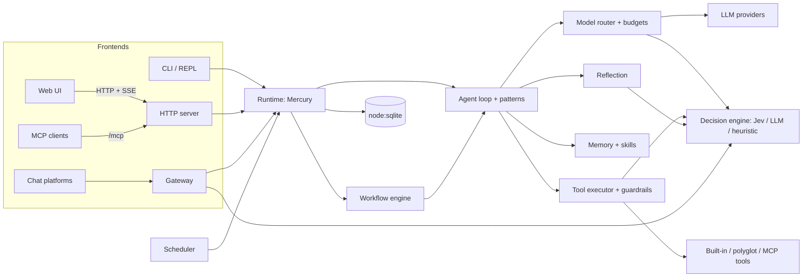

# ☿ Mercury

A self-hosted, extensible **agentic AI platform** in TypeScript: a CLI, a web UI, chat-platform
gateways, multi-agent workflows, persistent memory, skills, 75+ tools and MCP (client **and** server).
It aims for feature parity with Hermes Agent and adds a typed **decision engine (Jev)** that routes
models, judges risk, triages messages and drives reflection.

Mercury requires a **real LLM provider** — there is no built-in model. Point it at any of:
**OpenRouter**, **Ollama**, **LM Studio**, any **OpenAI-compatible** API, or **Anthropic**
(local or remote). Configuration/usage of the **Jev** decision engine is entirely **optional**.
See [docs/PROVIDERS.md](docs/PROVIDERS.md) for one-line setups.

> The deterministic mock provider used by the automated test suite is disabled in normal
> operation; it is only enabled when `MERCURY_ENABLE_MOCK=1` is set.

> Status: see [STATUS.md](STATUS.md) for what is tested and what has not been run against real
> external services.

## Quickstart

Requires **Node.js ≥ 22.5** (uses the built-in `node:sqlite`).

```bash
git clone <this repo> mercury && cd mercury
npm install && npm run build
node packages/cli/dist/bin.js setup            # interactive: admin user + LLM provider
node packages/cli/dist/bin.js serve            # web UI + API on http://localhost:3000
```

Or run `./install.sh` (builds and `npm link`s a global `mercury` binary), or use Docker:

```bash
docker compose up -d        # data persists in the mercury-data volume
```

Open the web UI. **The first account you register becomes admin.** Before Mercury can answer,
configure **one** LLM provider (see [docs/PROVIDERS.md](docs/PROVIDERS.md)) — for example:

```bash
# Local, no API key — just run Ollama / LM Studio, then:
mercury config set llm.providers.ollama '{"type":"ollama","enabled":true}'
mercury model ollama/llama3.1

# Or a cloud key in ~/.mercury/.env (ChatLLM / OpenRouter / OpenAI / Anthropic):
echo 'CHATLLM_API_KEY=s2-...' >> ~/.mercury/.env       # Abacus.AI ChatLLM / RouteLLM
mercury model chatllm/route-llm
# …or OPENROUTER_API_KEY / OPENAI_API_KEY / ANTHROPIC_API_KEY — e.g.:
# mercury model openrouter/openai/gpt-4o-mini
```

Setting `OPENROUTER_API_KEY` also enables the **optional** Jev decision model (`typesafe/jev-1.13`).
Copy [`.env.example`](.env.example) to `~/.mercury/.env` and [`mercury.example.yaml`](mercury.example.yaml)
to `~/.mercury/config.yaml` for a documented starting point.


`mercury setup` runs an interactive first-run wizard. `mercury doctor` checks the environment.
`mercury help <topic>` and the web **Help** panel document everything.

## Feature matrix

| Area | What you get |
|---|---|
| **Agent loop** | Streaming ReAct-style loop, patterns (react, plan-execute, reflexion…), subagents, `/stop`, `/retry`, `/undo`, `/compress`, `/rollback` |
| **LLM providers** | OpenRouter, Ollama, LM Studio, any OpenAI-compatible API, Anthropic (local **or** remote); a model router with tiers; per-user/model token and cost **budgets** |
| **Decision engine (optional)** | `jev` (OpenRouter decisions API) or the configured `llm`; drives model routing, injection classification, tool-approval "smart" mode, gateway triage, retries and reflection. Falls back to a safe heuristic when unconfigured |
| **Memory** | Working, episodic (sessions + search), semantic facts, procedural (skills), user model, shared blackboard; `MEMORY.md` / `USER.md` |
| **Reflection** | Post-run lessons and user-model updates, viewable in the UI |
| **Skills** | agentskills.io `SKILL.md` format, bundled examples, install from path/git |
| **Tools** | 76 built-ins in toolsets (files, shell, web, code, memory, scheduling, data, utility…), **polyglot tools** in any language via `tool.json` |
| **MCP** | Client (stdio/HTTP servers become tools) and server (`/mcp` streamable HTTP with scoped tokens, or `mercury mcp serve` over stdio) |
| **Workflows** | YAML templates: single, pipeline, round-robin, coordinator-worker, tree, map-reduce, router, blackboard, debate |
| **Scheduler** | Natural-language (“every day at 9am”) or cron schedules that run agent tasks |
| **Gateway** | 16 adapters: Telegram, Discord, Slack, WhatsApp, Signal, Matrix, Mattermost, Teams, IRC, Email, SMS, Home Assistant, RSS, webhook, webchat, CLI; DM pairing codes, cross-platform continuity, voice-memo transcription, triage to human review |
| **Voice** | STT/TTS providers: OpenAI, local whisper / edge-tts / piper, or any command; mic recording and playback in the web UI |
| **Security** | scrypt + JWT, scoped API tokens, RBAC, layered prompt-injection guardrails, approvals, path jail, SSRF guard, secret redaction, hash-chained audit log; see [docs/SECURITY.md](docs/SECURITY.md) |
| **Observability** | Event traces for every run, live debug stream with breakpoints and pause/resume, `mercury replay`, Prometheus `/metrics` |
| **Web UI** | No-build SPA: chat with streaming, tool chips and approvals, attachments, sessions, runs, workflows, memory, skills, tools/MCP, scheduler, integrations, models/budgets, users, debug, reflections, help; dark/light; English/German |
| **Extensibility** | Plugins (tools, hooks, providers, patterns, templates, adapters), scaffolding via `mercury new …`; see [docs/EXTENDING.md](docs/EXTENDING.md) |

## Architecture



Monorepo packages:

| Package | Role |
|---|---|
| `@mercury/core` | Config, DB, auth, LLM, decision engine, agent, memory, skills, workflows, scheduler, security |
| `@mercury/tools` | Built-in tools, terminal/browser backends, polyglot loader |
| `@mercury/mcp` | MCP client manager and Mercury MCP server |
| `@mercury/gateway` | Gateway controller and platform adapters |
| `@mercury/runtime` | Composition root (`createMercury()`) |
| `@mercury/server` | Fastify REST/SSE API, webhooks, `/mcp`, `/metrics`, static web UI |
| `@mercury/cli` | The `mercury` binary |

More detail: [docs/ARCHITECTURE.md](docs/ARCHITECTURE.md).

## Development

```bash
npm run build      # tsc project references
npm test           # vitest (offline)
npx eslint .       # lint
```

Configuration lives in `$MERCURY_HOME/config.yaml` (default `~/.mercury`). Use
`mercury config get|set <key>` to manage it. Deployment files: `Dockerfile`, `docker-compose.yml`,
`deploy/mercury.service` (systemd), `install.sh`.

## License

MIT
