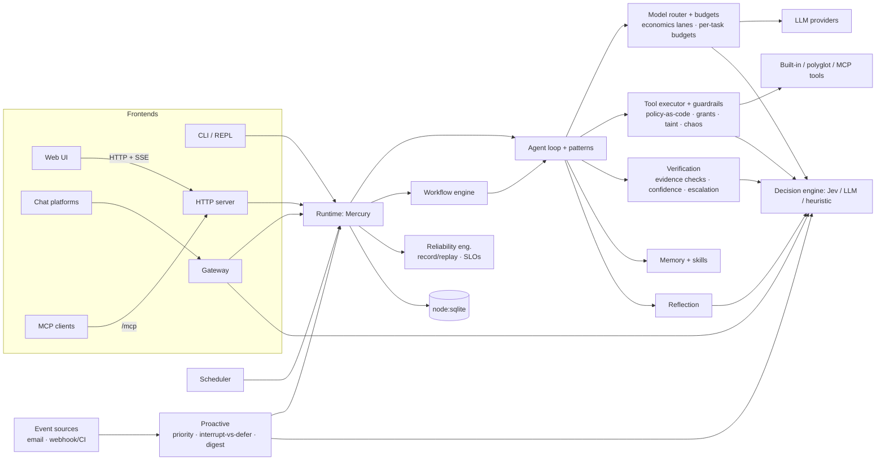

# Mercury Agent

A self-hosted, extensible **agentic AI platform** in TypeScript.
*CLI · Web UI · 19 chat gateways · multi-agent workflows · persistent memory · 75+ tools · MCP client & server*


---

Mercury Agent is a self-hosted, extensible **agentic AI platform** in TypeScript: a CLI, a web UI, chat-platform
gateways, multi-agent workflows, persistent memory, skills, 75+ tools and MCP (client **and** server).
It aims for feature parity with Hermes Agent and adds a typed **decision engine (Jev)** that routes
models, judges risk, triages messages and drives reflection.

Mercury requires a **real LLM provider** — there is no built-in model. Point it at any of:
**OpenRouter**, **Ollama**, **LM Studio**, any **OpenAI-compatible** API, or **Anthropic**
(local or remote). Configuration/usage of the **Jev** decision engine is entirely **optional**.
See [docs/PROVIDERS.md](docs/PROVIDERS.md) for one-line setups.

> The deterministic mock provider used by the automated test suite is disabled in normal
> operation; it is only enabled when `MERCURY_ENABLE_MOCK=1` is set.

> Status: see [STATUS.md](STATUS.md) for what is tested and what has not been run against real
> external services.

## Quickstart

Requires **Node.js ≥ 22.5** (uses the built-in `node:sqlite`).

```bash
git clone git@github.com/ms1963/mercury_agent.git mercury && cd mercury
npm install && npm run build
node packages/cli/dist/bin.js setup            # interactive: admin user + LLM provider
node packages/cli/dist/bin.js serve            # web UI + API on http://localhost:3000
```

Or run `./install.sh` (builds and `npm link`s a global `mercury` binary), or use Docker:

```bash
docker compose up -d        # data persists in the mercury-data volume
```

The default image is slim and does **not** bundle the offline voice engines. For in-container
offline STT/TTS, build the voice-enabled image (ships `ffmpeg` + `whisper` + `piper`; larger, as
it includes CPU PyTorch):

```bash
docker compose --profile voice up -d --build mercury-voice   # or: docker build -f Dockerfile.voice -t mercury-agent:voice .
```

Open the web UI. **The first account you register becomes admin.** Before Mercury can answer,
configure **one** LLM provider (see [docs/PROVIDERS.md](docs/PROVIDERS.md)) — for example:

```bash
# Local, no API key — just run Ollama / LM Studio, then:
mercury config set llm.providers.ollama '{"type":"ollama","enabled":true}'
mercury model ollama/llama3.1

# Or a cloud key in ~/.mercury/.env (ChatLLM / OpenRouter / OpenAI / Anthropic):
echo 'CHATLLM_API_KEY=s2-...' >> ~/.mercury/.env       # Abacus.AI ChatLLM / RouteLLM
mercury model chatllm/route-llm
# …or OPENROUTER_API_KEY / OPENAI_API_KEY / ANTHROPIC_API_KEY — e.g.:
# mercury model openrouter/openai/gpt-4o-mini
```

Setting `OPENROUTER_API_KEY` also enables the **optional** Jev decision model (`typesafe/jev-1.13`).
Copy [`.env.example`](.env.example) to `~/.mercury/.env` and [`mercury.example.yaml`](mercury.example.yaml)
to `~/.mercury/config.yaml` for a documented starting point.


`mercury setup` runs an interactive first-run wizard. `mercury doctor` checks the environment.
`mercury help <topic>` and the web **Help** panel document everything — in English and German
(German topics are served when the locale is `de`, falling back to English).

## Feature matrix

| Area | What you get |
|---|---|
| **Agent loop** | Streaming ReAct-style loop, patterns (react, plan-execute, reflexion…), subagents, `/stop`, `/retry`, `/undo`, `/compress`, `/rollback` |
| **LLM providers** | OpenRouter, Ollama, LM Studio, any OpenAI-compatible API, Anthropic (local **or** remote); a model router with tiers; per-user/model token and cost **budgets** |
| **Economics & routing** | Cheapest-model-likely-to-succeed selection with **local vs frontier lanes** (routine tasks stay on the near-zero-cost local lane, harder tasks go to frontier/default); **hard per-task budgets** that halt or escalate on exceed; a running **cost-vs-value** estimate (cost so far, projected final cost, value/cost ratio, budget-used) via `GET /api/tasks` and the Models & budgets panel; configure under `router.economics` and `budgets.perTask` |
| **Decision engine (optional)** | `jev` (OpenRouter decisions API) or the configured `llm`; drives model routing, injection classification, tool-approval "smart" mode, gateway triage, retries and reflection. Falls back to a safe heuristic when unconfigured |
| **Memory** | Working, episodic (sessions + search), semantic facts, procedural (skills), user model, shared blackboard; `MEMORY.md` / `USER.md` |
| **Reflection** | Post-run lessons and user-model updates, viewable in the UI |
| **Skills** | agentskills.io `SKILL.md` format, bundled examples, install from path/git; **self-distilling skills** — the agent distils reusable, parameterized skills from its own successful (or 👍-rated) runs, governs them (review → approve, versioned, auto-promote/retire by success-rate & cost) and reuses an approved match as a "proven skill" plan hint; `GET /api/distilled-skills`, **Distilled Skills** panel; **off by default** under `skills.distill` |
| **Tools** | 79 built-ins in toolsets (files, shell, web, code, memory, scheduling, data, utility…) — see [docs/TOOLS.md](docs/TOOLS.md); **polyglot tools** in any language via `tool.json` |
| **Personalities** | One built-in persona (`default`) plus drop-in `*.md` persona files; bundled examples in [`personalities/`](personalities); add your own in `~/.mercury/personalities/` |
| **MCP** | Client (stdio/HTTP servers become tools) and server (`/mcp` streamable HTTP with scoped tokens, or `mercury mcp serve` over stdio) |
| **Workflows** | YAML templates: single, pipeline, round-robin, coordinator-worker, tree, map-reduce, router, blackboard, debate, **planner-executor** (decompose → execute with configurable min/target/max steps + re-plan-on-failure, so runs go deeper instead of terminating too early) |
| **Scheduler** | Natural-language (“every day at 9am”) or cron schedules that run agent tasks |
| **Gateway** | 19 adapters: Telegram, Discord, Slack, WhatsApp, Facebook, X (Twitter), LinkedIn (outbound), Signal, Matrix, Mattermost, Teams, IRC, Email, SMS, Home Assistant, RSS, webhook, webchat, CLI; DM pairing codes, cross-platform continuity, voice-memo transcription, triage to human review |
| **Voice** | STT/TTS providers: OpenAI, local whisper / edge-tts / piper, or any command; mic recording and playback in the web UI |
| **Security** | scrypt + JWT, scoped API tokens, RBAC, layered prompt-injection guardrails, approvals, path jail, SSRF guard, secret redaction, hash-chained audit log; see [docs/SECURITY.md](docs/SECURITY.md) |
| **Governance & security** | Least-privilege **per-task credential grants** (scoped, time-limited, no standing keys; ephemeral credentials minted in-memory and never persisted); **policy-as-code** (declarative `allow`/`deny`/`approve` rules — e.g. "no payments over €100 without approval", "never email external domains") enforced before sensitive tool actions; prompt-injection **taint tracking** that marks and propagates untrusted tool output and can gate actions on it; a **replayable audit trail** (`GET /api/runs/:id/trace`) and a dedicated **Governance** panel; see [docs/SECURITY.md](docs/SECURITY.md) and [docs/PERMISSIONS.md](docs/PERMISSIONS.md) |
| **Verification** | Evidence-based completion checks — `test` (real shell command), `schema` (JSON-schema), `assertion` (substring/regex/predicate) and `critic` (decision engine as LLM judge) — combined into a 0..1 **confidence** score; runs below `verification.confidenceThreshold` are **escalated for human review** instead of silently passing; `GET/POST /api/verif…`, `/api/escalations`, dedicated **Verification** panel |
| **Reliability engineering** | **Record/replay** real runs as regression tests (diff status/tools/output), **chaos** fault injection into the real tool path (failures/timeouts/latency, seedable, tool-glob gated, **off by default**), and per-agent **SLOs** (success rate, intervention/escalation rate, cost-per-task vs targets); `mercury reliability …`, `GET /api/slo\|chaos\|recordings`, **Reliability** panel; configure under `reliability` |
| **Proactive (not annoying)** | Event-trigger framework — sources (**email** via the gateway, generic **webhook/CI**) → declarative rules → actions; an **interrupt-vs-defer priority model** so urgent events notify immediately and low-priority ones are **batched into a periodic digest** (via the scheduler); `mercury proactive …`, `GET /api/proactive`, `POST /api/proactive/events\|digest/flush\|poll`, **Proactive** panel; **disabled by default**, configure under `proactive` |
| **Learning from runs** | Learns from completed runs (**off by default**): injects **experience hints** from similar past successes, **auto-tunes model routing** per (difficulty bucket, model) from observed success rates (falls back to economics), and records **failure playbooks**; `mercury learn <stats\|hints\|playbooks>`, `GET /api/learning*`, **Learning** panel; configure under `learning` |
| **Skill composition & MCP presets** | `skill_compose` runs a skill with other skills/tools as a cached pipeline (depth limit + cycle guard); curated **MCP connector presets** (filesystem, fetch, github, git, sqlite) with env-var placeholders via `mercury mcp <presets\|status\|enable>`; **gated `web_read`** tool (HTTP **or** headless-browser rendering + HTML-to-text behind the SSRF guard and approval/policy) |
| **Observability** | Event traces for every run, a **replayable run trace** (`GET /api/runs/:id/trace`) with per-step explanations and run totals, live debug stream with breakpoints and pause/resume, `mercury replay`, Prometheus `/metrics` |
| **Run replay & time-travel** | Every run's event stream is persisted as a per-run trace (migration #8); **scrub the timeline**, inspect the **reconstructed state** at any step, **edit an input and re-run from there** — forking a new linked run (`parent_run_id` + `from_step`) that reuses the upstream prefix and deterministically recomputes downstream (governance still applies); `mercury.traces` facade, `GET /api/traces`, `GET /api/runs/:id/timetravel`, `GET /api/runs/:id/state?step=N`, `POST /api/runs/:id/replay`, **Run Replay** panel; **on by default** under `replay` |
| **Evaluation-driven self-improvement** | Promote real (or 👍-rated) runs into labeled **eval cases** (expected tools/output/cost); a deterministic **scored regression gate** over pass-rate, cost-per-task, intervention-rate and output-similarity; a **governed auto-tuner** that proposes changes (routing/pattern/temperature/skill/prompt), tests each against the suite and keeps ONLY improvements that don't break the budget ceiling or governance-protected config; accepted tunes are **versioned & reversible**; `mercury.evals` facade, `GET/POST /api/evals/*`, **Evaluations & Auto-tune** panel; harness **on**, auto-tuning **off by default** under `evals.autotune` |
| **Sharable Agent Bundles** | Export skills + workflows + personality + policy + MCP presets into one **versioned, signed artifact** ("Mercury pack") and install it into another instance in one command/endpoint; install **verifies the signature** (tamper detection), checks **version/compatibility**, is **idempotent**, and routes policy/MCP presets through the **governance/approval** path; `mercury.bundles` facade, `mercury bundle export\|inspect\|install`, `GET/POST /api/bundles/*`, **Agent Bundles** panel; **on by default** under `bundles` |
| **Web UI** | No-build SPA: chat with streaming, tool chips and approvals, attachments, sessions, runs, workflows, memory, skills, tools/MCP, scheduler, integrations, models/budgets (with cost-vs-value), governance (grants/policies/replay trace), verification (confidence/escalations), reliability (SLOs/recordings/chaos), distilled skills (review/approve/retire), run replay (timeline/time-travel/fork), evaluations & auto-tune (cases/scores/tunes), agent bundles (export/install), proactive (events/digest/rules), users, debug, reflections, help; dark/light; English/German |
| **Add-Ins** | Drop-in tools, personalities and permission profiles under `<dataDir>/addins/` — no source edits; `mercury addin list\|scaffold`; see [docs/ADDINS.md](docs/ADDINS.md) |
| **Permission profiles** | Per-agent/personality policies that can only further-restrict (strict intersection), `mercury perms list\|show`; see [docs/PERMISSIONS.md](docs/PERMISSIONS.md) |
| **LLM Wiki** | Ingestion-time knowledge synthesis (Karpathy's pattern): immutable `raw/` sources + LLM-authored cross-linked pages, with ingest / query / lint via `wiki_*` tools and `mercury wiki …`; see [docs/WIKI.md](docs/WIKI.md) |
| **Reliability** | Circuit breaker, saga/compensation, retry + exponential backoff, TTL cache and single-flight coalescing; see [docs/RELIABILITY.md](docs/RELIABILITY.md) |
| **Extensibility** | Plugins (tools, hooks, providers, patterns, templates, adapters), scaffolding via `mercury new …`; see [docs/EXTENDING.md](docs/EXTENDING.md) |

## What makes Mercury superior

Mercury started as "feature parity with Hermes Agent plus the Jev decision engine." Beyond that
baseline it adds a coherent, **deterministically tested** (offline, mock-provider) set of
differentiators:

- **Jev decision engine** — a typed decision layer that routes models by task class / cost /
  capability, judges risk to drive "smart" tool approvals, triages gateway messages and triggers
  reflection, with a safe heuristic fallback when unconfigured.
- **Self-evaluation harness** — `mercury eval [--tag <t>] [--json]` runs a built-in deterministic
  benchmark against the agent (round-trip answers, explicit + natural-language tool dispatch,
  tool-result grounding, memory writes) and reports pass/score so regressions are caught in CI.
- **Resilient provider calls** — retryable errors retry with **exponential backoff + bounded jitter**
  (configurable `llm.retryBackoffMs` / `llm.retryJitter`), non-retryable errors fail fast, a
  per-model **circuit breaker** skips a model that keeps failing until it cools down, and a
  cross-model fallback chain is attempted; every retry emits a structured `llm.retry` event. These
  and the other reliability/efficiency primitives (saga/compensation, TTL cache, single-flight
  coalescing) are documented in [docs/RELIABILITY.md](docs/RELIABILITY.md).
- **Token + cost accounting** — per-call token counts and estimated cost (from per-1M-token model
  rates) recorded to the usage ledger, emitted as events, and surfaced per-run by `mercury eval`.

See **[docs/COMPARISON.md](docs/COMPARISON.md)** for the full, honestly-scoped feature-by-feature
table (and [STATUS.md](STATUS.md) for what is tested vs not yet run against real services).

## Architecture



Monorepo packages:

| Package | Role |
|---|---|
| `@mercury/core` | Config, DB, auth, LLM, decision engine, agent, memory, skills, workflows, scheduler, security |
| `@mercury/tools` | Built-in tools, terminal/browser backends, polyglot loader |
| `@mercury/mcp` | MCP client manager and Mercury MCP server |
| `@mercury/gateway` | Gateway controller and platform adapters |
| `@mercury/runtime` | Composition root (`createMercury()`) |
| `@mercury/server` | Fastify REST/SSE API, webhooks, `/mcp`, `/metrics`, static web UI |
| `@mercury/cli` | The `mercury` binary |

More detail: [docs/ARCHITECTURE.md](docs/ARCHITECTURE.md).

## Documentation

| Guide | For whom |
| --- | --- |
| [docs/EASY_START.md](docs/EASY_START.md) | **Absolute-beginner guide** — the gentlest path from zero to a first working chat |
| [docs/INSTALL_GUIDE.md](docs/INSTALL_GUIDE.md) | **New / non-technical users** — friendly, step-by-step: install, connect ChatLLM or Ollama (and optionally Jev), send prompts, create agents, change settings |
| [docs/QUICK.md](docs/QUICK.md) | A fast, plain-language quick start |
| [docs/GUIDE.md](docs/GUIDE.md) | **The complete manual** — every CLI command, config key, tool, endpoint and extension point ([PDF](docs/GUIDE.pdf)) |
| [docs/WEB_UI.md](docs/WEB_UI.md) | **Working with the web UI instead of the CLI** — start the server, sign in, and which panel replaces which command |
| [docs/TOOLS.md](docs/TOOLS.md) | **Complete reference of all 79 built-in tools**, grouped by toolset (auto-generated from source) |
| [docs/PROVIDERS.md](docs/PROVIDERS.md) | One-line LLM provider setups |
| [examples/env/](examples/env/) | Copy-paste `.env` files for 15 LLM providers (OpenAI, Anthropic, OpenRouter, ChatLLM, Groq, Mistral, DeepSeek, Gemini, Ollama, …) |
| [docs/ARCHITECTURE.md](docs/ARCHITECTURE.md) · [docs/SECURITY.md](docs/SECURITY.md) · [docs/EXTENDING.md](docs/EXTENDING.md) | Design, security model, and how to extend Mercury |
| [docs/RELIABILITY.md](docs/RELIABILITY.md) | **Reliability & efficiency patterns** — circuit breaker, saga/compensation, retry/backoff, TTL cache, single-flight, and the `llm.circuitBreaker` config keys |
| [docs/WIKI.md](docs/WIKI.md) | **LLM Wiki** — ingestion-time knowledge synthesis (Karpathy's pattern): the `wiki_ingest`/`wiki_query`/`wiki_lint` tools, the `mercury wiki` CLI, directory layout and config keys |
| [docs/ADDINS.md](docs/ADDINS.md) | **Add-Ins** — add tools, personalities and permission profiles by dropping declarative files into `<dataDir>/addins/`, no source edits; manifest format, layout, the `mercury addin` CLI |
| [docs/PERMISSIONS.md](docs/PERMISSIONS.md) | **Per-agent/personality permission profiles** — the effective-policy merge (intersection / most-restrictive) semantics with a worked example, and the `mercury perms` CLI |
| [docs/COMPARISON.md](docs/COMPARISON.md) | **Mercury vs Hermes Agent** — what Mercury adds beyond the parity baseline, honestly marked tested-vs-untested |
| [STATUS.md](STATUS.md) | Honest tested-vs-untested status of every subsystem |

> This README is also available as a [PDF](README.pdf).

## Development

```bash
npm run build      # tsc project references
npm test           # vitest (offline)
npx eslint .       # lint
```

Configuration lives in `$MERCURY_HOME/config.yaml` (default `~/.mercury`). Use
`mercury config get|set <key>` to manage it. Deployment files: `Dockerfile`, `Dockerfile.voice` (offline voice baked in), `docker-compose.yml`,
`deploy/mercury.service` (systemd), `install.sh`.

## License

MIT
