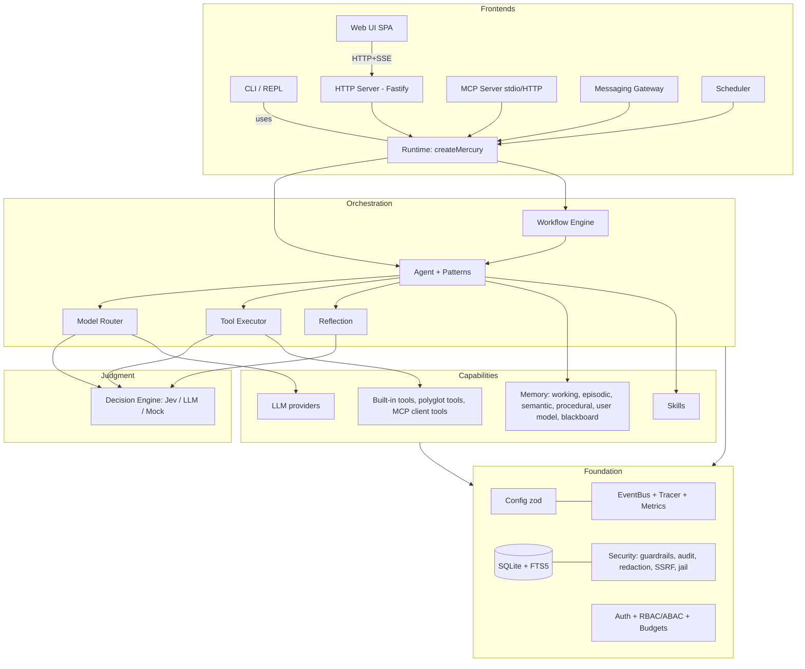
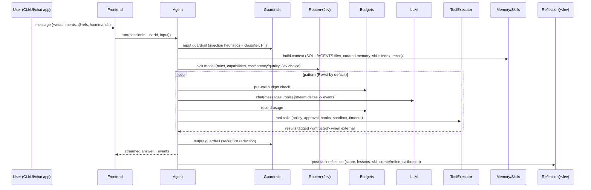

# Mercury — Architecture

Mercury is a self-hosted, extensible agentic AI platform written in TypeScript (Node 22+, ESM,
npm-workspaces monorepo). It aims for feature parity with Hermes Agent (Nous Research) and adds
multi-agent workflows, a typed decision engine (Jev), RBAC, token budgets and an MCP server.

This document explains *how the system is put together*. For security details see
[SECURITY.md](SECURITY.md); for writing extensions see [EXTENDING.md](EXTENDING.md).

---

## 1. Design principles

1. **Small, explicit interfaces.** Every subsystem is behind a TypeScript interface
   (`LLMProvider`, `Tool`, `Pattern`, `WorkflowTemplate`, `DecisionProvider`, `Adapter`,
   `MemoryProvider`, `Plugin`, `SttProvider`, `TtsProvider`, `TerminalBackend`, `BrowserBackend`).
2. **Offline first.** A deterministic `mock` LLM, `mock` decision provider, hash embeddings and
   mock STT/TTS let everything run and be tested without API keys or network.
3. **One composition root.** `@mercury/runtime` (`createMercury()`) wires all services. The CLI,
   the HTTP server, the gateway, the scheduler and the MCP server are thin front-ends over it.
4. **Everything is an event.** Every LLM call, tool call, memory op, decision and thought is
   published on the `EventBus`, persisted as a trace and streamable to the UI.
5. **Untrusted by default.** Content that did not come from the authenticated user (tool output,
   web pages, e-mails, attachments, MCP results) is tagged and spotlighted, and can never trigger
   sensitive tools without approval.

---

## 2. Layered architecture



| Layer | Responsibility | Packages / folders |
|---|---|---|
| Frontends | Human & machine entry points | `packages/cli`, `packages/server` (+`public/` SPA), `packages/mcp` (server), `packages/gateway`, scheduler in core |
| Composition | Builds and owns all services | `packages/runtime` |
| Orchestration | Agent loop, reasoning patterns, workflows, subagents, reflection | `core/src/agent`, `core/src/workflows`, `core/src/reflection` |
| Judgment | Typed calibrated decisions (Jev) for routing and meta-cognition | `core/src/decision` |
| Capabilities | LLMs, router, tools, memory, skills, voice, attachments | `core/src/llm`, `core/src/router`, `packages/tools`, `core/src/memory`, `core/src/skills`, `core/src/voice`, `core/src/attachments` |
| Foundation | Config, DB, events, logging, security, auth, budgets, i18n, help | `core/src/{config,db,events,logging,security,auth,budgets,i18n,help}` |

---

## 3. Package map

```
mercury/
├─ packages/
│  ├─ core/        @mercury/core     — domain logic, interfaces, no HTTP server
│  │  └─ src/
│  │     types/  config/  db/  events/  logging/  security/  auth/  budgets/
│  │     llm/  router/  decision/  agent/  agent/patterns/  memory/  skills/
│  │     reflection/  tools/ (registry+executor)  workflows/  scheduler/
│  │     attachments/  voice/  plugins/  checkpoints/  i18n/  help/  extensions/
│  ├─ tools/       @mercury/tools    — 50+ built-in tools, toolsets, polyglot runner,
│  │                                    execute_code sandbox, terminal & browser backends
│  ├─ mcp/         @mercury/mcp      — MCP client manager + Mercury-as-MCP-server
│  ├─ gateway/     @mercury/gateway  — adapter SDK, gateway runner, 16 adapters
│  ├─ runtime/     @mercury/runtime  — createMercury(): composition root
│  ├─ server/      @mercury/server   — Fastify REST/SSE API, webhooks, /mcp, web UI
│  └─ cli/         @mercury/cli      — `mercury` binary, REPL, subcommands, scaffolding
├─ skills/            bundled skills (SKILL.md, agentskills.io format)
├─ tools/             polyglot example tools (Python, JS, C++, Java, Go) with tool.json
├─ workflows/         bundled workflow specs (YAML)
├─ personalities/     bundled personalities (*.md)
├─ locales/           i18n catalogs (en.json, de.json)
├─ docs/              architecture, security, extending, help topics (docs/help/*.md + docs/help/de/*.md)
└─ deploy/            Dockerfile, docker-compose.yml, systemd unit
```

Dependency direction: `cli, server → runtime → {tools, mcp, gateway} → core`. `core` depends
only on `zod` and `yaml` (and Node built-ins, including `node:sqlite`).

---

## 4. Main data flow (one chat turn)



Every arrow above emits an event (`run.start`, `llm.request`, `llm.delta`, `llm.response`,
`tool.call`, `tool.result`, `decision`, `memory.*`, `guardrail.*`, `run.end`) carrying `runId`,
`spanId` and `parentSpanId`. Events are persisted (`events` table) for replay and debugging.

---

## 5. Key subsystems

### 5.1 Agent core (`core/src/agent`)
* `Agent.run()` prepares context, selects a model and a `Pattern`, runs it, applies output
  guardrails, persists messages and triggers reflection.
* `ReactLoop` is the primitive: LLM call → native tool calls (or text-ReAct fallback parsing
  `Action:`/`Action Input:` for models without tool calling) → execute → repeat, with retries,
  abort signal (`/stop`), max-iteration limit, streaming deltas and debug breakpoints.
* Patterns (`core/src/agent/patterns`): `react`, `cot`, `plan-execute`, `reflexion`, `tot`,
  `self-consistency`, `critic`; selectable explicitly, by config, or automatically by Jev.
* Slash commands (`/new /reset /model /retry /undo /stop /compress /usage /insights /skills
  /rollback /personality /pattern /help /<skill>`) are implemented once in
  `agent/commands.ts` and reused by CLI, web UI and gateway.

### 5.2 Decision engine — Jev (`core/src/decision`)
* `DecisionEngine` exposes `choice`, `noul`, `score` and batch `decide()` with typed answers
  (`{choice, confidence, probabilities}`, `{noul}`, `{score, probabilities, confidence}`).
* Providers: `JevDecisionProvider` (OpenRouter Decisions API `POST /api/alpha/decisions`,
  model `typesafe/jev-1.13`), `LlmDecisionProvider` (structured JSON + self-reported
  confidence), `MockDecisionProvider` (deterministic keyword heuristics). Chain with fallback.
* **(a) Routing/judgment**: model selection, pattern/workflow selection, tool-approval gating,
  prompt-injection classification, message/mail triage with a human-review queue.
* **(b) Meta-cognition**: step and answer scoring (Score), retry/escalate (Noul), next
  strategy (Choice), and calibration (predicted vs. observed outcome, Brier score).

### 5.3 LLM layer and router (`core/src/llm`, `core/src/router`, `core/src/budgets`)
* Unified `ChatMessage` with attachments (image/audio/video/document); providers degrade
  gracefully (audio → transcript, video → frames/transcript, image → description) when the
  model lacks a capability.
* Providers: `openai`, `anthropic`, `openrouter`, `ollama`, `lmstudio`, `openai-compatible`
  (any number of named endpoints), `mock`.
* `ModelRouter`: explicit model > rules (regex/tags) > capability filter > weighted score
  (quality, cost, latency) > optional Jev choice among top-k > fallback chain on errors.
* `BudgetService`: per user × model × period (daily/monthly) limits on tokens and cost,
  checked before (estimate) and after (actual) each call, admin override, usage ledger.

### 5.4 Memory (`core/src/memory`)
| Kind | Implementation |
|---|---|
| Working | message window + `ContextCompressor` (`/compress`, automatic at threshold) |
| Episodic | `sessions`/`messages` tables + FTS5 `messages_fts`; `search_sessions` with LLM summary |
| Semantic | `facts` table + FTS5 + hand-written cosine vector index; pluggable embeddings |
| Curated | bounded `MEMORY.md` + `USER.md` per user (Hermes-compatible, char limits) |
| Procedural | skills (see 5.5) + skill statistics |
| User model | dialectic profile (observations → traits with confidence), Honcho-like |
| Blackboard | shared key/value + posts per workflow run (persisted) |
| External | `MemoryProvider` interface, registered by plugins |

All memory is scoped by `userId` (and optional `scope` such as a project or workflow run).

### 5.5 Skills (`core/src/skills`)
`SKILL.md` with agentskills.io frontmatter (`name`, `description`, optional `license`,
`compatibility`, `allowed-tools`, `metadata`). Progressive disclosure: the system prompt carries
only the index (name + description); `skill_view` loads full content; supporting files on
demand. Skills are discovered from bundled, `~/.mercury/skills` and `./.mercury/skills`,
installable from a folder or git URL, created autonomously by reflection and refined by
`skill_update` with success statistics.

### 5.6 Tools (`core/src/tools`, `packages/tools`, `packages/mcp`)
* `Tool` = name, toolset, description, zod/JSON schema, `risk` (`safe|moderate|dangerous`),
  `untrustedOutput` flag, `execute(args, ctx)`.
* `ToolExecutor` pipeline: policy (RBAC/ABAC) → trust check (untrusted-derived calls) →
  Jev/LLM gate → approval → `before_tool_call` hooks → checkpoint → execute with timeout →
  redaction → spotlighting → `after_tool_call` hooks → audit.
* Toolsets can be enabled/disabled globally and per platform (`cli`, `web`, `telegram`, …).
* Polyglot tools: any executable with a `tool.json` manifest speaking JSON over stdio.
* MCP client tools are namespaced `mcp__<server>__<tool>` and filtered per server.

### 5.7 Multi-agent workflows (`core/src/workflows`)
Templates: `single`, `pipeline`, `blackboard`, `coordinator-worker`, `tree`, `debate`,
`map-reduce`, `router`, `round-robin`. A workflow spec (YAML/JSON) names a template, agents
(role, model, toolsets, pattern) and budgets. `WorkflowContext.spawn()` enforces
`maxSubagentsPerAgent` (concurrency, default 3), `maxDepth`, and per-run budgets (agents,
steps, tokens, wall-clock). `delegate_task` uses the same mechanism.

### 5.8 Gateway (`packages/gateway`)
One process hosts many `Adapter`s. Inbound messages are normalized to `InboundMessage`
(text, attachments, sender, chat), voice memos are transcribed, unknown senders receive a DM
pairing code, identities are linked to Mercury users, conversation continuity is per user across
platforms (configurable), optional Jev triage routes low-confidence items to a review queue.

### 5.9 Scheduler (`core/src/scheduler`)
Persistent schedules (cron, natural language, intervals, one-shot) running agents or workflows
with attached skills, delivering to gateway targets; pause/resume/edit/run-now, history,
retries, budgets.

### 5.10 Reliability & efficiency primitives (`core/src/reliability`)
A small set of composable, dependency-free primitives: a `CircuitBreaker` (closed → open →
half-open), a `Saga`/`runSaga` compensation orchestrator (forward steps with LIFO rollback on
failure), a `TtlCache` (lazy-expiring, size-bounded), `SingleFlight` (coalesces concurrent calls
for the same key into one in-flight promise), and `retry`/`backoffDelay` (exponential backoff with
bounded jitter; the backoff logic is shared with `core/src/llm/backoff.ts`). The LLM layer wires the
circuit breaker and retry/backoff into provider calls (`llm.circuitBreaker.*`, `llm.retry*`). See
[RELIABILITY.md](RELIABILITY.md).

### 5.11 LLM Wiki (`core/src/wiki`)
An ingestion-time knowledge base (Karpathy's "LLM wiki" pattern): raw sources are stored immutably
under `raw/`, the LLM synthesises/updates cross-linked markdown pages under `wiki/`, and `index.md` /
`log.md` track the corpus. Operations: **ingest** (store raw + synthesise), **query** (consult index,
read relevant pages, answer with citations) and **lint** (orphans, broken links, stubs, staleness,
LLM-assisted contradictions, plus a delta-lint of recently touched pages). Exposed as the `wiki_*`
tools and `mercury wiki …`. The synthesis/query/contradiction quality is **untested against a real
LLM** — only against a test-local fake. See [WIKI.md](WIKI.md).

### 5.12 Add-Ins & permission profiles (`core/src/addins`, `core/src/auth/policy.ts`)
A unified declarative Add-In loader discovers tools, personalities and permission profiles dropped
into `<dataDir>/addins/` (and `<dataDir>/permissions/`) without source edits — additive and
backward-compatible with the legacy `personalities/`, `tools/` and `plugins/` scans; malformed
manifests and path-escaping entries are skipped with warnings. `effectivePolicy()` merges a base
policy with a per-agent/personality profile by **strict intersection** (deny = union, max tool-risk =
min, allow-lists intersected) so a profile can only further-restrict, never escalate. CLI:
`mercury addin list|scaffold`, `mercury perms list|show`. See [ADDINS.md](ADDINS.md) and
[PERMISSIONS.md](PERMISSIONS.md).

---

## 6. Extension points

| Extension | Interface | Discovery |
|---|---|---|
| Tool (TS/JS) | `Tool` | `~/.mercury/tools/*.js`, `./.mercury/tools`, plugins |
| Tool (any language) | `tool.json` + executable | `tools/`, `~/.mercury/tools/<name>/` |
| Skill | `SKILL.md` | `skills/`, `~/.mercury/skills`, `./.mercury/skills`, git |
| Workflow | YAML/JSON spec or `WorkflowTemplate` class | `workflows/`, `~/.mercury/workflows` |
| Pattern | `Pattern` | plugins, `~/.mercury/patterns/*.js` |
| LLM provider | `LLMProvider` | config `providers`, plugins |
| Decision provider | `DecisionProvider` | plugins |
| Adapter | `Adapter` (extends `BaseAdapter`) | `~/.mercury/adapters/*.js`, plugins |
| Plugin | `Plugin { setup(api) }` | `~/.mercury/plugins/*`, config `plugins` |
| Memory provider / context engine | `MemoryProvider`, `ContextEngine` | plugins |
| Personality | `*.md` | `personalities/`, `~/.mercury/personalities` |
| Add-In (tools/personalities/profiles) | declarative files + manifest | `<dataDir>/addins/*` |
| Permission profile | declarative policy (name→policy map or single policy) | `<dataDir>/permissions/*` |
| Hooks | `HookName` handlers | plugins, config `hooks` (webhook/log) |

Scaffolding: `mercury new tool|skill|workflow|adapter|plugin <name>`.

---

## 7. Security model (summary)

Principals: `admin`, `user`, `api_client` (API tokens with scopes). Trust levels for content:
`system > user > trusted_tool > untrusted`. Guardrails run on input, tool calls and output;
external content is spotlighted inside `<untrusted_content>` markers with an instruction
hierarchy in the system prompt; sensitive tools derived from untrusted content require approval;
terminal commands pass dangerous-pattern detection and approval; file tools are jailed; web tools
are SSRF-protected; secrets are redacted from logs/outputs; an append-only hash-chained audit
log records security-relevant actions. Full threat model: [SECURITY.md](SECURITY.md).

---

## 8. Data directory layout (`~/.mercury`, override with `MERCURY_HOME`)

```
~/.mercury/
├─ config.yaml        user config (layer 2)         ├─ .env            secrets (layer 3)
├─ mercury.db         SQLite (users, sessions, messages, facts, usage, schedules, events, audit…)
├─ users/<id>/        MEMORY.md, USER.md             ├─ attachments/    uploaded files
├─ skills/ tools/ workflows/ plugins/ adapters/ personalities/ patterns/   user extensions
├─ checkpoints/<session>/<n>/                        ├─ mcp.json        external MCP servers (hot reload)
└─ secret.key         JWT signing key (generated, 0600)
```

---

## 9. Hermes Agent feature-parity matrix

| Hermes feature | Mercury module | Notes |
|---|---|---|
| Toolsets, 40+ tools, enable/disable per platform, `hermes tools` | `packages/tools/src/builtin/*`, `core/src/tools/registry.ts`, `mercury tools` | 55+ tools in 14 toolsets |
| `execute_code` (script calling tools via RPC) | `packages/tools/src/sandbox/execute-code.ts` | child process, JSON-RPC over stdio, timeout, env scrub |
| Image generation (pluggable) | `packages/tools/src/builtin/media.ts` (`image_generate`) | mock (SVG) default, OpenAI-compatible provider |
| Skills, progressive disclosure, agentskills.io | `core/src/skills/*` | `skills_list`, `skill_view` |
| Autonomous skill creation / self-improvement | `core/src/reflection/reflector.ts`, `skill_create`, `skill_update` | success stats in `skill_stats` |
| `/skills`, `/<skill-name>` | `core/src/agent/commands.ts` | |
| Skill hub / install from folder or git | `core/src/skills/installer.ts`, `mercury skills install` | |
| MEMORY.md / USER.md bounded memory | `core/src/memory/curated.ts` | char limits configurable |
| FTS5 session search + LLM summarization | `core/src/memory/episodic.ts`, `search_sessions` | |
| User modeling (Honcho-like) | `core/src/memory/user-model.ts` | dialectic observations → traits |
| Pluggable external memory providers | `core/src/memory/providers.ts` | plugin API |
| Messaging gateway (Telegram, Discord, Slack, WhatsApp, Signal, Email, Matrix, HA, webhooks) | `packages/gateway/src/adapters/*` | + Mattermost, Teams, IRC, SMS, RSS, web chat, CLI |
| DM pairing codes | `core/src/auth/pairing.ts`, `gateway/src/gateway.ts` | |
| Cross-platform continuity | `gateway/src/gateway.ts` (`continuity: per-user`) | |
| Voice memo transcription | `gateway/src/gateway.ts` + `core/src/voice` | |
| Cron scheduler (NL + cron, skills, delivery, pause/resume/edit) | `core/src/scheduler/*` | |
| Subagent delegation (`delegate_task`, isolated, restricted toolsets, parallel) | `core/src/workflows/spawner.ts`, `packages/tools/src/builtin/agents.ts` | max 3/agent, max depth |
| MCP client (stdio, HTTP, SSE, filtering, sampling) | `packages/mcp/src/client.ts` | hot reload of `mcp.json` |
| Voice mode, STT/TTS (whisper, OpenAI, Edge/piper, custom CLI) | `core/src/voice/*`, CLI `/voice`, web mic | wake-word hook interface |
| Vision / image input / attachments | `core/src/attachments/*`, `llm` content parts | |
| Browser automation (local, CDP, cloud) | `packages/tools/src/browser/*` | Playwright if installed; fetch-based fallback |
| Terminal backends (local, Docker, SSH, plugins) + approvals | `packages/tools/src/terminal/*`, `core/src/security/commands.ts` | |
| Context files (AGENTS.md, CLAUDE.md, SOUL.md, .cursorrules…) | `core/src/agent/context-files.ts` | |
| `@file` `@folder` `@diff` `@url` references | `core/src/agent/references.ts` | jail + SSRF + untrusted tagging |
| Filesystem checkpoints, `/rollback` | `core/src/checkpoints/checkpoints.ts` | |
| Plugin architecture (hooks, memory providers, context engines) | `core/src/plugins/*` | |
| Event hooks (logging, alerts, webhooks, interception, metrics, guardrails) | `core/src/plugins/hooks.ts`, `core/src/plugins/builtin-hooks.ts` | |
| Context compression `/compress` | `core/src/agent/compression.ts` | |
| `/usage`, `/insights` | `core/src/agent/insights.ts` | |
| Personalities, SOUL.md | `core/src/agent/personalities.ts` | |
| Slash commands `/new /reset /model /retry /undo /stop /compress /usage /insights /skills /rollback /help` | `core/src/agent/commands.ts` | |
| CLI: chat, model, tools, config, gateway, setup, update, doctor, plugins | `packages/cli/src/commands/*` | |
| `hermes claw migrate` style import | `mercury import-agent` (imports `~/.hermes`) | |
| CLI extras: user, token, schedule, skills, mcp, serve, help, new | `packages/cli/src/commands/*` | |

Mercury-only additions: Jev decision engine, reasoning patterns, multi-agent workflow templates,
RBAC/ABAC + API tokens, token budgets, MCP *server*, hash-chained audit log, debug breakpoints and
run replay, web UI, i18n, polyglot tool protocol.
