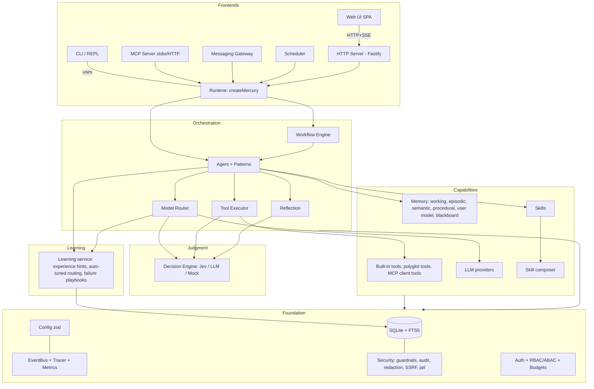

# Mercury — Architecture

Mercury is a self-hosted, extensible agentic AI platform written in TypeScript (Node 22+, ESM,
npm-workspaces monorepo). It aims for feature parity with Hermes Agent (Nous Research) and adds
multi-agent workflows, multi-agent teams/orchestration, a governed long-term memory & knowledge/RAG
layer, a typed decision engine (Jev), RBAC, token budgets and an MCP server.

This document explains *how the system is put together*. For security details see
[SECURITY.md](SECURITY.md); for writing extensions see [EXTENDING.md](EXTENDING.md).

> **Covers Mercury up to v2.2.1.** Relative to the v2.1.x architecture, v2.2.x adds two
> subsystems documented below: **self-extending tools / dynamic tool synthesis** (§5.25,
> shipped in v2.2.0, **disabled by default**) and the **hands-free voice mode** in the web
> chat (§5.26, shipped in v2.2.1, a progressive-enhancement front end over the existing voice
> subsystem of §5.4/§7). Both are additive and backward-compatible; nothing in the v2.1.x
> flows changed. See [CHANGELOG.md](../CHANGELOG.md) for the release notes.

---

## 1. Design principles

1. **Small, explicit interfaces.** Every subsystem is behind a TypeScript interface
   (`LLMProvider`, `Tool`, `Pattern`, `WorkflowTemplate`, `DecisionProvider`, `Adapter`,
   `MemoryProvider`, `Plugin`, `SttProvider`, `TtsProvider`, `TerminalBackend`, `BrowserBackend`).
2. **Offline first.** A deterministic `mock` LLM, `mock` decision provider, hash embeddings and
   mock STT/TTS let everything run and be tested without API keys or network.
3. **One composition root.** `@mercury/runtime` (`createMercury()`) wires all services. The CLI,
   the HTTP server, the gateway, the scheduler and the MCP server are thin front-ends over it.
4. **Everything is an event.** Every LLM call, tool call, memory op, decision and thought is
   published on the `EventBus`, persisted as a trace and streamable to the UI.
5. **Untrusted by default.** Content that did not come from the authenticated user (tool output,
   web pages, e-mails, attachments, MCP results) is tagged and spotlighted, and can never trigger
   sensitive tools without approval.

---

## 2. Layered architecture



| Layer | Responsibility | Packages / folders |
|---|---|---|
| Frontends | Human & machine entry points | `packages/cli`, `packages/server` (+`public/` SPA), `packages/mcp` (server), `packages/gateway`, scheduler in core |
| Composition | Builds and owns all services | `packages/runtime` |
| Orchestration | Agent loop, reasoning patterns, workflows, subagents, reflection | `core/src/agent`, `core/src/workflows`, `core/src/reflection` |
| Judgment | Typed calibrated decisions (Jev) for routing and meta-cognition | `core/src/decision` |
| Capabilities | LLMs, router, tools, memory, skills (incl. composition), voice, attachments | `core/src/llm`, `core/src/router`, `packages/tools`, `core/src/memory`, `core/src/skills`, `core/src/voice`, `core/src/attachments` |
| Learning | Experience hints, auto-tuned routing, failure playbooks (from run history) | `core/src/learning` |
| Foundation | Config, DB, events, logging, security, auth, budgets, i18n, help | `core/src/{config,db,events,logging,security,auth,budgets,i18n,help}` |

**Reading the diagram.** The graph is read top-to-bottom as a strict dependency gradient: every
box only ever calls boxes *below* it, never above or sideways out of its layer, which is what keeps
the system testable in isolation. At the top, the five **Frontends** are interchangeable skins —
the CLI/REPL, the web SPA (talking HTTP+SSE to the Fastify server), the MCP *server* (exposing
Mercury to other agents over stdio/HTTP), the messaging gateway and the scheduler — and each one
does nothing but translate its transport into a call on the single composition root `RT`
(`createMercury()`). Because they all share that one root, a capability added once (a new tool, a
new pattern) appears on every frontend at the same time with no per-frontend wiring. **Orchestration**
is the agent loop and the workflow engine that drives it; note that `WF → AG`, i.e. a workflow is
just a structured way to spawn and sequence agents, not a parallel code path. The agent fans out to
three services — the model **Router**, the **Tool Executor** and **Reflection** — and each of those
consults the **Judgment** layer (Jev/LLM/Mock decisions) rather than hard-coding a choice; that
single `… --> DEC` convergence is why routing, tool-approval gating and self-scoring can all be
swapped between a real decision model and a deterministic mock without touching their callers.
**Capabilities** (LLM providers, memory, skills, the tool catalog) are leaf services that hold no
orchestration logic. **Learning** sits off to the side on purpose: it only *observes* the run
history (`AG/RTR → LRN → DB`) and feeds back a suggestion the router is free to ignore, so it can
be disabled with zero behavioural change. Everything ultimately rests on **Foundation** — config,
the SQLite+FTS5 database, the event bus/tracer, and the security/auth/budget gates — which is the
only layer every other layer is allowed to depend on. The table above maps each of these boxes to
the concrete package or folder that implements it.

---

## 3. Package map

```
mercury/
├─ packages/
│  ├─ core/        @mercury/core     — domain logic, interfaces, no HTTP server
│  │  └─ src/
│  │     types/  config/  db/  events/  logging/  security/  auth/  budgets/
│  │     llm/  router/  decision/  agent/  agent/patterns/  memory/  skills/ (+composer)
│  │     learning/  distill/  timetravel/  evals/  bundles/  teams/  reflection/  tools/ (registry+executor)  workflows/  scheduler/
│  │     synthesis/ (self-extending tools, v2.2.0)  attachments/  voice/  plugins/  checkpoints/  i18n/  help/  extensions/
│  ├─ tools/       @mercury/tools    — 50+ built-in tools, toolsets, polyglot runner,
│  │                                    execute_code sandbox, terminal & browser backends,
│  │                                    synthesis/ (out-of-process compile/test runners for synthesized tools, v2.2.0)
│  ├─ mcp/         @mercury/mcp      — MCP client manager + Mercury-as-MCP-server + curated presets
│  ├─ gateway/     @mercury/gateway  — adapter SDK, gateway runner, 19 adapters
│  ├─ runtime/     @mercury/runtime  — createMercury(): composition root
│  ├─ server/      @mercury/server   — Fastify REST/SSE API, webhooks, /mcp, web UI
│  └─ cli/         @mercury/cli      — `mercury` binary, REPL, subcommands, scaffolding
├─ skills/            bundled skills (SKILL.md, agentskills.io format)
├─ tools/             polyglot example tools (Python, JS, C++, Java, Go) with tool.json
├─ workflows/         bundled workflow specs (YAML)
├─ personalities/     bundled personalities (*.md)
├─ locales/           i18n catalogs (en.json, de.json)
├─ docs/              architecture, security, extending, help topics (docs/help/*.md + docs/help/de/*.md)
└─ deploy/            Dockerfile, Dockerfile.voice (offline voice), docker-compose.yml, systemd unit
```

Dependency direction: `cli, server → runtime → {tools, mcp, gateway} → core`. `core` depends
only on `zod` and `yaml` (and Node built-ins, including `node:sqlite`).

**Reading the tree.** The repository is an npm-workspaces monorepo, and the nesting mirrors the
dependency rule stated just above: the seven `packages/*` are the only publishable units, and the
arrow `cli, server → runtime → {tools, mcp, gateway} → core` is acyclic — `core` is the leaf that
everything imports and that imports nothing from its siblings, which is why its only third-party
dependencies are `zod` (schema validation) and `yaml`. Everything under `packages/core/src/` is a
*folder per subsystem*, and each of those folders maps one-to-one to a numbered subsection of §5
below (e.g. `decision/` → §5.2, `synthesis/` → §5.25), so the two listings are meant to be read
together. The split between `core/src/synthesis/` and `packages/tools/src/synthesis/` is the
load-bearing design choice behind self-extending tools (§5.25): all the *pure, injectable* logic
(gap detection, authoring prompts, policy checks, the registry) lives in `core` with no ability to
spawn a process, while the part that actually compiles and executes a drafted tool out-of-process
lives in `packages/tools` — so `core` stays side-effect-free and unit-testable, and the dangerous
capability is isolated in one auditable place. The remaining top-level folders (`skills/`,
`tools/`, `workflows/`, `personalities/`, `locales/`, `docs/`, `deploy/`) are **content, not code**:
they are the bundled defaults and the i18n/documentation/deployment assets that ship with the
product and are also the discovery roots that user extensions (under `~/.mercury/…`) layer on top of
(§6). `deploy/` carries two Dockerfiles because offline voice (piper/whisper) pulls in heavy native
binaries kept out of the default image.

---

## 4. Main data flow (one chat turn)


**Reading the diagram.** This is the life of a single chat turn, and the order of the arrows is the
order the guarantees are enforced. The turn begins when any frontend normalizes its input and calls
`run()` with a `{sessionId, userId, input}` triple — the `userId` is what every downstream scope
(memory, budgets, RBAC) keys on, so authentication has already happened before the agent sees the
message. The **first** thing the agent does is run the *input* guardrail (injection heuristics,
classifier, PII) — deliberately before any model or memory access, so a prompt-injection attempt is
caught before it can influence context assembly. Context is then *built, not just fetched*: SOUL/AGENTS
files, curated `MEMORY.md`/`USER.md`, the skills index (names+descriptions only — progressive
disclosure, §5.5), semantic recall and the learned experience hint (§5.17) are assembled into the
prompt. Model selection happens once per turn through the router (§5.3), which may consult Jev and the
learned-routing table. The **loop** is the ReAct pattern by default (other patterns from §5.1 slot in
here unchanged): every iteration does a *pre-call* budget check (so a turn cannot overspend by making
the call first and counting after), streams the LLM response as `llm.delta` events, records actual
usage, and then runs any tool calls through the full `ToolExecutor` pipeline (policy → grants →
approval → sandbox → timeout → taint, §5.6/§5.13). The `T-->>A: results tagged <untrusted>` arrow is
the trust boundary in action — anything a tool brought back from outside is marked so it can never
silently trigger a sensitive action later. After the loop, the *output* guardrail redacts secrets/PII
from the final answer, the answer streams back to the frontend, and only then — out of the user's
critical path — does post-task **reflection** score the run, extract lessons, create/refine skills and
feed the calibration loop. When self-extending tools are enabled (§5.25), a tool call that matches no
registered tool additionally emits a `tool.miss` event here, which is what the gap detector counts.

Every arrow above emits an event (`run.start`, `llm.request`, `llm.delta`, `llm.response`,
`tool.call`, `tool.result`, `tool.miss` (§5.25), `decision`, `memory.*`, `guardrail.*`, `run.end`)
carrying `runId`, `spanId` and `parentSpanId`. Events are persisted (`events` table) for replay and
debugging — this single stream is also the substrate every later subsystem reuses: traces (§5.20),
learning (§5.17), evals (§5.21) and the governance audit trail (§5.13) are all just different folds
over it, which is why "everything is an event" (§1) is a load-bearing principle and not a slogan.

---

## 5. Key subsystems

### 5.1 Agent core (`core/src/agent`)
* `Agent.run()` prepares context, selects a model and a `Pattern`, runs it, applies output
  guardrails, persists messages and triggers reflection.
* `ReactLoop` is the primitive: LLM call → native tool calls (or text-ReAct fallback parsing
  `Action:`/`Action Input:` for models without tool calling) → execute → repeat, with retries,
  abort signal (`/stop`), max-iteration limit, streaming deltas and debug breakpoints.
* Patterns (`core/src/agent/patterns`): `react`, `cot`, `plan-execute`, `reflexion`, `tot`,
  `self-consistency`, `critic`; selectable explicitly, by config, or automatically by Jev.
* Slash commands (`/new /reset /model /retry /undo /stop /compress /usage /insights /skills
  /rollback /personality /pattern /help /<skill>`) are implemented once in
  `agent/commands.ts` and reused by CLI, web UI and gateway.

### 5.2 Decision engine — Jev (`core/src/decision`)
* `DecisionEngine` exposes `choice`, `noul`, `score` and batch `decide()` with typed answers
  (`{choice, confidence, probabilities}`, `{noul}`, `{score, probabilities, confidence}`).
* Providers: `JevDecisionProvider` (OpenRouter Decisions API `POST /api/alpha/decisions`,
  model `typesafe/jev-1.13`), `LlmDecisionProvider` (structured JSON + self-reported
  confidence), `MockDecisionProvider` (deterministic keyword heuristics). Chain with fallback.
* **(a) Routing/judgment**: model selection, pattern/workflow selection, tool-approval gating,
  prompt-injection classification, message/mail triage with a human-review queue.
* **(b) Meta-cognition**: step and answer scoring (Score), retry/escalate (Noul), next
  strategy (Choice), and calibration (predicted vs. observed outcome, Brier score).

### 5.3 LLM layer and router (`core/src/llm`, `core/src/router`, `core/src/budgets`)
* Unified `ChatMessage` with attachments (image/audio/video/document); providers degrade
  gracefully (audio → transcript, video → frames/transcript, image → description) when the
  model lacks a capability.
* Providers: `openai`, `anthropic`, `openrouter`, `ollama`, `lmstudio`, `openai-compatible`
  (any number of named endpoints), `mock`.
* `ModelRouter`: explicit model > rules (regex/tags) > capability filter > weighted score
  (quality, cost, latency) > optional Jev choice among top-k > fallback chain on errors.
* `BudgetService`: per user × model × period (daily/monthly) limits on tokens and cost,
  checked before (estimate) and after (actual) each call, admin override, usage ledger.
* **Economics & routing** (`router.economics`, `core/src/budgets/task-budgets.ts`): each model
  profile carries a `lane` (`local` | `frontier` | `default`); `inferDifficulty` scores a task
  from cheap offline signals and `selectCheapestSufficient` picks the cheapest model whose quality
  tier clears that bar (routine tasks stay on the near-zero-cost local lane, harder tasks exclude
  local). `TaskBudgetService` enforces a cost/token ceiling scoped to one task/run, checked by the
  `LLMService` before every call — exceeding it throws `TaskBudgetExceededError` and the task is
  halted or escalated (`budgets.perTask.onExceed`). A running **cost-vs-value** estimate is exposed
  via `GET /api/tasks`. The `RouteDecision` now also reports `lane` and `qualityNeed`.
* **Learned routing hook** (`RouteLearner`): the router exposes an optional `setLearner()` seam.
  After its economics/decision choice it asks the learner to `suggest(bucket, candidates)` the model
  with the best *observed* success rate for the task's difficulty bucket; when the learner has enough
  data it overrides the choice and the `RouteDecision` is flagged `adjustedByLearning`, otherwise the
  router keeps its own pick (graceful, backward-compatible). The implementation is the
  `LearningService` (§5.17); `routeBucket`/`inferDifficulty` are shared between the two.

### 5.4 Memory (`core/src/memory`)
| Kind | Implementation |
|---|---|
| Working | message window + `ContextCompressor` (`/compress`, automatic at threshold) |
| Episodic | `sessions`/`messages` tables + FTS5 `messages_fts`; `search_sessions` with LLM summary |
| Semantic | `facts` table + FTS5 + hand-written cosine vector index; pluggable embeddings |
| Curated | bounded `MEMORY.md` + `USER.md` per user (Hermes-compatible, char limits) |
| Procedural | skills (see 5.5) + skill statistics |
| User model | dialectic profile (observations → traits with confidence), Honcho-like |
| Blackboard | shared key/value + posts per workflow run (persisted) |
| External | `MemoryProvider` interface, registered by plugins |

All memory is scoped by `userId` (and optional `scope` such as a project or workflow run).

### 5.5 Skills (`core/src/skills`)
`SKILL.md` with agentskills.io frontmatter (`name`, `description`, optional `license`,
`compatibility`, `allowed-tools`, `metadata`). Progressive disclosure: the system prompt carries
only the index (name + description); `skill_view` loads full content; supporting files on
demand. Skills are discovered from bundled, `~/.mercury/skills` and `./.mercury/skills`,
installable from a folder or git URL, created autonomously by reflection and refined by
`skill_update` with success statistics.

**Skill composition** (`core/src/skills/composer.ts`, config `composition`): a `SkillComposer` runs a
small pipeline whose steps are either tool calls (`{tool, args}`) or nested sub-skill compositions
(`{skill, steps, inputs}`). Every tool step goes back through the **real** `ToolExecutor`, so policy,
approval, audit, taint and chaos all still apply. Intermediate results are memoised in a bounded
`TtlCache` (keyed on skill + inputs + steps) and runaway is guarded two ways — a hard depth limit
(`composition.maxDepth`) with active-stack cycle detection, and a per-composition step budget
(`composition.maxSteps`). Exposed as the `skill_compose` tool (§5.6). Additive: nothing runs it unless
the tool (or an explicit caller) is used.

### 5.6 Tools (`core/src/tools`, `packages/tools`, `packages/mcp`)
* `Tool` = name, toolset, description, zod/JSON schema, `risk` (`safe|moderate|dangerous`),
  `untrustedOutput` flag, `execute(args, ctx)`.
* `ToolExecutor` pipeline: policy (RBAC/ABAC) → **policy-as-code** (`PolicyCodeEngine`:
  `allow`/`deny`/`approve`, strictest wins) → **grant check** (`GrantBroker`: least-privilege,
  time-limited, no standing keys) → trust check (untrusted-derived calls) → Jev/LLM gate →
  approval → `before_tool_call` hooks → checkpoint → execute with timeout → redaction →
  spotlighting → **taint tracking** of untrusted output (`TaintTracker`) → `after_tool_call`
  hooks → audit (replayable via `buildTrace`). See 5.13 and [SECURITY.md](SECURITY.md).
* Toolsets can be enabled/disabled globally and per platform (`cli`, `web`, `telegram`, …).
* Polyglot tools: any executable with a `tool.json` manifest speaking JSON over stdio.
* MCP client tools are namespaced `mcp_<server>_<tool>` and filtered per server.
* **Gated web reader** (`web_read`, toolset `web`): fetches a page through the SSRF-guarded
  `safeFetch` and returns the *readable main content* (title + article text, boilerplate stripped by
  `extractMainContent`), optionally with the page's links. Unlike `web_fetch` (risk `safe`), it is
  risk-tagged `moderate`, marked `sensitive` and **always requests approval**, so opening an arbitrary
  URL goes through the same approval/policy/audit path as other sensitive actions; its output is
  tainted. It has two interchangeable backends behind the one `extractMainContent` pipeline: the
  default **HTTP** backend (one `safeFetch`, no JavaScript) and an opt-in **headless-browser** backend
  (`render=true`, or `tools.web.render`) that renders the live DOM through `tools.browser.backend`
  (playwright/cdp) for client-rendered pages, then extracts from it. The entry URL is SSRF-validated
  with `assertSafeUrl` before any real-browser navigation, and when no browser backend is installed the
  tool transparently degrades to the HTTP path (`renderPage` in `browser/backends.ts`).
* **Skill composition tool** (`skill_compose`, toolset `skills`, risk `moderate`): drives the
  `SkillComposer` (§5.5) behind `ctx.services.composition`; returns an error (not a throw) when
  composition is disabled.

### 5.7 Multi-agent workflows (`core/src/workflows`)
Templates: `single`, `pipeline`, `blackboard`, `coordinator-worker`, `tree`, `debate`,
`map-reduce`, `router`, `round-robin`, `planner-executor`. A workflow spec (YAML/JSON) names a template,
agents (role, model, toolsets, pattern) and budgets. `WorkflowContext.spawn()` enforces
`maxSubagentsPerAgent` (concurrency, default 3), `maxDepth`, and per-run budgets (agents,
steps, tokens, wall-clock). `delegate_task` uses the same mechanism.

**Planner-executor** (`workflows/templates/planner.ts`, config `workflows.planner`): the fix for
workflows terminating too early. A planner makes one structured LLM call to decompose the goal into an
ordered list of between `minSteps` and `maxSteps` steps (aiming for `targetSteps`); an executor agent
runs each step in turn, fed the accumulated results of prior steps, emitting one `workflow.step` per
step; on a failed step, if `replanOnFailure` is set, it re-plans the remaining work once
(`workflow.replan`) and continues, bounded by the hard `maxSteps` cap and the workflow budget; a
`synthesizer` agent (or a final `complete` call) merges the step outputs into one answer. Planning
degrades gracefully — when the LLM returns no usable JSON the plan is padded with deterministic generic
steps so the workflow still runs the configured depth. The planner is **off by default**; step budgets
come from config and can be overridden per workflow via `spec.options`.

### 5.8 Gateway (`packages/gateway`)
One process hosts many `Adapter`s. Inbound messages are normalized to `InboundMessage`
(text, attachments, sender, chat), voice memos are transcribed, unknown senders receive a DM
pairing code, identities are linked to Mercury users, conversation continuity is per user across
platforms (configurable), optional Jev triage routes low-confidence items to a review queue.

### 5.9 Scheduler (`core/src/scheduler`)
Persistent schedules (cron, natural language, intervals, one-shot) running agents or workflows
with attached skills, delivering to gateway targets; pause/resume/edit/run-now, history,
retries, budgets.

### 5.10 Reliability & efficiency primitives (`core/src/reliability`)
A small set of composable, dependency-free primitives: a `CircuitBreaker` (closed → open →
half-open), a `Saga`/`runSaga` compensation orchestrator (forward steps with LIFO rollback on
failure), a `TtlCache` (lazy-expiring, size-bounded), `SingleFlight` (coalesces concurrent calls
for the same key into one in-flight promise), and `retry`/`backoffDelay` (exponential backoff with
bounded jitter; the backoff logic is shared with `core/src/llm/backoff.ts`). The LLM layer wires the
circuit breaker and retry/backoff into provider calls (`llm.circuitBreaker.*`, `llm.retry*`). See
[RELIABILITY.md](RELIABILITY.md).

### 5.11 LLM Wiki (`core/src/wiki`)
An ingestion-time knowledge base (Karpathy's "LLM wiki" pattern): raw sources are stored immutably
under `raw/`, the LLM synthesises/updates cross-linked markdown pages under `wiki/`, and `index.md` /
`log.md` track the corpus. Operations: **ingest** (store raw + synthesise), **query** (consult index,
read relevant pages, answer with citations) and **lint** (orphans, broken links, stubs, staleness,
LLM-assisted contradictions, plus a delta-lint of recently touched pages). Exposed as the `wiki_*`
tools and `mercury wiki …`. The synthesis/query/contradiction quality is **untested against a real
LLM** — only against a test-local fake. See [WIKI.md](WIKI.md).

### 5.12 Add-Ins & permission profiles (`core/src/addins`, `core/src/auth/policy.ts`)
A unified declarative Add-In loader discovers tools, personalities and permission profiles dropped
into `<dataDir>/addins/` (and `<dataDir>/permissions/`) without source edits — additive and
backward-compatible with the legacy `personalities/`, `tools/` and `plugins/` scans; malformed
manifests and path-escaping entries are skipped with warnings. `effectivePolicy()` merges a base
policy with a per-agent/personality profile by **strict intersection** (deny = union, max tool-risk =
min, allow-lists intersected) so a profile can only further-restrict, never escalate. CLI:
`mercury addin list|scaffold`, `mercury perms list|show`. See [ADDINS.md](ADDINS.md) and
[PERMISSIONS.md](PERMISSIONS.md).

### 5.13 Governance & security (`core/src/auth/grants.ts`, `core/src/security/{policy-code,taint}.ts`, `core/src/events/replay.ts`)
Four governance layers in front of sensitive actions, all config-driven and backward-compatible:
* **`GrantBroker`** — least-privilege, time-limited credential grants bound to a task (no standing
  keys). Ephemeral credentials are minted in memory against a grant and never persisted; capability
  checks deny with `GrantDeniedError` when no live grant exists. Config `security.grants`.
* **`PolicyCodeEngine`** — declarative policy-as-code (`allow`/`deny`/`approve`, strictest wins) with
  a built-in payment-cap + external-email rule set, evaluated before sensitive tool actions. Config
  `security.policies`.
* **`TaintTracker`** — marks tool outputs crossing the trust boundary as tainted, propagates taint
  monotonically across a run, and keeps a value-level provenance graph; policy rules gate on
  `whenTainted`.
* **`buildTrace`** — turns a run's event stream into an ordered, replayable audit trace (per-step
  explanations + run totals). Exposed via `GET /api/runs/:id/trace` and the Governance panel.

See [SECURITY.md](SECURITY.md).

### 5.14 Verification (`core/src/verification`)
Evidence-based completion checking so "done" rests on evidence, not optimism. `runCheck` executes
pluggable checks — `test` (a real shell command; exit 0 = pass), `schema` (JSON-schema validation of
output), `assertion` (substring/regex/predicate), `critic` (reuses the Jev decision engine
`decisions.noul` as an LLM judge — no mock) — each returning a 0..1 confidence and a reason. The
`Verifier` aggregates per-check confidences into one score; when it is below
`verification.confidenceThreshold` the run is **escalated for human review** (persisted) rather than
silently passing. Wired into the runtime as `m.verifier`; API `GET /api/verifications[/:id]`,
`POST /api/verify`, `GET /api/escalations`, `POST /api/escalations/:id/resolve`; **Verification**
panel. Present by default but every check is opt-in per step, so existing flows are unchanged. Config
`verification`.

### 5.15 Reliability engineering (`core/src/reliability/{regression,chaos,slo}.ts`)
Turns real runs into regression tests, injects controlled faults, and tracks per-agent SLOs — distinct
from the low-level primitives of §5.10, which it builds on. `RunRecorder` snapshots a real run
(input, tool calls, output, model) and `ReplayService` re-runs it through the live agent, diffing
status, tool sequence and output similarity to flag regressions. `ChaosController` deterministically
(seedable) injects failures/timeouts/latency into the **real** tool-execution path
(`core/src/tools/executor.ts`), gated by a tool-glob allowlist, to prove retries/circuit-breakers/sagas
degrade gracefully — **off by default** (`reliability.chaos.enabled = false`). `SloService` computes
success rate, intervention/escalation rate and cost-per-task per agent over a window from the real run
history, flagging target breaches. Wired as `m.runRecorder`, `m.replay`, `m.chaos`, `m.slo`; API
`GET /api/slo|chaos|recordings`, `POST /api/recordings[/:id/replay]`, `DELETE /api/recordings/:id`;
CLI `mercury reliability`; **Reliability** panel. Config `reliability`.

### 5.16 Proactive (`core/src/proactive`)
An event-trigger framework so the agent reacts to the world without being annoying. `EventSource`s
produce events — `GatewayEmailSource` subscribes to the existing gateway's `gateway.inbound` event
(real inbound email), `WebhookSource` ingests generic webhook/CI events via
`POST /api/proactive/events`. Declarative rules (source/kind glob + substring) map an event to an
optional agent action and a base priority. The interrupt-timing model `scorePriority` scores each
event 0..1 (urgent/security/CI-fail signals raise it, newsletters/FYIs lower it); events at/above
`proactive.interruptThreshold` **interrupt** immediately (deliver + run action), the rest are
**deferred** into a digest queue. `ProactiveService.flushDigest` bundles the deferred queue into one
digest, delivered on a cron (`proactive.digestCron`) by **reusing the Scheduler** (a sentinel job).
Wired as `m.proactive`; API `GET /api/proactive`, `POST /api/proactive/events|digest/flush|poll`;
CLI `mercury proactive`; **Proactive** panel. **Disabled by default.** Config `proactive`.

### 5.17 Learning from runs (`core/src/learning`)
The agent learns from its own completed runs, driven entirely by the real `runs` table and the
`EventBus` (no external state). The `LearningService` subscribes to `run.end` and does three things,
each independently toggleable and all **off at the master switch by default** (`learning.enabled =
false`):
* **1a Experience hints** — `hintFor(task, userId?)` finds the most similar past *successful* run(s)
  by cheap token-overlap (Jaccard) similarity and distils a short "Learned from past runs" hint that
  the agent injects into the run-start context via its system prompt. No sufficiently similar run →
  no hint. Config `learning.hints` (`enabled`, `maxExamples`, `minSimilarity`, `lookback`).
* **1b Auto-tuned routing** — each finished run upserts a `(difficulty bucket, model)` row (runs,
  successes, cost, tokens) into `learning_route_stats`. As the router's `RouteLearner` (§5.3),
  `suggest()` returns the model with the best observed success rate for a bucket once it clears
  `routing.minSamples` and `routing.minSuccessRate` (ties broken by lower average cost); otherwise it
  returns `null` and the router keeps its economics/decision choice. Config `learning.routing`.
* **1c Failure playbooks** — recurring error signatures (normalised by `errorSignature`, which strips
  ids/numbers/quoted paths/hex) are recorded in `learning_playbooks`; when a later similar task
  succeeds, what worked is stored as that signature's remediation. `playbookForTask` /
  `playbookForError` surface a remediation (with enough occurrences and task similarity) on the next
  matching task or failure. Config `learning.playbooks` (`enabled`, `minOccurrences`, `minSimilarity`).

Persistence is **migration #6**: `learning_route_stats` (PK `(bucket, model)`) and `learning_playbooks`
(unique `signature`), both indexed. Wired as `m.learning` (started/stopped with the runtime, attached
to the router via `setLearner`); reads are exposed via `GET /api/learning[/stats|/playbooks|/hint]` and
the CLI `mercury learn stats|hints|playbooks`; the admin **Learning** panel renders status, the routing
table and the playbooks. Learning must never break a run — recording is wrapped so a failure is
swallowed. Config `learning`.

### 5.18 Curated MCP presets (`packages/mcp/src/presets.ts`)
Ready-to-use `McpServerConfig`s for well-known reference MCP servers (`filesystem`, `fetch`, `github`,
`git`, `sqlite`), each with a safe default policy (`trust: 'untrusted'` so output is spotlighted,
sampling off) and **no hardcoded secrets** — anything sensitive is a `${ENV_VAR}` placeholder listed in
`requiredEnv`. `mercury mcp presets` lists them; `mercury mcp enable <preset>` resolves the placeholders
from the environment (`resolvePreset`, reporting any still-missing env vars) and writes the concrete
config under `mcp.servers.<name>`, after which the existing MCP client subsystem (§5.6) connects to it
like any user-defined server. Only the resolved config is ever written — the preset itself never holds a
secret value.

### 5.19 Self-distilling skills (`core/src/distill`)
Mercury distils reusable, parameterized skills from its own winning runs. The `Distiller` service
(`distill/distiller.ts`, behind the `DistillStore` port over `distill/store.ts`) subscribes to the
`EventBus`: on `run.end` with success — and on positive (👍) feedback — it reads the run's tool-call
sequence and generalizes concrete argument values into named parameters, producing a candidate skill
(trigger text, params, ordered steps, `source_runs`). **Off at the master switch by default**
(`skills.distill.enabled = false`): nothing is distilled, matched or recorded until enabled.

* **Dedup & versioning** — a new trace whose trigger is ≥ `dedupMinSimilarity` similar (Jaccard
  token-overlap) to an existing skill updates that skill and bumps its `version` instead of inserting
  a duplicate; otherwise a new row is created.
* **Governance** — candidates land as `status: pending` and are inert until approved (via the
  **Distilled Skills** panel or `POST /api/distilled-skills/:id/approve`), unless
  `skills.distill.autoApprove` promotes them on creation. A winning run must have made at least
  `minToolCalls` tool calls to be eligible.
* **Promote/demote by evidence** — each use updates `uses`/`successes`/`failures`/`cost_sum`/
  `tokens_sum`; an approved skill whose observed success rate falls below `retireBelowSuccessRate`
  after at least `minRunsBeforeRetire` uses is auto-retired. `maxSkills` caps retention (oldest
  retired pruned first).
* **Reuse** — `planHintFor(input)` finds an approved skill whose trigger matches the incoming task
  ≥ `matchMinSimilarity` and the agent (§5.1, depth 0 only) injects the proven path into the system
  prompt as a strong "proven skill" plan hint so it executes the known-good procedure.

Persistence is **migration #7**: `distilled_skills` (PK `id`, unique `name`, indexed on
`(status, updated_at)`), storing `trigger`, JSON `params`/`steps`/`source_runs`, `version`, `status`
and the rolling stats counters. Wired as `m.distiller` (started/stopped with the runtime), read/managed
via `GET /api/distilled-skills` and `POST /api/distilled-skills/:id/{approve,retire}`. Distillation must
never break a run — recording is wrapped so a failure is swallowed. Config `skills.distill`.

### 5.20 Deterministic run replay & time-travel debugging (`core/src/timetravel`)
Every run's event stream is persisted as a per-run trace so a run can be inspected and re-run like a
recording. The `TimeTravelService` (`timetravel/service.ts`, behind the `TraceStore` port over
`timetravel/store.ts`) subscribes to the `EventBus` and records, per run, the `input`, the deterministic
`seed` (model/router inputs needed to reproduce choices), the ordered steps, and — for a forked run —
its lineage (`parent_run_id`, `from_step`, `edits`). **On by default** (`replay.enabled = true`);
backward-compatible.

* **Reconstruct state** — `getStateAt(runId, step)` folds the recorded events up to `step` into a
  reconstructed snapshot (LLM-call and tool-call counts, accumulated cost, tokens, taint flag). Deltas
  are recomputed on demand; set `replay.persistDeltas` to also persist per-step deltas (larger traces).
* **Fork & replay** — `replayFrom(runId, { fromStep, edits })` creates a new linked run that reuses the
  upstream prefix (events ≤ `fromStep`) verbatim and deterministically recomputes everything downstream
  from the (optionally edited) input, via the runtime's `forkRunner` (a session-based continuation of
  the agent loop). Because the recomputed portion runs the real agent path, **governance, policy and
  approvals (§5.13) still apply** to it; only the untouched prefix is replayed as-is.
* **Retention** — `retainTraces` caps stored traces (oldest pruned first).

Persistence is **migration #8**: `run_traces` (PK `run_id`, indexed on `(user_id, created_at)` and
`parent_run_id`) storing `input`, `seed`, `steps`, the fork lineage columns and optional `deltas`.
Exposed as the `mercury.traces` facade (`getTrace`, `getStateAt`, `listTraces`, `replayFrom`), the REST
endpoints `GET /api/traces`, `GET /api/runs/:id/timetravel`, `GET /api/runs/:id/state?step=N` and
`POST /api/runs/:id/replay {fromStep, edits}`, and the admin **Run Replay** panel. Config `replay`.

### 5.21 Evaluation-driven self-improvement (`core/src/evals`)
Closes the loop from observed runs to governed configuration changes. `EvalService`
(`evals/service.ts`, behind the `EvalStore`/`TuneStore` ports over `evals/store.ts`) turns real
behaviour into a scored regression gate and drives a governed auto-tuner. **Harness on by default**
(`evals.enabled = true`); **auto-tuning off by default** (`evals.autotune.enabled = false`).

* **Promote** — `promoteRun(runId)` reads a real (or 👍-rated) run from the `runs`/`events` log and
  derives a labeled `EvalCase`: the input plus the *expected* tool names, output substrings and a cost
  ceiling observed on that run. Cases are grouped into suites.
* **Deterministic scoring** — `runSuite(suiteId)` executes every case through an injected
  `EvalCaseRunner` (the runtime wires this to an ephemeral, non-reflecting agent run) and scores each
  with the pure functions in `evals/scorer.ts`: `scoreCase` (pass = no error ∧ all expected tools
  present ∧ all expected substrings present ∧ cost ≤ ceiling; `similarity` = Jaccard `textSimilarity`
  to the reference output; `intervened` = errored), then `aggregateScore` combines pass-rate,
  cost-per-task, intervention-rate and output-similarity into a single 0..1 score using
  `evals.weights`. Score points are persisted (retention `evals.retainScores`) and trendable.
* **Governed auto-tuner** — `proposeTune(suiteId, proposals?)` measures each `TuneProposal` (model
  routing, pattern, temperature, skill promote/retire, prompt) against the suite via
  `measureProposal`, and `evals/tuner.ts` gates it: `violatesGovernance` rejects any patch touching a
  governance-protected prefix (`security.*`, `governance.*`, `approvals.*`, `policies.*`); the per-task
  **budget ceiling** (`evals.costCeiling`) rejects a proposal whose cost-per-task exceeds it; a
  proposal is **accepted only if** it improves the aggregate score by at least
  `evals.autotune.minImprovement`. Proposals auto-apply only when **both** `evals.autotune.enabled`
  and `evals.autotune.autoApply` are set; otherwise they are returned for review.
* **Versioned & reversible** — `applyTune` captures the previous config values and writes a versioned
  `TuneRecord`; `revertTune(id)` restores the captured values and marks the record reverted
  (idempotent).

Persistence is **migrations #9 and #10**: `eval_suites`, `eval_cases`, `eval_scores` and `tune_history`.
Exposed as the `mercury.evals` facade (`promoteRun`, `runSuite`, `proposeTune`, `applyTune`,
`revertTune`, `listTunes`, suites/cases CRUD), the REST endpoints under `GET/POST /api/evals/*`
(read-gated by `audit.read`, mutations by `config.manage`), and the admin **Evaluations & Auto-tune**
panel. Config `evals`.

### 5.22 Sharable Agent Bundles (`core/src/bundles`)
Packages a running agent's configuration into one portable, signed artifact ("Mercury pack") and
installs it into another instance. `BundleService` (`bundles/service.ts`, behind the `BundleStore` port
over `bundles/store.ts`) with the pure pack/verify helpers in `bundles/bundle.ts`. **On by default**
(`bundles.enabled = true`).

* **Export** — `export(sections?)` reads the selected sections from the current config — `skills`,
  `workflows`, `personality` (`agent.personality`), `policy` (`security.policies`), `mcp`
  (`mcp.servers`) — into a `Bundle` with a manifest (name, description, author, bundle `version`,
  `mercuryVersion`, `formatVersion`) and an HMAC-SHA256 `signature` over the canonical JSON of
  `{manifest, contents}`. `exportToFile` writes it under `bundles.dir`.
* **Integrity & compatibility** — `verifyBundle(b, secret)` recomputes the HMAC and compares in
  constant time, so any tampering with manifest or contents fails verification (enforced on install
  when `bundles.requireSignature`). `checkCompat` rejects a bundle whose `formatVersion` exceeds the
  supported `BUNDLE_FORMAT_VERSION`, or whose major `mercuryVersion` exceeds the running major.
* **Idempotent, governed install** — `install(bundle, source)` verifies signature → checks compat →
  short-circuits if the same bundle digest is already recorded (idempotent) → applies ungoverned
  sections directly and **queues governed sections** (`policy`, `mcp`) for approval unless
  `bundles.autoApprovePolicy` / `bundles.autoApproveMcp` are set. `approvePending` applies a queued
  section through the same governance path. `inspect(bundle)` reports manifest, sections and
  verification/compat **without installing**.

Persistence is **migration #11**: `installed_bundles` (digest-keyed, with pending governed sections).
Exposed as the `mercury.bundles` facade (`export`, `exportToFile`, `inspect`, `install`,
`approvePending`, `list`), the CLI `mercury bundle export|inspect|install`, the REST endpoints under
`GET/POST /api/bundles/*` (auth-gated), and the admin **Agent Bundles** panel. Config `bundles`.

### 5.23 Governed long-term memory & knowledge (`core/src/memory`)
Extends the existing memory subsystem (§5.4) into a governed, auditable knowledge layer while keeping
every existing signature backward-compatible (governance is **off/soft by default**).

* **Governance** — `memory/governance.ts` provides `scanPii(text)` (regex detectors for email, credit
  card, SSN, IP and phone, returning redacted text + matches) and the queryable `MemoryAuditStore`
  (table `memory_audit`). `MemoryManager.remember/recall/forget` route through policy (when
  `memory.governance.enforcePolicy`), detect & **redact or block** PII per `memory.governance.pii.*`,
  enforce **namespace allow-lists** (strict mode), and record every decision (`allow`/`deny`/`redact`)
  to both the `memory_audit` ledger and the global audit bus.
* **Namespaces & retention** — facts carry a `namespace` dimension on top of per-user scope;
  `memory.retention.{ttlDays,maxItemsPerNamespace}` prune on write. `namespaces(userId)` and
  `count/prune` live in `memory/facts.ts`.
* **Knowledge / RAG** — `memory/knowledge.ts` (`chunkText`, `KnowledgeStore`) ingests documents
  (chunk → embed), stores them in the `knowledge` table + `knowledge_fts` FTS5 index, and recalls
  chunks with **provenance** via hybrid FTS+vector RRF. When `memory.knowledge.enabled`, knowledge
  grounds `buildContext()`. `memory/lift.ts` (`measureMemoryLift`) quantifies memory's eval lift.
* Memory config is an **ungoverned bundle section** (`memory`). Persistence is **migrations #12–#13**
  (`facts.namespace`, `memory_audit`, `knowledge`, `knowledge_fts`). Exposed as the existing
  `mercury.memory` facade (new methods `namespaces`, `auditLog`, `addKnowledge`, `searchKnowledge`),
  CLI `mercury memory remember|recall|forget|ns|knowledge add|knowledge search|audit`, REST
  `/api/memory/{namespaces,audit,knowledge}` (auth-gated), and the **Memory & Knowledge** panel.

### 5.24 Multi-agent orchestration — teams (`core/src/teams`)
A new core module that composes role-specialised agents into one governed run, reusing the spawner
(§5.7) and blackboard. `TeamsService` (`teams/service.ts`, behind the `TeamStore` port over
`teams/store.ts`; ports in `teams/ports.ts`). **Off by default** (`teams.enabled = false`).

* **Definitions & strategies** — a team is a named, persisted set of `members` (role, optional
  model/pattern/toolsets, task template) plus a `strategy`: **coordinator** (member[0] plans, workers
  run in parallel, outputs synthesised), **pipeline** (sequential, output chained), or **debate**
  (all answer, then synthesise/pick).
* **Governed & resilient** — `run()` checks `teams.run` policy, honours an optional approval gate and a
  **per-run budget ceiling** (further members recorded as `skipped` once hit), and wraps every member
  call in try/catch so one failing member becomes an `error` step (status `partial`) instead of
  crashing the run. Successful outputs are posted to the blackboard. Delegation is injected (the
  runtime wires a `TeamDelegate` over `Spawner.spawn` and a `TeamSynthesizer` over the LLM).
* `teams.manage` (admin) governs create/delete; `teams.run` governs runs. Persistence is
  **migrations #14–#15** (`teams`, `team_runs`). Exposed as the `mercury.teams` facade, CLI
  `mercury team list|create|show|delete|run|runs`, REST `GET/POST /api/teams/*` (auth-gated), and the
  admin **Teams** panel. Config `teams`.

### 5.25 Self-extending tools — dynamic tool synthesis (`core/src/synthesis`, `packages/tools/src/synthesis`) — v2.2.0
When a capability is repeatedly needed but no registered tool provides it, Mercury can **draft, validate
and register a brand-new tool by itself**. This is the highest-risk subsystem in the platform, so it is
**disabled by default** behind a single master kill-switch (`selfExtension.enabled = false`); while off,
every entry point is a hard, localized no-op that returns a clear refusal (`SYNTH_DISABLED`). Pure,
injectable logic lives in `core/src/synthesis/*`; the only part that spawns a process — the real
out-of-process compile/test runners — is isolated in `packages/tools/src/synthesis/runners.ts` (see the
package-map note in §3 for why the split matters). Wired as `m.synthesizer`.

The pipeline is linear and **every step is a gate** — a draft that fails any stage never reaches the
next:
* **Gap detection** (`gap-detector.ts`, `GapTracker`) — each unresolved tool call emits a `tool.miss`
  runtime event (§4); a capability becomes a synthesis candidate only after it has missed at least
  `missThreshold` times (default 3), so one-off needs never trigger authoring.
* **Authoring** (`authoring.ts`) — an injected `SynthLlmRunner` is prompted to produce a complete draft:
  a tool name, an input schema, the implementation (Python or Node per `runtimes`), a **generated unit
  test**, and a **least-privilege capability manifest** declaring exactly which of filesystem/network/
  shell it needs. `parseDraft`/`extractJsonObject` turn the raw LLM text into a typed
  `SynthesizedToolDraft` or a list of parse errors.
* **Validation before registration** (`validation.ts`, `policy.ts`) — three checks, strictest-first and
  all **out-of-process (never `eval`)**: the manifest is checked **deny-by-default** against the
  configured grants (`checkManifest` — a draft asking for more than `allowFilesystem`/`allowNetwork`/
  `allowShell`/`allowedHosts` permit is rejected), then a compile check, then the generated unit test is
  actually run by the `packages/tools` runners.
* **Approval gating** — a validated tool lands as `pending` (`SynthApprovalState`) and is inert until a
  human approves it, unless `autoApprove` is explicitly set (documented as dangerous).
* **Sandboxed execution & persistence** (`registry.ts`) — on approval the tool is written as a persisted
  polyglot tool folder under `<dataDir>/synth-tools` (config `selfExtension.dir`) with a `.synth.json`
  provenance file, after which it is loaded and run exactly like any hand-written polyglot tool (§5.6):
  scrubbed env, no network unless declared and host-allow-listed, and `timeoutMs` / `maxOutputChars`
  caps. Because it persists on disk (not in a DB migration) and is picked up by the normal polyglot
  discovery path, a synthesized tool survives restarts and is subject to the same ToolExecutor policy,
  approval, audit and taint pipeline as every other tool.

Surfaces: CLI `mercury selfextend status|enable|disable|list|gaps|synthesize|approve|deny` (all
`--json`), REST `GET /api/selfextend`, `POST /api/selfextend/toggle`,
`POST /api/selfextend/:id/approve|deny`, and the admin **Self-Extend** panel. EN+DE help
(`docs/help/selfextend.md`, `docs/help/de/selfextend.md`) and full EN/DE i18n. Covered by
`tests/synthesis.test.ts`. **Honesty note:** the infrastructure is implemented and offline-tested
(stubbed LLM runner + real local compile/test runners); real-LLM draft quality and the full
polyglot/Docker host-sandbox execution path are **not** CI-verified and are experimental. Config
`selfExtension`; threat model in [GAPS.md](GAPS.md) §2b and [SECURITY.md](SECURITY.md).

### 5.26 Hands-free voice mode in the web chat (`packages/server/public/js/voice.js`) — v2.2.1
A ChatLLM-style **hands-free layer** added to the browser chat UI. It is purely a front-end augmentation
of the existing voice subsystem (§5.4 "Voice memo transcription", §7, `core/src/voice`) and the existing
`POST /api/voice/speak` (piper TTS) and `POST /api/voice/transcribe` (whisper STT) endpoints — **no
server, agent or protocol change**, which is why it ships as a patch release. Two controls appear in the
chat header, both persisted in the browser and **OFF by default**: a **read-aloud toggle** (🔊/🔇) that
speaks each completed assistant reply, and a **hands-free mic** with an optional **auto-send** toggle
(🗣/🖐) so a spoken command submits itself; the existing manual per-message 🔊 button is unchanged.

It is built as **progressive enhancement**. The primary, zero-setup path is the browser's own Web Speech
API — `window.speechSynthesis` for output and `SpeechRecognition`/`webkitSpeechRecognition` for input,
with the voice/recognition language derived from the UI language (`de-DE`/`en-US`). When those APIs are
absent (notably Firefox, and older Safari), it **degrades gracefully** to the server endpoints above.
The decision logic is isolated in a new, dependency-free module `packages/server/public/js/voice.js`
(pure helpers: markdown→speakable-text, language/voice resolution, capability + fallback-path selection,
and speaker/listener wrappers) consumed by `chat.js`. That separation is what makes the feature testable:
`tests/voice-web.test.ts` exercises the helpers with **23 offline unit tests** using fake browser globals
(no real microphone, speaker or DOM). New EN/DE i18n keys (`chat.readAloud*`, `chat.listening`,
`chat.autoSend*`) preserve catalog parity. **Known limitation:** the thin DOM wiring in `chat.js` that
binds these helpers to the actual buttons is **not** covered by CI (the pure module is); see
[GAPS.md](GAPS.md) §2c for that caveat and the browser-support matrix.

---

## 6. Extension points

| Extension | Interface | Discovery |
|---|---|---|
| Tool (TS/JS) | `Tool` | `~/.mercury/tools/*.js`, `./.mercury/tools`, plugins |
| Tool (any language) | `tool.json` + executable | `tools/`, `~/.mercury/tools/<name>/` |
| Skill | `SKILL.md` | `skills/`, `~/.mercury/skills`, `./.mercury/skills`, git |
| Workflow | YAML/JSON spec or `WorkflowTemplate` class | `workflows/`, `~/.mercury/workflows` |
| Pattern | `Pattern` | plugins, `~/.mercury/patterns/*.js` |
| LLM provider | `LLMProvider` | config `providers`, plugins |
| Decision provider | `DecisionProvider` | plugins |
| Adapter | `Adapter` (extends `BaseAdapter`) | `~/.mercury/adapters/*.js`, plugins |
| Plugin | `Plugin { setup(api) }` | `~/.mercury/plugins/*`, config `plugins` |
| Memory provider / context engine | `MemoryProvider`, `ContextEngine` | plugins |
| Personality | `*.md` | `personalities/`, `~/.mercury/personalities` |
| Add-In (tools/personalities/profiles) | declarative files + manifest | `<dataDir>/addins/*` |
| Permission profile | declarative policy (name→policy map or single policy) | `<dataDir>/permissions/*` |
| Hooks | `HookName` handlers | plugins, config `hooks` (webhook/log) |

Scaffolding: `mercury new tool|skill|workflow|adapter|plugin <name>`.

---

## 7. Security model (summary)

Principals: `admin`, `user`, `api_client` (API tokens with scopes). Trust levels for content:
`system > user > trusted_tool > untrusted`. Guardrails run on input, tool calls and output;
external content is spotlighted inside `<untrusted_content>` markers with an instruction
hierarchy in the system prompt; sensitive tools derived from untrusted content require approval;
terminal commands pass dangerous-pattern detection and approval; file tools are jailed; web tools
are SSRF-protected; secrets are redacted from logs/outputs; an append-only hash-chained audit
log records security-relevant actions. Governance adds least-privilege time-limited credential
**grants** (no standing keys), **policy-as-code** (`allow`/`deny`/`approve`, strictest wins) before
sensitive actions, **taint tracking** of untrusted tool output, and a **replayable audit trail**
(§5.13). **Verification** (§5.14) adds a human-in-the-loop safety net — low-confidence completions are
escalated for review instead of passing silently; **chaos** fault injection (§5.15) is **off by
default** and gated by a tool-glob allowlist so it can only run deliberately. The gated `web_read`
tool (§5.6) is `sensitive` and always requires approval, so opening an arbitrary web page is subject
to the same approval/policy/audit path (and its output is tainted) as any other sensitive action.
**Self-extending tools** (§5.25) are the highest-risk capability and are therefore **off by default**;
when enabled, a drafted tool still clears a deny-by-default capability-manifest check, an
out-of-process compile+test gate and human approval before it can run, and once registered it executes
under the same jailed/sandboxed ToolExecutor path as any other tool.
Full threat model: [SECURITY.md](SECURITY.md).

---

## 8. Data directory layout (`~/.mercury`, override with `MERCURY_HOME`)

```
~/.mercury/
├─ config.yaml        user config (layer 2)         ├─ .env            secrets (layer 3)
├─ mercury.db         SQLite (users, sessions, messages, facts, usage, schedules, events, audit…)
├─ users/<id>/        MEMORY.md, USER.md             ├─ attachments/    uploaded files
├─ skills/ tools/ workflows/ plugins/ adapters/ personalities/ patterns/   user extensions
├─ checkpoints/<session>/<n>/                        ├─ mcp.json        external MCP servers (hot reload)
├─ addins/ permissions/   declarative Add-Ins & permission profiles (§5.12)
├─ synth-tools/<name>/   persisted self-extending tools + `.synth.json` provenance (§5.25, when enabled)
├─ bundles/           exported/installed Mercury packs (§5.22)
└─ secret.key         JWT signing key (generated, 0600)
```

**Reading the layout.** `~/.mercury` (overridable with `MERCURY_HOME`) is the single writable root for
one install, and it embodies the three-layer config model: `config.yaml` is layer 2 (user config) and
`.env` is layer 3 (secrets), stacked on the built-in defaults that are layer 1. Almost all *state* lives
in the one `mercury.db` SQLite file — users, sessions, messages, facts, usage, schedules, the event log
and the audit chain, plus every migration-backed table from §5 (learning, distilled skills, traces,
evals, bundles, teams, memory/knowledge) — which is why a backup is essentially that file plus this
directory. The items that are **not** in the DB are the ones that are intentionally file-based so they can
be edited, inspected or version-controlled by hand: the per-user curated memory (`users/<id>/MEMORY.md`,
`USER.md`), the uploaded `attachments/`, and the whole family of extension/discovery folders
(`skills/ tools/ workflows/ plugins/ adapters/ personalities/ patterns/`, plus `addins/` and
`permissions/`) that mirror the bundled defaults from §3 and are merged on top of them at startup (§6).
Two folders are written by the agent itself rather than the user: `synth-tools/` holds self-extending
tools as persisted polyglot folders with their `.synth.json` provenance (§5.25, present only when that
feature is enabled), and `bundles/` holds exported/installed packs (§5.22). `checkpoints/<session>/<n>/`
backs the filesystem snapshot + `/rollback` feature, `mcp.json` is hot-reloaded so external MCP servers
can be added without a restart, and `secret.key` (mode 0600) is the generated JWT signing key — losing it
invalidates issued tokens but nothing else.

---

## 9. Hermes Agent feature-parity matrix

| Hermes feature | Mercury module | Notes |
|---|---|---|
| Toolsets, 40+ tools, enable/disable per platform, `hermes tools` | `packages/tools/src/builtin/*`, `core/src/tools/registry.ts`, `mercury tools` | 55+ tools in 14 toolsets |
| `execute_code` (script calling tools via RPC) | `packages/tools/src/sandbox/execute-code.ts` | child process, JSON-RPC over stdio, timeout, env scrub |
| Image generation (pluggable) | `packages/tools/src/builtin/media.ts` (`image_generate`) | mock (SVG) default, OpenAI-compatible provider |
| Skills, progressive disclosure, agentskills.io | `core/src/skills/*` | `skills_list`, `skill_view` |
| Autonomous skill creation / self-improvement | `core/src/reflection/reflector.ts`, `skill_create`, `skill_update` | success stats in `skill_stats` |
| `/skills`, `/<skill-name>` | `core/src/agent/commands.ts` | |
| Skill hub / install from folder or git | `core/src/skills/installer.ts`, `mercury skills install` | |
| MEMORY.md / USER.md bounded memory | `core/src/memory/curated.ts` | char limits configurable |
| FTS5 session search + LLM summarization | `core/src/memory/episodic.ts`, `search_sessions` | |
| User modeling (Honcho-like) | `core/src/memory/user-model.ts` | dialectic observations → traits |
| Pluggable external memory providers | `core/src/memory/providers.ts` | plugin API |
| Messaging gateway (Telegram, Discord, Slack, WhatsApp, Signal, Email, Matrix, HA, webhooks) | `packages/gateway/src/adapters/*` | + Mattermost, Teams, IRC, SMS, RSS, web chat, CLI |
| DM pairing codes | `core/src/auth/pairing.ts`, `gateway/src/gateway.ts` | |
| Cross-platform continuity | `gateway/src/gateway.ts` (`continuity: per-user`) | |
| Voice memo transcription | `gateway/src/gateway.ts` + `core/src/voice` | |
| Cron scheduler (NL + cron, skills, delivery, pause/resume/edit) | `core/src/scheduler/*` | |
| Subagent delegation (`delegate_task`, isolated, restricted toolsets, parallel) | `core/src/workflows/spawner.ts`, `packages/tools/src/builtin/agents.ts` | max 3/agent, max depth |
| MCP client (stdio, HTTP, SSE, filtering, sampling) | `packages/mcp/src/client.ts` | hot reload of `mcp.json` |
| Voice mode, STT/TTS (whisper, OpenAI, Edge/piper, custom CLI) | `core/src/voice/*`, CLI `/voice`, web mic | wake-word hook interface; **hands-free web voice mode (auto read-aloud + spoken input, v2.2.1, §5.26)** |
| Vision / image input / attachments | `core/src/attachments/*`, `llm` content parts | |
| Browser automation (local, CDP, cloud) | `packages/tools/src/browser/*` | Playwright if installed; fetch-based fallback |
| Terminal backends (local, Docker, SSH, plugins) + approvals | `packages/tools/src/terminal/*`, `core/src/security/commands.ts` | |
| Context files (AGENTS.md, CLAUDE.md, SOUL.md, .cursorrules…) | `core/src/agent/context-files.ts` | |
| `@file` `@folder` `@diff` `@url` references | `core/src/agent/references.ts` | jail + SSRF + untrusted tagging |
| Filesystem checkpoints, `/rollback` | `core/src/checkpoints/checkpoints.ts` | |
| Plugin architecture (hooks, memory providers, context engines) | `core/src/plugins/*` | |
| Event hooks (logging, alerts, webhooks, interception, metrics, guardrails) | `core/src/plugins/hooks.ts`, `core/src/plugins/builtin-hooks.ts` | |
| Context compression `/compress` | `core/src/agent/compression.ts` | |
| `/usage`, `/insights` | `core/src/agent/insights.ts` | |
| Personalities, SOUL.md | `core/src/agent/personalities.ts` | |
| Slash commands `/new /reset /model /retry /undo /stop /compress /usage /insights /skills /rollback /help` | `core/src/agent/commands.ts` | |
| CLI: chat, model, tools, config, gateway, setup, update, doctor, plugins | `packages/cli/src/commands/*` | |
| `hermes claw migrate` style import | `mercury import-agent` (imports `~/.hermes`) | |
| CLI extras: user, token, schedule, skills, mcp, serve, help, new | `packages/cli/src/commands/*` | |

Mercury-only additions: Jev decision engine, reasoning patterns, multi-agent workflow templates
(including the `planner-executor` template), learning from runs (experience hints, auto-tuned routing,
failure playbooks), skill composition, curated MCP presets, a gated `web_read` tool,
**self-extending tools / dynamic tool synthesis (v2.2.0, §5.25)**, RBAC/ABAC + API
tokens, token budgets, MCP *server*, hash-chained audit log, debug breakpoints and run replay, web UI
(with a **hands-free voice mode**, v2.2.1, §5.26), i18n, polyglot tool protocol.
