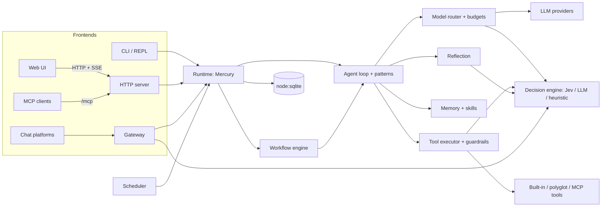

# ☿ The Mercury Agent Handbook

### The complete, end-to-end handbook for users, administrators and developers — Mercury Agent v1.3.0

---

This handbook is the single book that takes you from *"I just heard of Mercury"* to *"I run, govern and extend a fleet of autonomous agents."* It is deliberately long and detailed: it explains the small things (which key to paste where) and the big things (how the agent decides, remembers and improves). If you only read one document about Mercury, read this one — it links out to the specialised references (`GUIDE.md`, `PROVIDERS.md`, `SECURITY.md`, `EXTENDING.md`, …) when you want to go deeper on a single subject.

> **A note on honesty.** Mercury is developed offline-first and tested with a deterministic suite
> (185 offline tests). Many subsystems that talk to *live external services* — real LLM providers,
> the Jev decisions API, chat-platform adapters, speech services, Docker/SSH terminal backends —
> have **not** been exercised end-to-end against those live services in the repository. Wherever a
> feature is in that category, this handbook says so plainly rather than pretending. See
> [`STATUS.md`](../STATUS.md) for the authoritative tested-vs-untested matrix.

---

## How to read this handbook — the three on-ramps

There is **one spine** (the red thread below) and **three on-ramps** onto it. Everybody walks the same road; you just join it at the point that matches your goal and read the depth boxes that match your role.

| You are… | Your goal | Start at | Read deeply | Skim |
|---|---|---|---|---|
| **A user (layman)** | Chat with a capable assistant, give it tasks, let it remember you | Part 0 → Part 1 → Part 2 → Part 3 | Parts 3, 5, 6 (chatting, memory, schedules) | Parts 8–10 |
| **An administrator** | Run Mercury for a team safely and keep it healthy | Part 1 → Part 8 → Part 9 | Parts 1, 7, 8, 9 (install, integrations, govern, observe) | Part 10 |
| **A developer** | Add tools, adapters, providers, patterns; embed Mercury | Part 0 → Part 4 → Part 10 | Parts 4, 5, 10 + the appendices | Parts 3, 6 |

Throughout, boxes marked **👤 For users**, **🛠 For admins** and **🧑‍💻 For developers** call out the role-specific detail, so you can read the whole book or follow just your lane.

---

## The red thread — *"From zero to a trustworthy autonomous colleague"*

Everything in this handbook hangs off one story. Mercury is not a chatbot you type at; it is a **colleague you hire, equip, teach, trust and supervise.** You bring that colleague to life in a fixed sequence of movements, and each movement adds exactly one capability. Keep this sequence in your head and nothing in Mercury will feel random — every feature is "the tool for one movement."

1. **Give it a home** *(Install)* — one Node process and one SQLite file on your machine.
2. **Give it a brain** *(LLM providers)* — Mercury ships with no model; you point it at one.
3. **Give it a voice** *(Chats, Sessions, Runs)* — you talk; it answers; every exchange is recorded.
4. **Give it hands** *(Tools)* — 79 built-in tools let it read files, run code, search the web, act.
5. **Give it a memory and teach it** *(Memory, Skills, Reflection, Lessons)* — it remembers you, distils reusable skills, and learns a lesson from every run.
6. **Let it work on its own** *(Scheduler, Workflows)* — scheduled agents and multi-agent teams.
7. **Connect it to the world** *(Integrations & MCP)* — chat platforms, email, and the Model Context Protocol as both client and server.
8. **Put it on a leash** *(Personalities, Permissions, Budgets, Security)* — govern what each agent may do, as whom, with what spend, under what guardrails.
9. **Give yourself x-ray vision** *(Observability & Debugging)* — every run is a traceable event stream you can watch, pause, replay and diagnose.
10. **Let it evolve** *(Extending Mercury)* — add your own tools, adapters, providers and patterns.

The trust in "trustworthy" is earned in movements 8 and 9; the autonomy in "autonomous" is granted in movements 4, 6 and 7; the "colleague" is built in movements 3 and 5. The whole book is just these ten movements, told in order and in depth.

---

## Table of contents

- **Part 0 — Understand Mercury** (the mental model, the vocabulary, the architecture)
- **Part 1 — Give it a home: download & install** (from source, global binary, Docker; macOS/Linux/Windows)
- **Part 2 — Give it a brain: LLM providers & models** (every provider, switching providers & models, the router)
- **Part 3 — Give it a voice: chats, sessions, runs & slash commands**
- **Part 4 — Give it hands: the tool system** (catalogue, risk, approvals, polyglot)
- **Part 5 — Give it a memory and teach it** (the six memories, skills, reflection, **memory lessons**)
- **Part 6 — Let it work on its own: scheduled agents & workflows**
- **Part 7 — Connect it to the world: integrations & MCP** (mail, Telegram, WhatsApp, Signal, Slack, …; LinkedIn & X honestly; MCP client & server)
- **Part 8 — Put it on a leash: personalities, permissions, budgets & security**
- **Part 9 — X-ray vision: observability, debugging & eliminating issues**
- **Part 10 — Let it evolve: extending Mercury as a developer**
- **Appendices** — CLI quick reference, configuration quick reference, troubleshooting, glossary, the documentation map

---

# Part 0 — Understand Mercury

> **Read this first regardless of your role.** Five minutes here makes every later part obvious.

## 0.1 What Mercury is (and is not)

Mercury Agent is a **self-hosted, extensible agentic AI platform written in TypeScript.** "Agentic" means it does not just answer — it *reasons in a loop, calls tools, remembers, reflects and acts* until a task is done. "Self-hosted" means it runs entirely on **your** machine or server: one Node process, one SQLite database file, your keys, your data. "Extensible" means almost everything — tools, providers, personalities, adapters, reasoning patterns — is a drop-in you can add without editing the core.

It is **not** a hosted SaaS, and it **ships with no language model of its own.** Before Mercury can say a single useful word you must point it at a real LLM — cloud or local (Part 2). This is a feature, not a limitation: you choose the brain, you own the bill, and you can run fully offline against a local model.

What you get, at a glance:

| You get… | In one line |
|---|---|
| A **CLI** | `mercury …` — chat, configure, schedule, manage, everything scriptable |
| A **web UI** | A no-build single-page app with 17 panels (chat, runs, memory, scheduler, …) |
| **19 chat gateways** | Telegram, Discord, Slack, WhatsApp, Facebook, X, LinkedIn, Signal, Matrix, Teams, Email, SMS, ... |
| **Multi-agent workflows** | Nine templates — pipeline, debate, map-reduce, coordinator-worker, … |
| **Persistent memory** | Six kinds, from working scratch to curated long-term facts |
| **79 built-in tools** | Files, shell, web, code, git, data, media, scheduling, memory, … |
| **MCP client *and* server** | Consume external tool servers; expose Mercury's own tools to others |
| A typed **decision engine (Jev)** | Optional; routes models, judges risk, triages, drives reflection |

## 0.2 The vocabulary — Chats, Sessions, Runs (and why the difference matters)

These three words are used precisely throughout Mercury. Confusing them is the single most common source of confusion, so pin them down now.

| Term | What it is | Lifetime | Where you see it |
|---|---|---|---|
| **Chat** | The live act of exchanging messages with the agent — what you do in the CLI REPL, the web Chat panel, or a Telegram thread. | Momentary (the conversation in front of you) | CLI, web Chat panel, any gateway |
| **Session** | The **persisted thread** that a chat belongs to: its full message history, stored in SQLite with full-text search. You can leave and return to a session, search it, rename it, branch from it. | Durable (until you delete it) | `--session <id>`, `/sessions`, web **Sessions** panel |
| **Run** | **One execution of the agent loop** — a single turn of "think → call tools → answer," recorded as a traceable stream of events (every LLM call, tool call, decision, guardrail verdict). A session contains many runs. | Durable (as an event trace) | `/api/runs`, `mercury replay`, web **Runs**/**Debug** panels |

The mental model: **you have a Chat, inside a Session, and every time you press enter you trigger a Run.** A Session is the *memory of the conversation*; a Run is the *recording of one thought*. Part 3 covers Chats and Sessions; Part 9 covers Runs (because a Run is really an observability object).

## 0.3 The architecture in one picture



Read it as the red thread flowing left to right: **frontends** (how you reach the agent) feed the **runtime** (the one composition root that wires everything), which drives the **agent loop**, which in turn uses the **brain** (LLMs + router), the **hands** (tools + guardrails), the **memory**, and **reflection** — with the optional **decision engine** advising the risky calls, and everything persisted to **one SQLite file.**

## 0.4 The seven packages (orientation for developers)

> **🧑‍💻 For developers.** Mercury is a monorepo of seven packages with a strict one-way dependency
> direction: `cli, server → runtime → {tools, mcp, gateway} → core`. `core` depends only on `zod`,
> `yaml` and Node built-ins — keep HTTP/server concerns out of it.

| Package | Role |
|---|---|
| `@mercury/core` | Config, DB, auth, LLM, decision engine, agent, memory, skills, workflows, scheduler, security |
| `@mercury/tools` | Built-in tools, terminal/browser backends, the polyglot loader |
| `@mercury/mcp` | MCP client manager and the Mercury MCP server |
| `@mercury/gateway` | Gateway controller and the 19 platform adapters |
| `@mercury/runtime` | The composition root — `createMercury()` wires everything together |
| `@mercury/server` | Fastify REST/SSE API, webhooks, `/mcp`, `/metrics`, static web UI |
| `@mercury/cli` | The `mercury` binary |

The CLI, server, gateway, scheduler and MCP server are all **thin front-ends over the same runtime** — which is why a slash command behaves identically whether you type it in the CLI, the web UI or Telegram.

---

# Part 1 — Give it a home: download & install

> **The first movement of the red thread.** Before anything else, Mercury needs a place to live: one
> Node process and one data directory. There is no database server, cache or message queue to run.

## 1.1 Requirements (check these first)

| Requirement | Why | How to check |
|---|---|---|
| **Node.js ≥ 22.5.0** | Mercury uses the built-in `node:sqlite` module, which only exists from Node 22.5. | `node -v` |
| **npm** | Bundled with Node; installs the workspace. | `npm -v` |
| **git** | To clone the repository. | `git --version` |
| A POSIX shell | For the optional `install.sh`. | — |
| ~500 MB disk | For `node_modules` + build output. The runtime footprint itself is small. | — |
| **One LLM provider** | *Optional at install, required to answer.* A cloud key or a local Ollama/LM Studio. | Part 2 |

You will see an **"ExperimentalWarning: SQLite is an experimental feature"** on startup. That is expected with Node 22's `node:sqlite` — it is harmless. Silence it with `NODE_NO_WARNINGS=1` if you wish.

## 1.2 Install from source (recommended)

```bash
git clone https://github.com/ms1963/mercury_agent.git mercury && cd mercury
npm install          # installs workspace deps for all 7 packages
npm run build        # tsc project references → each package's dist/
```

`npm run build` runs `tsc -b packages/cli packages/server`, which transitively builds every package through TypeScript project references. When it finishes you can run the binary directly:

```bash
node packages/cli/dist/bin.js version      # → "mercury 1.0.0"
node packages/cli/dist/bin.js doctor       # environment health check (see Appendix C)
```

> **esbuild postinstall warning.** The root `package.json` pre-approves esbuild's postinstall
> (`"allowScripts": { "esbuild": true }`), so clean installs are silent on npm versions that gate
> build scripts. On older npm you may still see a one-line "script was not approved" notice — it is
> harmless; the build and tests run regardless.

## 1.3 Install the global `mercury` binary

`install.sh` builds the project and `npm link`s a global `mercury` command, so you can type `mercury …` from anywhere instead of `node packages/cli/dist/bin.js …`:

```bash
./install.sh
mercury version
```

> **Status.** `install.sh` is provided but has **not been run in the test environment.** If `npm
> link` fails for permission reasons, run it with the right privileges or keep using
> `node packages/cli/dist/bin.js`. Throughout this handbook, `mercury <cmd>` and
> `node packages/cli/dist/bin.js <cmd>` are interchangeable.

## 1.4 Install with Docker

```bash
docker compose up -d        # builds the image and runs the server; data persists in the mercury-data volume
docker compose logs -f
docker compose down         # stop — the named volume (your data) survives
```

The repo ships a `Dockerfile` and a `docker-compose.yml` declaring a named volume `mercury-data` mounted at the data directory, so your DB, config and secrets survive container restarts. Pass provider keys via the compose `environment:` block or an `env_file:` — **never bake keys into the image.**

For offline voice (STT/TTS) inside the container, build the voice-enabled image — it bundles `ffmpeg` + `whisper` + `piper` (larger, includes CPU PyTorch):

```bash
docker compose --profile voice up -d --build mercury-voice   # or: docker build -f Dockerfile.voice -t mercury-agent:voice .
```

## 1.5 Platform notes (macOS / Linux / Windows)

Mercury is pure Node, so it runs anywhere Node ≥ 22.5 runs. The only per-platform wrinkle is how you get a recent Node and where the data directory lands.

| Platform | Getting Node ≥ 22.5 | Data directory default |
|---|---|---|
| **macOS** | `brew install node` (or `nvm install 22`). Apple Silicon and Intel both fine. | `~/.mercury` |
| **Linux** | Distro package may be old — prefer `nvm` or NodeSource. The hardened `deploy/mercury.service` systemd unit is for Linux hosts. | `~/.mercury` |
| **Windows** | Use the Node MSI or `nvm-windows`. WSL2 is the smoothest path if you want the POSIX `install.sh`. | `%USERPROFILE%\.mercury` |

Override the data directory anywhere with the `MERCURY_HOME` environment variable or the `dataDir` config key.

## 1.6 First-run setup — admin account + one provider

Mercury needs (a) an admin account and (b) one LLM provider before it can answer. Two ways:

**Interactive wizard** (recommended for a first install):

```bash
mercury setup
```

It prompts for an admin username and password and walks you through selecting and wiring a provider.

**Non-interactive** (scripts, CI, containers):

```bash
mercury setup --username admin --password '<pw>' --provider ollama --model ollama/llama3.1
```

**Or register through the web UI** — start the server and sign up; **the first account that registers automatically becomes the admin.**

The fastest provider paths (full matrix in Part 2):

```bash
# Local, no API key — run Ollama or LM Studio first, then:
mercury config set llm.providers.ollama '{"type":"ollama","enabled":true}'
mercury model ollama/llama3.1

# Or a cloud key in the data-dir .env:
echo 'CHATLLM_API_KEY=s2-...' >> ~/.mercury/.env    # Abacus.AI ChatLLM / RouteLLM
mercury model chatllm/route-llm
# …or OPENROUTER_API_KEY / OPENAI_API_KEY / ANTHROPIC_API_KEY
```

## 1.7 Start it and verify

```bash
mercury serve                                # web UI + API on http://localhost:3000
mercury doctor                               # checks Node version, data dir, config, providers, keys
MERCURY_ENABLE_MOCK=1 mercury chat "hello"   # offline smoke test (no provider) → "Echo: hello"
npm test                                     # the vitest suite (185 tests, offline)
```

`mercury serve` starts **everything in one process**: the REST/SSE API, the static web UI, the **scheduler**, the **gateway** (if enabled), and the **MCP endpoint** at `/mcp`.

> **The mock provider is for testing only.** It is disabled in normal operation and enabled *only*
> when `MERCURY_ENABLE_MOCK=1` is set. Use it for an offline smoke test; never for real work.

## 1.8 Where everything lives (the data directory)

Everything Mercury knows is under `~/.mercury` (override with `MERCURY_HOME`). Knowing this layout makes backups and troubleshooting trivial.

```
~/.mercury/
├── config.yaml              # main configuration (Part 2 onward, full ref in Appendix B)
├── .env                     # API keys, loaded at startup — never commit
├── mercury.db               # the SQLite database (sessions, runs, events, users, memory index…)
├── secret.key               # JWT signing key, mode 0600 — never commit or share
├── mcp.json                 # MCP server definitions (hot-reloaded)
├── users/<userId>/
│   ├── MEMORY.md            # curated long-term memory (Part 5)
│   └── USER.md              # the agent's model of that user (Part 5)
├── attachments/   skills/   tools/   workflows/
├── plugins/   adapters/   personalities/   patterns/
└── checkpoints/<sessionId>/<n>/   # session checkpoints for replay/rewind
```

> **🛠 For admins — back up the whole directory.** It contains the database, the signing key, user
> memory and every extension. A snapshot while the server is stopped is simplest; for a live backup,
> copy `mercury.db` with a SQLite-aware tool. Keep the directory readable only by the Mercury user.

## 1.9 Updating Mercury

```bash
mercury update        # convenience wrapper: git pull + npm install + npm run build
# Manual equivalent:
git pull && npm install && npm run build       # then restart the service
```

> **Status.** `mercury update` has **not been run** against a real upstream in the test environment;
> the manual three-command form is the reliable path.

---

# Part 2 — Give it a brain: LLM providers & models

> **The second movement.** Mercury has **no built-in model.** You must point it at one real LLM
> backend before it can answer. This part shows every supported provider, exactly how to switch
> providers and models, and how the model router chooses for you.

## 2.1 The one rule: model ids are `provider/model`

Every model in Mercury is addressed as **`"<provider>/<model>"`** — e.g. `openai/gpt-4o-mini`, `anthropic/claude-sonnet-4-5`, `ollama/llama3.1`, `chatllm/route-llm`. You set the active one three equivalent ways:

```bash
mercury model openai/gpt-4o-mini          # the CLI
```
```yaml
# ~/.mercury/config.yaml
llm:
  defaultModel: openai/gpt-4o-mini
```
```text
/model openai/gpt-4o-mini                  # inside any chat (CLI, web, gateway)
```

Leave `llm.defaultModel: auto` and the **router** picks among every configured provider for each request (§2.6).

## 2.2 Where keys go — and where they must never go

API keys belong in **`~/.mercury/.env`** (or the process environment). **Never put a key in `config.yaml`**, which may be shared or committed.

```bash
# ~/.mercury/.env
OPENAI_API_KEY=sk-...
ANTHROPIC_API_KEY=sk-ant-...
```

Four providers **auto-enable the moment their key is present** — no config entry needed at all:

| Set this env key | …and this provider turns on | Example model id |
|---|---|---|
| `OPENAI_API_KEY` | `openai` | `openai/gpt-4o-mini` |
| `ANTHROPIC_API_KEY` | `anthropic` | `anthropic/claude-sonnet-4-5` |
| `OPENROUTER_API_KEY` | `openrouter` **(+ optional Jev decision model)** | `openrouter/openai/gpt-4o-mini` |
| `CHATLLM_API_KEY` or `ABACUS_API_KEY` | `chatllm` (Abacus.AI RouteLLM) | `chatllm/route-llm` |

> Secrets are redacted from logs and tool output by default (`security.redactSecrets: true`).

## 2.3 The fastest route — copy a ready-made `.env`

The repository ships **15 ready-to-use provider env files** in [`examples/env/`](../examples/env/). Pick one, copy it, paste your key, run:

```bash
cp examples/env/openai.env ~/.mercury/.env
$EDITOR ~/.mercury/.env          # put your real key in
mercury chat "hello"             # Mercury auto-loads ~/.mercury/.env
```

Each file sets three things: `MERCURY_MODEL` (the default, as `provider/model`), `<PROVIDER>_API_KEY` (your secret), and — for non-built-in providers — one `MERCURY__llm__providers__<id>={...}` line that registers the provider inline (the same block you'd otherwise put in `config.yaml`, expressed as one environment variable). You can combine several blocks in one `.env`; keep only one `MERCURY_MODEL` line.

## 2.4 Every provider, with its exact recipe

### Built-in providers (key is enough)

**Abacus.AI ChatLLM / RouteLLM** — OpenAI-compatible, auto-picks the best model per request:

```bash
echo 'CHATLLM_API_KEY=s2-...' >> ~/.mercury/.env     # ABACUS_API_KEY also works
mercury model chatllm/route-llm                       # or chatllm/gpt-4o-mini, chatllm/claude-sonnet-4-5
```
Default base URL `https://routellm.abacus.ai/v1`; override with the `baseUrl` field if needed.

**OpenRouter** — hundreds of models behind one key; also powers the optional Jev engine:

```bash
echo 'OPENROUTER_API_KEY=sk-or-...' >> ~/.mercury/.env
mercury model openrouter/openai/gpt-4o-mini           # or openrouter/anthropic/claude-3.5-sonnet, …
```

**OpenAI**:

```bash
echo 'OPENAI_API_KEY=sk-...' >> ~/.mercury/.env
mercury model openai/gpt-4o-mini
```

**Anthropic** — uses Anthropic's native Messages API:

```bash
echo 'ANTHROPIC_API_KEY=sk-ant-...' >> ~/.mercury/.env
mercury model anthropic/claude-sonnet-4-5             # or anthropic/claude-haiku-4-5
```
An Anthropic-*compatible* gateway works via the `baseUrl` field:
```bash
mercury config set llm.providers.anthropic '{"type":"anthropic","baseUrl":"https://your-gateway","enabled":true}'
```

### Local providers (no key)

**Ollama** — install [Ollama](https://ollama.com), pull a model, then:

```bash
ollama pull llama3.1
mercury config set llm.providers.ollama '{"type":"ollama","enabled":true}'
mercury model ollama/llama3.1
```
Default base URL `http://localhost:11434/v1`; override with `baseUrl` if remote.

**LM Studio** — start its local server (default `http://localhost:1234/v1`), load a model, then:

```bash
mercury config set llm.providers.lmstudio '{"type":"lmstudio","enabled":true}'
mercury model lmstudio/<model-name-shown-in-lmstudio>
```

### Any OpenAI-compatible endpoint (Groq, Mistral, DeepSeek, Gemini, xAI/Grok, Together, Fireworks, Perplexity, Azure, vLLM, LocalAI…)

One generic recipe covers them all — register the provider with `type: openai-compatible`, a `baseUrl`, and an `apiKeyEnv` naming the env var that holds the key:

```bash
mercury config set llm.providers.myapi '{"type":"openai-compatible","baseUrl":"https://host/v1","apiKeyEnv":"MYAPI_KEY","enabled":true}'
echo 'MYAPI_KEY=...' >> ~/.mercury/.env        # omit if the endpoint needs no key
mercury model myapi/<model>
```

The exact base URLs for the popular hosts (from the shipped [`examples/env/`](../examples/env/) templates):

| Provider | `baseUrl` | Example default model |
|---|---|---|
| **Groq** | `https://api.groq.com/openai/v1` | `groq/llama-3.3-70b-versatile` |
| **Mistral** | `https://api.mistral.ai/v1` | `mistral/mistral-large-latest` |
| **DeepSeek** | `https://api.deepseek.com/v1` | `deepseek/deepseek-chat` |
| **Google Gemini** | `https://generativelanguage.googleapis.com/v1beta/openai` | `gemini/gemini-2.0-flash` |
| **xAI (Grok)** | `https://api.x.ai/v1` | `xai/grok-2-latest` |
| **Together AI** | `https://api.together.xyz/v1` | `together/meta-llama/Llama-3.3-70B-Instruct-Turbo` |
| **Fireworks AI** | `https://api.fireworks.ai/inference/v1` | `fireworks/accounts/fireworks/models/llama-v3p3-70b-instruct` |
| **Perplexity** | `https://api.perplexity.ai` | `perplexity/sonar` |
| **Azure OpenAI** | `https://<RESOURCE>.openai.azure.com/openai/deployments/<DEPLOYMENT>?api-version=<VER>` | `azure/<DEPLOYMENT>` |

Azure is the one special case: it authenticates with an **`api-key` header** rather than a bearer token, so use the `headers` field instead of `apiKeyEnv` — see [`examples/env/azure-openai.env`](../examples/env/azure-openai.env). For any endpoint, `headers` can add any extra header the host needs.

> **Note on "X".** `xai/grok-*` above is **xAI's Grok language model** (the brain), reached at
> `api.x.ai`. It is *not* the same as posting to the social network **X/Twitter** (an integration) —
> see Part 7.4 for the honest status of X as a *gateway*.

## 2.5 Switching providers and models — the three scopes

You can change the model at three scopes, from most permanent to most transient:

| Scope | How | Lasts |
|---|---|---|
| **Global default** | `mercury model <id>` or `llm.defaultModel` in config | Until you change it |
| **This session** | `/model <id>` inside a chat | For that session |
| **This one turn** | `mercury chat --model <id> "…"` | For that single message |

`/model` with no argument shows the current model; `/model auto` hands the choice back to the router.

## 2.6 The model router (let Mercury choose)

With `llm.defaultModel: auto` and `router.enabled: true` (the default), Mercury **routes each request to the best model** among those you've configured. Optionally declare model *profiles* so it can score candidates:

```yaml
llm:
  models:
    - { id: openai/gpt-4o-mini, tags: [cheap, fast], quality: 0.7, costPer1MInput: 0.15, costPer1MOutput: 0.6, contextWindow: 128000, tools: true, vision: true }
    - { id: anthropic/claude-sonnet-4-5, tags: [smart], quality: 0.95, costPer1MInput: 3, costPer1MOutput: 15, contextWindow: 200000, tools: true }
router:
  weights: { quality: 1, cost: 0.3, latency: 0.2 }
  rules: []            # regex/tag → force a model
  fallback: []         # ordered fallback ids tried on error
  useDecisions: true   # let the decision engine pick among the top-k
  topK: 3
```

The router resolves a model in this order: **explicit model > `router.rules` (regex/tags) > capability filter (does it support the tools/vision/json you need?) > weighted score (`router.weights`) > optional Jev choice among the top-k > `router.fallback` chain on error.** Turn routing off with `router.enabled: false` to always use `llm.defaultModel`.

> **🛠 For admins — resilient provider calls.** Retryable errors retry with exponential backoff +
> bounded jitter (`llm.retryBackoffMs`, `llm.retryJitter`); non-retryable 4xx fail fast; a per-model
> **circuit breaker** (`llm.circuitBreaker.*`) skips a model that keeps failing until it cools down;
> then the cross-model fallback chain is tried. Every retry emits an `llm.retry` event. Details in
> [`RELIABILITY.md`](RELIABILITY.md).

## 2.7 The optional Jev decision engine (a second, smaller brain)

Jev (`typesafe/jev-1.13`, via the OpenRouter Decisions API) is a **typed decision/judgment model** Mercury uses for small structured choices: model routing, prompt-injection classification, smart tool-approval, gateway triage, retry/escalation and reflection scoring. It is **entirely optional** — Mercury runs fully without it.

| `decision.provider` | Behaviour |
|---|---|
| `auto` (default) | Use Jev **only** when `OPENROUTER_API_KEY` is set; else your configured LLM; else a safe built-in heuristic |
| `jev` | Force Jev (requires the OpenRouter key) |
| `llm` | Use your normal LLM for decisions, never Jev |

So the simplest way to "turn on" Jev is just to set `OPENROUTER_API_KEY`. The confidence thresholds that gate each decision (injection 0.7, tool-approval 0.8, triage 0.8, retry 0.6, answer-quality 0.5) and per-decision on/off switches live under `decision.*` (Appendix B). Part 8 and Part 9 show where Jev actually shows up.

> **Status.** The Jev provider was tested only with **mocked HTTP** (parsing, retry, fail-fast,
> fallback). It has **not** been run against the real OpenRouter Decisions API.

---

# Part 3 — Talking to Mercury: chats, sessions & runs (the third movement: giving it a voice)

Now that Mercury has a home (Part 1) and a brain (Part 2), you can talk to it. This part is the one every **👤 user** needs, and it also defines three words that the rest of the handbook leans on constantly — **chat**, **session**, and **run**. If you only remember one table from this guide, make it the one in [Part 0](#02-the-vocabulary-you-must-not-confuse). Here is the practical version.

## 3.1 Three ways to start a conversation

| Where | How | Best for |
|---|---|---|
| **CLI one-shot** | `mercury chat "your question"` | quick questions, scripts, piping output |
| **CLI REPL** | `mercury chat` (no message) | an interactive back-and-forth in the terminal |
| **Web UI** | `mercury serve`, open `http://<host>:3000`, use the **Chat** panel | the richest experience: streaming, markdown, tool chips, inline approvals, attachments |

Useful `chat` flags: `--model <id>` (override the model for this one turn), `--session <id>` (continue a specific past conversation), `--pattern <name>` (force a reasoning pattern from [Part 2](#24-reasoning-patterns-how-the-brain-thinks)), and `--user <id>` (act as a particular user). In the REPL, anything you type is a message; anything beginning with `/` is a **slash command** (next section), and `/exit` or `/quit` leaves.

> **👤 For users — the fastest start.** Run `mercury serve`, open the page, register the first
> account (that makes you the admin), pick a provider in **Settings**, and type into the Chat box.
> That's it — everything else in this handbook is optional depth.

## 3.2 The web UI at a glance (19 panels)

The web UI is a single no-build page served by `mercury serve`. It has **dark/light themes** and **English/German** locales, and nineteen panels — each panel is explored in the part shown:

| Panel | What it does | Covered in |
|---|---|---|
| **Chat** | streaming conversation, markdown, tool chips, inline approvals, usage, feedback | this part |
| **Sessions** | browse/search past conversations | this part |
| **Runs** | every run with its event timeline | this part + [Part 9](#part-9--x-ray-vision-observability-debugging--troubleshooting-the-ninth-movement-seeing-everything) |
| **Workflows** | define and launch multi-agent workflows | [Part 6](#part-6--autonomy-scheduler--workflows-the-sixth-movement-work-that-runs-itself) |
| **Memory** | view/edit curated memory, browse facts | [Part 5](#part-5--memory--learning-the-fifth-movement-an-agent-that-remembers-and-improves) |
| **Skills** | list/view/install skills | [Part 5](#54-skills-reusable-know-how) |
| **Tools/MCP** | toggle tools, add MCP servers | [Part 4](#part-4--the-hands-tools-the-fourth-movement-doing-not-just-talking) + [Part 7](#part-7--connecting-to-the-world-integrations--mcp-the-seventh-movement-reaching-beyond-the-box) |
| **Scheduler** | create/edit/run scheduled tasks | [Part 6](#61-the-scheduler-tasks-that-run-on-their-own) |
| **Integrations** | gateway: chat-platform adapters, pairing | [Part 7](#part-7--connecting-to-the-world-integrations--mcp-the-seventh-movement-reaching-beyond-the-box) |
| **Models/Budgets** | per-user/model cost & token caps | [Part 8](#84-budgets-spending-caps-that-actually-stop-spending) |
| **Users** (admin) | manage accounts & roles | [Part 8](#83-security-authentication-tokens--rbac) |
| **Debug** | breakpoints, step-through, resume/skip | [Part 9](#93-live-debugging-breakpoints-for-an-agent) |
| **Reflections** | post-run scores, lessons, auto-skills | [Part 5](#55-reflection--memory-lessons-how-mercury-gets-better) |
| **Distilled Skills** (admin) | review/approve/retire self-distilled skills | [Part 5](#57-self-distilling-skills-120) |
| **Run Replay** (admin) | scrub a run's timeline, inspect state, fork a corrected re-run | [Part 5](#58-run-replay--time-travel-debugging-120) |
| **Evaluations & Auto-tune** (admin) | promote runs to cases, run suites, view scores/trends, propose & apply/revert governed tunes | [Part 5](#59-evaluation-driven-self-improvement-130) |
| **Agent Bundles** (admin) | export/download a signed bundle, install/upload one, list installed bundles | [Part 7](#77-sharable-agent-bundles-130) |
| **Help** | the in-app help pages (also in German) | — |
| **Settings** | providers, keys, everything else | [Part 2](#part-2--the-brain-llm-providers--models-the-second-movement-choosing-and-switching-intelligence) |

## 3.3 Slash commands (the same everywhere)

Slash commands are implemented once (`core/src/agent/commands.ts`) and behave identically in the CLI REPL, the web Chat panel, and inbound gateway messages (Part 7). This is the full set:

| Command | Effect |
|---|---|
| `/help [topic]` | Help overview, or a specific topic |
| `/new`, `/reset` | Start a fresh session / clear the current one |
| `/model [id\|auto]` | Show or switch the model for this session |
| `/pattern [name\|auto]` | Show or switch the reasoning pattern |
| `/personality [name]` | Switch the active personality ([Part 8](#81-personalities-giving-an-agent-a-character)) |
| `/retry` | Re-run the last turn |
| `/undo` | Undo the last exchange |
| `/stop` | Abort the running agent |
| `/compress` | Compress the working context now |
| `/usage` | Token/cost usage for this session |
| `/insights [days]` | Usage insights (an admin may append `all` for everyone) |
| `/skills [name]` | List skills, or view one |
| `/<skill-name>` | Invoke a skill directly |
| `/rollback [checkpoint-id]` | Roll the filesystem back to a checkpoint |
| `/approve <id>`, `/deny <id>`, `/approvals` | The tool-approval queue ([Part 8](#82-permissions--approvals-the-leash)) |
| `/memory [query]` | Show or search your memory ([Part 5](#part-5--memory--learning-the-fifth-movement-an-agent-that-remembers-and-improves)) |
| `/feedback good\|bad` | Rate the last run (feeds reflection) |
| `/debug on\|off\|llm\|tool\|list\|resume <id>\|skip <id>` | Live debugging & breakpoints ([Part 9](#93-live-debugging-breakpoints-for-an-agent)) |
| `/tools` | List currently available tools |
| `/sessions [query]` | List or search sessions |
| `/exit`, `/quit` | Leave the REPL (REPL only) |

## 3.4 Sessions: Mercury's long-term conversation memory

A **session** is a stored conversation. Every chat you have is saved to SQLite with full-text search (FTS5), so you can always come back to it.

- **Continue** a session with `mercury chat --session <id>`, or pick one in the web **Sessions** panel, or type `/sessions` in chat.
- **Search** across all your sessions with `/sessions <query>` (or the search box in the panel).
- Sessions are **per user** — each user sees only their own.

## 3.5 Attachments & inline references

You can hand Mercury files and pointers mid-conversation:

- **Attachments** — upload images, audio, video and documents in the web UI (or `POST /api/attachments`). They are capped at `attachments.maxBytes` (**25 MB**). Providers degrade gracefully when the model lacks a capability: audio becomes a transcript, video becomes frames/transcript, an image becomes a description.
- **Inline references** are expanded *before* the turn runs: `@file <path>`, `@folder <path>`, `@diff` (your current git diff), and `@url <url>`. References obey the path jail and the SSRF guard (Part 8), and whatever they pull in is tagged **untrusted** so it can never silently trigger a sensitive action.
- **Project context files** — Mercury auto-loads `AGENTS.md`, `CLAUDE.md`, `SOUL.md`, `.cursorrules` and similar files from your working directory and folds them into the system prompt, so the agent understands the project you're standing in.

## 3.6 Runs: the unit of work behind every answer

When you send a message, Mercury executes a **run** — one trip through the reasoning loop that may call several tools and the LLM multiple times before it replies. A chat has many sessions over its life; a session has many runs; a run has many steps and events.

Runs are **first-class and fully recorded**. You don't need to think about them as a user, but they are the backbone of everything in [Part 9](#part-9--x-ray-vision-observability-debugging--troubleshooting-the-ninth-movement-seeing-everything): every run has an id, a timeline of events (LLM calls, tool calls, approvals, errors), and can be **replayed** (`mercury replay <runId>`) or inspected in the **Runs** panel. That is the thread we pick up once the agent starts doing things — which is the next movement.

---

# Part 4 — The hands: tools (the fourth movement: doing, not just talking)

A chatbot talks. An **agent** acts. Tools are the hands that turn Mercury from a text generator into something that reads your files, runs commands, searches the web, generates images and edits code. Mercury ships **79 built-in tools** organised into **19 toolsets**.

## 4.1 The safety idea you need first: risk levels & "untrusted"

Every tool carries a **risk level**, and this single concept drives the whole approval system in [Part 8](#82-permissions--approvals-the-leash):

| Risk | Meaning |
|---|---|
| `safe` | Runs freely — reading, searching, calculating. No approval. |
| `moderate` | Gated by the approval policy **when it was triggered by untrusted content**. |
| `dangerous` | **Always** needs approval (e.g. deleting files, installing skills). |

Separately, any tool whose output comes from **outside** (the web, files, an MCP server) is tagged **untrusted** — its content is treated as data, never as instructions, so a malicious web page can never quietly make the agent delete your files. Keep these two ideas in mind; Part 8 shows exactly how they combine.

## 4.2 Managing which tools exist

```bash
mercury tools list                 # every tool
mercury tools toolsets             # every toolset
mercury tools enable  <name>       # enable a tool or a whole toolset
mercury tools disable <name>       # disable a tool or a whole toolset
```

You can also disable tools globally with `tools.disabled[]`, toggle whole toolsets with `tools.toolsets{}`, and disable toolsets **per platform** (e.g. forbid the `terminal` toolset on `telegram` only) with `tools.platforms.<name>.disabledToolsets`. In chat, `/tools` shows what's available right now. Over HTTP: `GET /api/tools`, `POST /api/tools/:name/run`, `POST /api/tools/toggle`.

## 4.3 The complete catalogue (81 tools in 19 toolsets)

| Toolset | Tools (risk) |
|---|---|
| **agents** (3) | `delegate_task` (moderate), `run_workflow` (moderate), `list_workflows` (safe) |
| **browser** (6) | `browser_navigate` (safe), `browser_snapshot` (safe), `browser_click` (moderate), `browser_type` (moderate), `browser_back` (safe), `browser_screenshot` (safe) |
| **code** (1) | `execute_code` (moderate) |
| **data** (6) | `json_query` (safe), `csv_parse` (safe), `yaml_convert` (safe), `sqlite_query` (moderate), `archive` (moderate), `document_text` (safe) |
| **decisions** (3) | `decide_choice` (safe), `decide_noul` (safe), `decide_score` (safe) |
| **files** (10) | `read_file` (safe), `write_file` (moderate), `edit_file` (moderate), `list_dir` (safe), `search_files` (safe), `find_files` (safe), `file_info` (safe), `delete_file` (dangerous), `move_file` (moderate), `make_dir` (safe) |
| **git** (4) | `git_status` (safe), `git_diff` (safe), `git_log` (safe), `git_commit` (moderate) |
| **media** (4) | `image_generate` (safe), `text_to_speech` (safe), `speech_to_text` (safe), `describe_image` (safe) |
| **memory** (6) | `memory` (safe), `memory_store` (safe), `memory_recall` (safe), `memory_forget` (moderate), `session_search` (safe), `user_profile` (safe) |
| **messaging** (2) | `send_message` (moderate), `list_platforms` (safe) |
| **process** (4) | `process_start` (moderate), `process_list` (safe), `process_output` (safe), `process_kill` (moderate) |
| **schedule** (3) | `schedule_create` (moderate), `schedule_list` (safe), `schedule_manage` (moderate) |
| **skills** (5) | `skills_list` (safe), `skill_view` (safe), `skill_manage` (safe), `skill_install` (dangerous), `skill_compose` (moderate) |
| **system** (1) | `system_info` (safe) |
| **terminal** (1) | `terminal` (moderate) |
| **utility** (11) | `calculator`, `current_time`, `date_calc`, `unit_convert`, `regex_extract`, `text_diff`, `text_stats`, `hash_text`, `base64`, `uuid`, `todo` (all safe) |
| **vector** (2) | `vector_index` (safe), `vector_search` (safe) |
| **web** (6) | `web_search` (safe), `web_fetch` (safe), `web_read` (moderate), `http_request` (moderate), `rss_read` (safe), `weather` (safe) |

## 4.4 The backends behind the risky tools (what admins must configure)

Some tools are thin front-ends over a backend you choose:

- **`terminal`** runs through `tools.terminal.backend`: `local` (default), `docker` (`tools.terminal.dockerImage`, default `node:22-slim`), or `ssh` (`tools.terminal.ssh.{host,user,keyPath}`). Dangerous command patterns — `rm -rf /`, disk formatting, fork bombs, `curl | sh`, `sudo`, credential access — **always** require approval, regardless of mode.
- **`execute_code`** runs a script in a child process that can call tools back over JSON-RPC, under `tools.executeCode.timeoutMs` (30 s) and `maxToolCalls` (50) limits, with a scrubbed environment.
- **`browser_*`** uses Playwright when installed, otherwise a fetch-based fallback (`tools.browser.backend` = `auto`|…; `cdpUrl` attaches to a remote Chrome).
- **`web_*`** go through `safeFetch` (SSRF guard + size cap). Search provider is `tools.web.searchProvider`: `duckduckgo` (default, **no key needed**), `searxng` (needs `searxngUrl`), or `brave` (needs `BRAVE_API_KEY`).
- **`image_generate`** uses `tools.image.provider` (`openai` default, or any OpenAI-compatible image provider/model).
- **`file_*`** are confined by the **path jail** (`tools.jail`) — the agent cannot read or write outside the allowed roots.

> **🛠 For admins — the mock branches are gone.** Per the "do not use mocks except for testing"
> rule this product follows, the former mock search/weather/image providers and mock STT/TTS
> branches were **removed**. An unconfigured provider now **fails explicitly** (e.g. `image_generate`
> throws `OPENAI_API_KEY is not set`) instead of returning placeholder output. Configure a real
> backend for any of these tools you intend to use.
>
> **Status.** The Docker and SSH terminal backends, the Playwright browser backend, real
> web-search providers and real image generation were **not** exercised against live services — only
> the local terminal and the fetch browser backend were run. See [`../STATUS.md`](../STATUS.md).

## 4.5 Polyglot tools: a tool can be written in any language

You are not limited to the built-ins or to TypeScript. **Any executable with a `tool.json` manifest becomes a tool**: Mercury writes the JSON arguments to the program's stdin and reads the result from its stdout (a non-zero exit is reported as an error). Mercury discovers them from `tools/`, `$MERCURY_HOME/tools/<name>/`, and any directory in `tools.polyglotDirs`. Bundled examples cover Python (`word_count_py`), JavaScript (`slugify_js`) and Go (`hash_go`). Writing your own is a five-minute job covered in [Part 10](#102-a-tool-in-any-language-the-polyglot-contract).

---

# Part 5 — Memory & learning (the fifth movement: an agent that remembers and improves)

A tool-wielding agent that forgets everything between runs is a goldfish with a chainsaw. This part is where Mercury stops being stateless. Two threads run through it: **memory** (what Mercury knows) and **learning** (how it gets better) — and the two meet in *reflection* and *memory lessons*, the features users most often ask about.

## 5.1 The six kinds of memory

Mercury does not have "a memory" — it has six, each with a different job, all scoped **per user**:

| # | Kind | What it holds | Where it lives |
|---|---|---|---|
| 1 | **Working** | the current run's short-term context | in-memory, compacted with `/compress` |
| 2 | **Episodic** | every past session, full-text searchable | SQLite + FTS5 |
| 3 | **Semantic** | discrete facts (remember / recall / forget) | FTS5 + a vector index |
| 4 | **Curated** | `MEMORY.md` (facts to always know) + `USER.md` (what it learned about you) | files, size-bounded |
| 5 | **Procedural** | skills — reusable know-how | `SKILL.md` files ([§5.4](#54-skills-reusable-know-how)) |
| 6 | **User model + blackboard** | inferred traits (with confidence) + a shared workflow scratchpad | DB |

## 5.2 Curated memory: the two files you can edit by hand

The two most important memory files are plain Markdown you can read and edit:

- **`MEMORY.md`** — facts the agent should *always* know (your timezone, your stack, your preferences). Bounded by `memory.memoryCharLimit` (**2200** chars).
- **`USER.md`** — what Mercury has inferred about *you*. Bounded by `memory.userCharLimit` (**1375** chars).

Edit them three ways: the `/memory` command in chat, the web **Memory** panel, or `PUT /api/memory/curated/:which`. The character limits are deliberate — curated memory is injected into every prompt, so it is kept small and high-signal.

## 5.3 Semantic facts: remember, recall, forget

Beyond the curated files, Mercury stores discrete **facts** and retrieves them by meaning:

```text
"Remember that our staging database is db-stage.internal"   → stored
"What's our staging database?"                              → recalled
"Forget the staging database detail"                        → removed
```

Under the hood these use the `memory_store` / `memory_recall` / `memory_forget` tools, backed by FTS5 plus a vector index. The embeddings provider is `memory.embeddings.provider`: **`hash`** (default — deterministic, zero-config, no API key), or **`openai`** / **`ollama`** for real semantic embeddings. Browse and search everything with `/memory [query]` or the Memory panel.

## 5.4 Skills: reusable know-how

A **skill** is a reusable procedure in the open **agentskills.io `SKILL.md`** format — a Markdown file with frontmatter (`name`, `description`, and optional `license`, `compatibility`, `allowed-tools`, `metadata`). Only the *index* (name + description) sits in the prompt; the agent loads the full body on demand (`skill_view`), so you can have many skills without bloating context.

```bash
mercury skills list                       # installed skills
mercury skills view <name>                # read one
mercury skills install <path|git-url>     # install from a folder or a git repo
```

Invoke a skill in chat with `/<skill-name>`. Authoring your own skill is covered in [Part 10](#106-authoring-skills--workflows).

## 5.5 Reflection & memory lessons: how Mercury gets better

This is the feature behind the questions *"what are reflections?"* and *"what are memory lessons?"* — they are the same system seen from two angles.

**After a run completes, Mercury can reflect on it.** The decision engine (Jev, or your LLM, or a heuristic) scores the outcome and does up to three things:

| Reflection output | What it is | Config |
|---|---|---|
| **A score** | an answer-quality judgment of the run (threshold `decision.thresholds.answerQuality` = 0.5) | `reflection.enabled` (default `true`) |
| **Lessons** ("memory lessons") | short, durable takeaways distilled from what went right or wrong — stored and surfaced in later runs so the same mistake isn't repeated | `reflection.lessons` (default `true`) |
| **User-model update** | refinements to the inferred traits in your user model | `reflection.userModel` (default `true`) |

On top of that, when a run used at least `skills.minToolCallsForSkill` (**4**) tool calls and `skills.autoCreate` is on, reflection can **turn the successful sequence into a new skill** — Mercury literally writes its own procedural memory — and refine existing skills with success statistics.

**So "memory lessons" = the lessons produced by reflection.** You influence them directly with `/feedback good|bad` after a run (an explicit signal that feeds reflection), and you review them in the web **Reflections** panel or via `GET /api/reflections`. Turn the whole subsystem off with `reflection.enabled: false`, or any individual part with the keys above.

> **The payoff of the red thread.** Reflection is why Parts 3–5 are ordered the way they are: a run
> (Part 3) uses tools (Part 4), and its outcome becomes memory and lessons (Part 5) that make the
> *next* run better. That loop is what makes Mercury a colleague rather than a command line.

## 5.6 Learning from runs (hints, auto-tuned routing, failure playbooks)

Reflection (5.5) distils *lessons*; **learning** goes a step further and lets Mercury improve its own
*behaviour* from the history of completed runs. It is driven entirely by the real `runs` table — no
external state — and is **off by default** (`learning.enabled: false`), so nothing is recorded,
injected or adjusted until you turn it on. Every part degrades gracefully when there isn't enough data.

It does three things, each independently toggleable:

| Capability | What it does | Config sub-key |
|---|---|---|
| **Experience hints** | At the start of a run, finds the most similar *past successful* run and injects a short hint into the agent's context. No similar run → no hint. | `learning.hints` |
| **Auto-tuned routing** | Records success rate per (difficulty bucket, model) and feeds it back to the model router, which prefers a learned model only once there are enough samples above a minimum success rate — otherwise it falls back to economics. A learning-adjusted route is flagged `adjustedByLearning`. | `learning.routing` |
| **Failure playbooks** | Recurring error signatures and the remediation that later worked are persisted, so a known pitfall is surfaced on the next matching task. | `learning.playbooks` |

Inspect what it has learned from the CLI:

```bash
mercury learn stats [bucket]     # observed routing success rates per (bucket, model); add --json
mercury learn hints "<task>"     # preview the hint that would be injected for a task
mercury learn playbooks          # recorded failure playbooks and their remediations
```

Admins get the same view in the web **Learning** panel (status, the auto-tuned routing table and the
failure playbooks), and over the API at `GET /api/learning[/stats|/playbooks|/hint]` (scope
`audit.read`). The full config block, with its safe defaults:

```yaml
learning:
  enabled: false            # master switch — OFF by default
  hints:    { enabled: true, maxExamples: 1, minSimilarity: 0.15, lookback: 50 }
  routing:  { enabled: true, minSamples: 5, minSuccessRate: 0.5 }
  playbooks:{ enabled: true, minOccurrences: 2, minSimilarity: 0.2 }
```

The sub-switches default `true`, but because the master `learning.enabled` is `false`, the whole
subsystem stays dormant until you enable it. See [docs/help/learning.md](help/learning.md).

## 5.7 Self-distilling skills (1.2.0)

Where learning (5.6) tunes *behaviour*, **self-distilling skills** turn a winning run into a reusable,
parameterized **skill** you can review, approve and let Mercury reuse automatically. When a run succeeds
— or you mark it `/feedback good` (👍) — Mercury distils its tool-call sequence into a candidate skill,
parameterizing the task-specific values. It is **off by default** (`skills.distill.enabled: false`).

Candidates are not trusted blindly — they go through **governance**:

| Stage | What happens |
|---|---|
| **Distil** | On run success or a 👍, a trace with at least `minToolCalls` (**2**) tool calls becomes a candidate (near-duplicates of an existing skill version it instead, by `dedupMinSimilarity`). |
| **Review & approve** | A candidate stays `pending` until an admin approves it (unless `autoApprove: true`). Each approval is a new **version**. |
| **Reuse** | For a new task, an approved skill above `matchMinSimilarity` surfaces to the planner as a **"proven skill"** hint, so Mercury executes a path that already worked. |
| **Promote / retire** | Approved skills are auto-retired once they have ≥ `minRunsBeforeRetire` (**5**) uses but fall below `retireBelowSuccessRate` (**0.5**) observed success. `maxSkills` (**500**) caps storage. |

Admins manage them in the web **Distilled Skills** panel and over the API at
`GET /api/distilled-skills`, `POST /api/distilled-skills/:id/approve` and
`POST /api/distilled-skills/:id/retire`. They are stored in the `distilled_skills` table (migration #7).
The config block:

```yaml
skills:
  distill:
    enabled: false            # master switch — OFF by default
    autoApprove: false        # approve candidates without review
    minToolCalls: 2           # min tool calls in a winning run to distil
    matchMinSimilarity: 0.3   # reuse an approved skill above this similarity
    dedupMinSimilarity: 0.6   # treat a trace as an existing skill above this
    minRunsBeforeRetire: 5    # uses before auto-retire is eligible
    retireBelowSuccessRate: 0.5
    maxSkills: 500
```

See [docs/help/skills.md](help/skills.md).

## 5.8 Run replay & time-travel debugging (1.2.0)

Every run's bus events are captured into a per-run **trace** (migration #8 `run_traces`), so you can
replay a run deterministically, inspect what the agent "knew" at any step, and fork a corrected run.
It is **on by default** (`replay.enabled: true`).

- **List & scrub.** Browse traced runs, then step through the timeline event by event.
- **Inspect state.** At any step, Mercury reconstructs the state the agent had at that point.
- **Edit & re-run from here.** Change an input at step *N* and *"re-run from here"*: Mercury **forks a new
  linked run** (`parent_run_id` + `from_step`) that reuses the unchanged upstream prefix and recomputes
  everything downstream. **Governance and approvals still apply** to the recomputed portion.

Admins use the web **Run Replay** panel; programmatically it is exposed as the `mercury.traces` facade
(`getTrace`, `getStateAt`, `listTraces`, `replayFrom`) and over the API:

```
GET  /api/runs/:id/timetravel         # the run's trace timeline
GET  /api/runs/:id/state?step=N       # reconstructed state at step N
GET  /api/traces                      # list traced runs
POST /api/runs/:id/replay {fromStep, edits}   # fork a corrected run from a step
```

Configure under `replay` (defaults shown):

```yaml
replay:
  enabled: true           # capture per-run bus-event traces
  retainTraces: 1000      # max traces retained (oldest pruned)
  persistDeltas: false    # also persist per-step state deltas
```

See [docs/help/replay.md](help/replay.md).

## 5.9 Evaluation-driven self-improvement (1.3.0)

Mercury can hold itself to a measurable bar and improve against it — **safely**. The harness is **on by
default** (it only reads and scores); the auto-tuner that mutates config is **off by default**.

1. **Promote** a real (or 👍-rated) run into a labeled **eval case** — the input plus the expected
   tools, output substrings and a cost ceiling — and group cases into a **suite**.
2. **Score** a suite deterministically: each case runs through an ephemeral agent run and is scored on
   pass/fail, cost, intervention and output-similarity; the suite gets a single weighted **0..1 score**
   that is persisted and trendable.
3. **Tune under governance**: a tuner proposes changes (model routing, pattern, temperature, skill
   promote/retire, prompt), tests each against the suite, and keeps **only** changes that improve the
   score by at least `minImprovement` **without** blowing the per-task budget ceiling or touching
   governance-protected config (`security.*`, `governance.*`, `approvals.*`, `policies.*`). Nothing
   auto-applies unless you set **both** `autotune.enabled` and `autotune.autoApply`.
4. **Reverse** any applied tune — every one is versioned and reversible.

```yaml
evals:
  enabled: true           # harness on (safe: read/score only)
  retainScores: 500
  costCeiling: 0.05        # worst-acceptable cost-per-task; also gates tuning
  autotune:
    enabled: false         # auto-tuner off by default (it mutates config)
    minImprovement: 0.02
    autoApply: false
```

Facade `mercury.evals`, REST `GET/POST /api/evals/*` (auth-gated), web **Evaluations & Auto-tune**
panel. See [docs/help/evals.md](help/evals.md).

---

# Part 6 — Autonomy: scheduler & workflows (the sixth movement: work that runs itself)

Everything so far happens because *you* sent a message. This movement cuts that cord in two ways: the **scheduler** makes Mercury act on its own clock, and **workflows** make several agents collaborate on one job.

## 6.1 The scheduler: tasks that run on their own

Schedule an agent (or a workflow) using natural language, cron, intervals, or a one-shot time:

```bash
mercury schedule list
mercury schedule add  --when "every day at 9am" "Summarise overnight news and email me"
mercury schedule edit <id> --when "every 3 hours" --name "News" --task "..."  # change time/name/task
mercury schedule pause  <id>
mercury schedule resume <id>
mercury schedule run    <id>          # run it now, once
mercury schedule delete <id>
```

Scheduled tasks can run a single agent or a whole workflow, carry attached skills, and **deliver their results to a gateway target** (Part 7) — e.g. post the morning summary to your Telegram. The scheduler ticks every `scheduler.tickMs` (**30 s**), retries a failed run up to `scheduler.maxRetries` (**2**), and keeps per-schedule history. Manage everything in the web **Scheduler** panel (each row has **Edit**, **Run now**, **History**, pause and delete — the Edit form's **Task** field is a multi-line textarea for longer prompts), or over HTTP with `/api/schedules` (`PATCH /api/schedules/:id` edits one).

> **👤 For users — a "scheduled agent" is just this.** When the request mentions "scheduled agents",
> it means a saved task here: a prompt + a time + optional delivery target. No code required.

## 6.2 Workflows: many agents, one job

A **workflow** coordinates multiple agents. You choose a **template** that describes how they relate:

| Template | Shape |
|---|---|
| `single` | one agent (the trivial case) |
| `pipeline` | agent A's output feeds agent B feeds C … |
| `round-robin` | agents take turns |
| `coordinator-worker` | a lead delegates subtasks to workers |
| `tree` | hierarchical delegation |
| `map-reduce` | fan out over items, then combine |
| `router` | pick the right agent for the input |
| `blackboard` | agents collaborate through a shared scratchpad |
| `debate` | agents argue opposing sides toward a conclusion |
| `planner-executor` | a planner decomposes the goal into several steps; an executor runs them in order, re-planning on failure, then synthesises the result |
| `auto` | let the decision engine pick the template for you |

A workflow **spec** (YAML or JSON) names the template and lists its agents — each with a role, model, toolsets and reasoning pattern — plus optional budgets:

```yaml
name: research-debate
description: Two researchers debate, a judge concludes
type: debate
agents:
  - role: optimist
    model: chatllm/gpt-5.1
    pattern: cot
  - role: skeptic
    model: anthropic/claude-sonnet-4.5
    pattern: critic
options: { rounds: 3 }
budget: { maxCost: 0.50 }
```

Run and manage them:

```bash
mercury workflow list
mercury workflow run debate "Remote work is better than office work"
mercury workflow run research-debate "Should we migrate to Rust?"
```

Workflows are also launchable from the web **Workflows** panel, or by the agent itself through the `run_workflow` tool (and the same tool over MCP). Authoring workflow specs in depth is in [Part 10](#106-authoring-skills--workflows).

### The `planner-executor` template — for work that was ending too soon

Some goals need several substantial steps, and a single-shot run tends to stop after the first. The
`planner-executor` template fixes that: a **planner** makes one structured call to break the goal into
an ordered list of steps (between `minSteps` and `maxSteps`, aiming for `targetSteps`); an **executor**
agent then runs each step in turn, fed the accumulated results of the previous steps, so each step
builds on the last; if a step fails and `replanOnFailure` is on, it re-plans the remaining work once and
continues (bounded by the hard `maxSteps` cap and the workflow budget — no runaway); finally a
`synthesizer` agent (or a built-in final call) merges all step outputs into one answer. Planning
degrades gracefully — if the model returns no usable plan, deterministic generic steps keep the workflow
at the configured depth.

It is **off by default**. Turn it on and tune the step budget globally, or override per workflow via
`options`:

```yaml
workflows:
  planner:
    enabled: false          # OFF by default
    minSteps: 3             # minimum steps a planned workflow must attempt
    targetSteps: 5          # what the planner aims for
    maxSteps: 12            # hard cap (runaway guard; also bounded by the workflow budget)
    replanOnFailure: true   # re-plan the remaining steps when a step fails instead of stopping
```

```yaml
# per-workflow override
name: deep-research
type: planner-executor
agents:
  - { role: executor, model: chatllm/gpt-5.1, pattern: react }
  - { role: synthesizer, model: chatllm/gpt-5.1 }
options: { minSteps: 4, targetSteps: 7, maxSteps: 12, replanOnFailure: true }
```

---

# Part 7 — Connecting to the world: integrations & MCP (the seventh movement: reaching beyond the box)

So far Mercury lives behind a terminal and a web page. This movement gives it reach: the **gateway** lets people talk to it from the chat apps they already use (Telegram, Slack, WhatsApp, email, …), and **MCP** lets it borrow tools from — and lend tools to — other AI systems.

## 7.1 The gateway: Mercury on your chat platforms

The gateway is a single controller that runs **adapters**, one per platform. It is **off by default** — turn it on with `gateway.enabled: true`, configure the adapters you want under `gateway.adapters.<name>`, then manage who's allowed in:

```bash
mercury gateway status           # adapters + pending pairings
mercury gateway start            # start adapters (or just run `mercury serve` with gateway.enabled)
mercury gateway pending          # list pairing codes awaiting approval
mercury gateway pair <CODE>      # approve a pairing code → links that chat identity to a user
```

Two safety ideas are built in and worth understanding before you expose Mercury to the public:

- **Pairing.** An unknown chat user gets a **pairing code** and *nothing reaches the agent* until an admin approves it (`gateway.pairing`, default `true`). Once paired, their messages run with that Mercury user's permissions ([Part 8](#82-permissions--approvals-the-leash)) — so a Telegram stranger can't act as your admin.
- **Triage.** With `gateway.triage: true`, low-confidence inbound messages are routed to a human-review queue instead of straight to the agent.
- **Continuity.** `gateway.continuity` is `per-user` (default — one memory across all a person's platforms) or `per-chat` (each chat is its own thread).

Slash commands (Part 3) work from chat platforms too, so a paired user can type `/model` or `/usage` from Telegram.

## 7.2 The 19 built-in adapters and how to configure them

Every adapter is configured under `gateway.adapters.<name>`. Most secrets can be given inline **or** via the environment variable shown. Here are the built-in adapters and their key settings (taken straight from the adapter source):

| Adapter | Inbound mechanism | Key config (env var) |
|---|---|---|
| **telegram** | long polling (no public URL needed) | `token` (`TELEGRAM_BOT_TOKEN`), `apiBase` |
| **slack** | Events API webhook | `token` (`SLACK_BOT_TOKEN`), `signingSecret` (`SLACK_SIGNING_SECRET`) |
| **discord** | HTTP interactions webhook (Ed25519-verified) | `token` (`DISCORD_BOT_TOKEN`), `publicKey` (`DISCORD_PUBLIC_KEY`) |
| **whatsapp** | Meta Cloud API webhook | `token` (`WHATSAPP_TOKEN`), `phoneNumberId`, `verifyToken`, `appSecret` |
| **facebook** | Messenger webhook (Meta, HMAC-verified) | `pageId` (`FACEBOOK_PAGE_ID`), `token` (`FACEBOOK_PAGE_TOKEN`), `verifyToken` (`FACEBOOK_VERIFY_TOKEN`), `appSecret` (`FACEBOOK_APP_SECRET`) |
| **x** | Account Activity API webhook (CRC + HMAC-verified) | `consumerSecret` (`X_CONSUMER_SECRET`), `token` (`X_BEARER_TOKEN`), `botUserId` (`X_BOT_USER_ID`) |
| **linkedin** | **outbound only** (posts UGC; no inbound webhook) | `token` (`LINKEDIN_TOKEN`), `authorUrn` (`LINKEDIN_AUTHOR_URN`) |
| **signal** | polls a signal-cli REST server | `url` (`SIGNAL_API_URL`), `number` (`SIGNAL_NUMBER`) |
| **sms** | Twilio messaging webhook | `accountSid` (`TWILIO_ACCOUNT_SID`), `authToken` (`TWILIO_AUTH_TOKEN`), `from`, `webhookUrl` |
| **email** | IMAP polling, replies via SMTP | see [§7.3](#73-the-email-adapter-in-detail) |
| **matrix**, **mattermost**, **teams**, **irc** | platform-native | under `gateway.adapters.<name>` |
| **rss** | polls feeds | `gateway.adapters.rss` |
| **homeassistant** | Home Assistant events | `gateway.adapters.homeassistant` |
| **webchat** | the built-in web Chat panel | — |
| **cli** | the terminal REPL | — |
| **webhook** | a **generic** inbound HTTP endpoint (`/webhooks/<name>`) | `gateway.adapters.webhook` |

Webhook-based adapters (Slack, Discord, WhatsApp, Facebook, X, SMS, the generic `webhook`) need their `/webhooks/<name>` endpoint reachable from the internet — set `server.publicUrl` so Mercury can build the correct public URLs. Telegram and the polling adapters (Signal, email, RSS) need **no** inbound route. LinkedIn is **outbound only** and also needs no inbound route.

> **👤 For users — the easiest integration.** Telegram. Create a bot with BotFather, drop the token
> into `gateway.adapters.telegram.token` (or `TELEGRAM_BOT_TOKEN`), enable the gateway, message your
> bot, then `mercury gateway pair <CODE>` once. No public URL, no webhooks.

## 7.3 The email adapter in detail

The email adapter polls an IMAP inbox for unseen mail and replies over SMTP, keeping the subject thread. The sender's address becomes the user/chat id. Config under `gateway.adapters.email`:

| Field | Default / env | Meaning |
|---|---|---|
| `imapHost` | — | IMAP server (omit for **send-only**) |
| `imapPort` | `993` | IMAP port |
| `imapSecure` | `true` | TLS for IMAP |
| `smtpHost` | — | SMTP server |
| `smtpPort` | `587` | SMTP port |
| `smtpSecure` | `false` | TLS for SMTP |
| `user` | `EMAIL_USER` | mailbox username |
| `pass` | `EMAIL_PASSWORD` | mailbox password / app password |
| `from` | — | the From address on replies |
| `intervalMs` | — | poll interval |

If you omit `imapHost`, the adapter runs **send-only** (great for the scheduler delivering reports by email without accepting inbound commands).

## 7.4 Facebook, X/Twitter and LinkedIn — the social adapters

Mercury ships **native** adapters for Facebook Messenger, X (Twitter) and LinkedIn. Two of them are bidirectional and one is outbound-only — know which before you wire them up. (Note: *xAI / Grok* appears in [Part 2](#part-2--the-brain-llm-providers--models-the-second-movement-choosing-and-switching-intelligence) as an **LLM provider** — that is the language model, not the X social network. Don't confuse the two.)

**Facebook Messenger (`facebook`) — bidirectional.** Inbound via the Meta Messenger webhook, outbound via the Graph Send API. Create a Facebook App + Page, subscribe the Page to the `messages` webhook event, and configure:

```jsonc
"gateway": { "adapters": { "facebook": {
  "enabled": true,
  "pageId": "<PAGE_ID>",          // or FACEBOOK_PAGE_ID
  "token": "<PAGE_ACCESS_TOKEN>", // or FACEBOOK_PAGE_TOKEN
  "verifyToken": "<ANY_STRING>",  // or FACEBOOK_VERIFY_TOKEN — must match the value you enter in the Meta webhook setup
  "appSecret": "<APP_SECRET>"     // or FACEBOOK_APP_SECRET — used to HMAC-verify every POST (x-hub-signature-256)
}}}
```

Set your Meta webhook callback URL to `{server.publicUrl}/webhooks/facebook` and the Verify Token to the same `verifyToken`. Mercury answers Meta's GET verification handshake automatically.

**X / Twitter (`x`) — bidirectional DMs.** Inbound via the Account Activity API, outbound via API v2 Direct Messages. Requires a project with Account Activity access. Configure:

```jsonc
"gateway": { "adapters": { "x": {
  "enabled": true,
  "consumerSecret": "<CONSUMER_SECRET>", // or X_CONSUMER_SECRET — verifies CRC challenges + signs the webhook
  "token": "<BEARER_TOKEN>",             // or X_BEARER_TOKEN — used for outbound DM sends
  "botUserId": "<YOUR_BOT_USER_ID>"      // or X_BOT_USER_ID — so the adapter ignores its own messages
}}}
```

Register `{server.publicUrl}/webhooks/x` as the Account Activity webhook. Mercury answers the X CRC (challenge-response check) GET automatically and verifies every POST with `x-twitter-webhooks-signature`.

**LinkedIn (`linkedin`) — outbound only.** LinkedIn offers **no general inbound messaging webhook** for standard apps, so this adapter can **post** (UGC shares) but cannot receive. Use it for the scheduler or workflows that publish to a LinkedIn profile/organization. Configure:

```jsonc
"gateway": { "adapters": { "linkedin": {
  "enabled": true,
  "token": "<ACCESS_TOKEN>",                      // or LINKEDIN_TOKEN — OAuth token with w_member_social
  "authorUrn": "urn:li:person:XXXX"               // or LINKEDIN_AUTHOR_URN — or urn:li:organization:XXXX
}}}
```

Posting a message to the `linkedin` adapter publishes it as a `PUBLIC` share via `POST /ugcPosts`. Because there is no inbound path, LinkedIn needs no public URL and will never pair a user or deliver a reply back into Mercury.

If you need another service that isn't built in, the two general routes still apply: the generic `webhook` adapter as a bridge, or a custom adapter via a plugin (the same `Adapter` interface these built-ins use — see [Part 10](#105-custom-gateway-adapters)).

## 7.5 MCP client — borrowing tools from other servers

Mercury is **both** an MCP client and an MCP server. As a **client**, you connect it to external MCP tool servers (a filesystem server, a GitHub server, a database server, hundreds of community ones), and **every tool that server offers becomes a tool your agent can call**, named `mcp_<server>_<tool>` and grouped into the toolset `mcp:<server>`.

Three transports are supported — use whichever the server documents:

| Transport | Use when the server… | Required fields |
|---|---|---|
| `stdio` | is a local program/command you run (the most common — e.g. an `npx` package) | `command`, optional `args`, `env` |
| `http` | is a remote Streamable-HTTP endpoint | `url`, optional `headers` |
| `sse` | is a remote Server-Sent-Events endpoint | `url`, optional `headers` |

**The simplest way to add servers — edit `~/.mercury/mcp.json`.** This file **hot-reloads**, so changes take effect with no restart. It maps server name → config:

```jsonc
{
  // A) Local stdio server via npx, scoped to one folder
  "fs": {
    "transport": "stdio",
    "command": "npx",
    "args": ["-y", "@modelcontextprotocol/server-filesystem", "/home/me/projects"],
    "trust": "untrusted"
  },

  // B) Local stdio server that needs a secret, passed via env
  "github": {
    "transport": "stdio",
    "command": "npx",
    "args": ["-y", "@modelcontextprotocol/server-github"],
    "env": { "GITHUB_PERSONAL_ACCESS_TOKEN": "<YOUR_TOKEN>" }
  },

  // C) Remote Streamable-HTTP server behind an auth header
  "weather": {
    "transport": "http",
    "url": "https://mcp.example.com/mcp",
    "headers": { "Authorization": "Bearer <YOUR_TOKEN>" },
    "include": ["get_forecast", "get_alerts"],
    "trust": "untrusted"
  }
}
```

Per-server options:

| Field | Meaning |
|---|---|
| `transport` | `stdio`, `http`, or `sse` (**required**) |
| `command`, `args`, `env` | for `stdio`: the program, its args, and env vars (a good place for the server's API key) |
| `url`, `headers` | for `http`/`sse`: the endpoint and any auth headers |
| `include` / `exclude` | glob lists to allow/deny specific tool names (hide the dangerous ones) |
| `trust` | `untrusted` (default) or `trusted`. Untrusted output is **spotlighted** (treated as data, not instructions) to resist injection — leave it untrusted unless you fully control the server |
| `allowSampling` | `false` by default; if `true` the server may ask **your** LLM for completions |
| `enabled` | set `false` to keep a definition but turn it off |

Equivalent alternatives: `mercury config set mcp.servers.<name> '{…}'`, the web **Tools/MCP** panel, or `POST /api/mcp` (admin). Then confirm and use:

```bash
mercury mcp list          # each server: transport, connected?, discovered tools (and any error)
mercury tools list        # the server's tools now show as mcp_<server>_<tool>
mercury chat "Use the filesystem tools to list my projects folder"
```

**Curated presets — the shortcut for well-known servers.** Rather than hand-writing the config for a
popular reference server, Mercury ships ready-to-use **presets** for `filesystem`, `fetch`, `github`,
`git` and `sqlite`. Each has a safe default policy (`trust: untrusted`, sampling off) and holds **no
secrets** — anything sensitive is an `${ENV_VAR}` placeholder you set in the environment first.

```bash
mercury mcp status                 # connected servers + tool counts (the default sub-command)
mercury mcp presets                # list the curated presets and the env vars each needs
export MCP_FS_ROOT=/home/me/projects
mercury mcp enable filesystem                 # resolve ${MCP_FS_ROOT}, write it into mcp.servers.filesystem
mercury mcp enable github --name gh --connect # custom server name; connect immediately after saving
```

`mercury mcp enable <preset>` substitutes the placeholders from your environment and writes the
resulting config under `mcp.servers.<name>` (the preset itself never stores the secret value); if a
required env var is still unset it warns you and leaves the placeholder in place. From there the server
behaves exactly like any server you defined by hand above. See [docs/help/mcp.md](help/mcp.md).

## 7.6 MCP server — lending Mercury's tools to others

Other MCP-aware apps (another Mercury, Claude Desktop, an IDE) can consume **Mercury's** tools, which appear to them as `mercury_<name>`. Two ways:

- **HTTP:** the streamable endpoint at **`/mcp`**. It requires a bearer token with the **`mcp`** scope (see [Part 8](#83-security-authentication-tokens--rbac)), and each tool additionally needs its own scope (e.g. `tools`). Configure with `mcp.server.enabled` and `mcp.server.path`.
- **stdio:** `mercury mcp serve` — ideal for desktop apps that launch a local command.

> **Status.** MCP was verified only with an in-memory client↔server roundtrip and an HTTP `/mcp`
> initialize handshake; connections to **real external MCP servers** have not been exercised against
> live services. The chat-platform adapters have likewise not been run against the live platforms.
> See [`../STATUS.md`](../STATUS.md).

## 7.7 Sharable Agent Bundles (1.3.0)

Reach also means **taking your agent's setup with you**. A **bundle** ("Mercury pack") is a single
versioned, signed artifact that packages a subset of your configuration — `skills`, `workflows`,
`personality`, `policy` and `mcp` presets — so you can hand a ready-made agent to a teammate or a second
instance. **On by default** (`bundles.enabled`).

```bash
mercury bundle export --sections skills,workflows,personality --out team.mbundle
mercury bundle inspect team.mbundle          # manifest + sections + signature/compat, no install
mercury bundle install team.mbundle          # verify signature → check compat → idempotent governed apply
mercury bundle list                          # what's installed
```

- **Signed & verified** — each bundle carries an HMAC-SHA256 signature over its canonical content;
  install **rejects any tampered bundle** (when `requireSignature`) and checks version/compatibility
  before applying anything.
- **Idempotent** — re-installing the same bundle digest changes nothing.
- **Governed** — bundled `policy` and `mcp` sections are **queued for approval**, not applied silently,
  unless you opt in with `autoApprovePolicy` / `autoApproveMcp`.

Facade `mercury.bundles`, CLI `mercury bundle …`, REST `GET/POST /api/bundles/*` (auth-gated), web
**Agent Bundles** panel (export/download, install/upload, list). See
[docs/help/bundles.md](help/bundles.md).

---

# Part 8 — The leash: personalities, permissions, budgets & security (the eighth movement: trust, bounded)

Movements 1–7 gave Mercury a brain, hands, memory, autonomy and reach. That is exactly the point at which an honest handbook slows down and talks about **control**. This movement is how you make an autonomous agent *safe to let loose* — by shaping its character, bounding what it may do, capping what it may spend, and locking down who may command it. These four layers stack: a personality sets tone, a permission profile sets limits, a budget sets cost, and the security model sets identity.

## 8.1 Personalities: giving an agent a character

A **personality** is a Markdown file that overlays the system prompt — it changes how Mercury writes and behaves without touching code. Personalities live in `personalities/*.md` and `$MERCURY_HOME/personalities/` (one built-in: `default`).

- Switch at runtime with `/personality [name]`, or set a default with `agent.personality`.
- A personality is more than tone: it can carry its **own permission profile** (next section), so a "pirate" or "intern" personality can be denied shell access even for a user who normally has it.

## 8.2 Permissions & approvals (the leash)

There are two complementary controls here: **what tools an identity may use at all** (permission profiles) and **what still needs a human's nod in the moment** (approvals).

### Permission profiles — and the one rule that matters

Mercury has always had **per-user** policies (`UserPolicy`: `allowedTools`, `deniedTools`, `deniedToolsets`, `allowedModels`, `deniedModels`, `allowedWorkflows`, `maxToolRisk`). On top of that sit **per-agent / per-personality permission profiles**. The rule you must internalise:

> **A profile can only *further restrict*, never escalate.** The effective policy is the
> **most-restrictive combination** of the user's base policy and the personality's profile. A
> profile can shrink what a user may do; it can never grant something the user wasn't already
> allowed.

The merge is mechanical:

| Field | Combination | Meaning |
|---|---|---|
| `deniedTools`, `deniedToolsets`, `deniedModels` | **union** | denied by either ⇒ denied |
| `maxToolRisk` | **minimum** | the safer cap wins |
| `allowedTools`, `allowedModels`, `allowedWorkflows` | **intersection** | effective allow-list ⊆ both |

**Worked example.** User `alice` may use `[web_search, read_file, bash]` at `maxToolRisk: dangerous`. Personality `researcher` allows `[web_search, read_file, write_file]`, denies the `shell` toolset, and caps risk at `moderate`. When alice runs as `researcher` she gets: `allowedTools: [web_search, read_file]` (intersection — `write_file` was never hers, `bash` isn't the profile's), `shell` denied, and `maxToolRisk: moderate`. She **cannot** run `bash` even though she normally could. **Admins bypass these ABAC restrictions entirely.**

Profiles are **declarative — no source edits**. Drop them in `<dataDir>/permissions/*.yaml` (file name = profile name, or a `{name: policy}` map), or ship them in an add-in manifest. Relocate with `permissions.dir`. Inspect with:

```bash
mercury perms list                 # configured profile names
mercury perms show researcher      # the stored profile + a note on effective-policy merge
```

### Approvals — the human in the loop

Even an allowed tool can be made to wait. `tools.approvals.mode` decides:

| Mode | Behaviour |
|---|---|
| `manual` | **default** — every sensitive call waits for a human |
| `smart` | the decision engine auto-approves low-risk calls above its confidence threshold |
| `auto` | approve everything (only for fully trusted environments) |
| `deny` | block all sensitive calls |

Approve or deny from chat (`/approve <id>`, `/deny <id>`, `/approvals`), the web UI, or `/api/approvals`. **Keep approvals on `manual` whenever the agent can read untrusted content and act on it** — that is the single most important operational setting in this handbook.

### Two more operational knobs

- **Path jail** (`tools.jail.roots`) confines file tools to listed roots plus the workspace; `tools.jail.allowOutside: true` disables it (not recommended).
- **SSRF guard** blocks private/loopback/link-local addresses for web tools unless `tools.web.allowPrivateNetworks: true`, and caps response size at `tools.web.maxBytes`.

## 8.3 Security: authentication, tokens & RBAC

Treat Mercury like a remote shell for anyone who can log in — because that is what it is. The full threat model is [`SECURITY.md`](SECURITY.md); the essentials:

- **Accounts.** Passwords hashed with **scrypt**; the **first registered user is admin**, the rest are `user`. Close sign-ups once set up: `mercury config set auth.allowRegistration false`.
- **Sessions.** HS256 **JWTs** signed with `$MERCURY_HOME/secret.key`, lifetime `auth.tokenTtlHours` (default **168 h = 7 days**).
- **API tokens.** Prefer scoped, expiring tokens over admin JWTs for integrations. They are `mrc_…` strings stored only as SHA-256 hashes:

  ```bash
  mercury token list
  mercury token create ci --scopes chat,mcp     # printed ONCE — copy it now
  mercury token revoke <id>
  ```

  Scopes: `chat, agent, workflow, memory, skills, tools, schedule, mcp, admin, read, *`. The `/mcp` endpoint needs the `mcp` scope **and** each tool's own scope.
- **RBAC & rate limiting.** Admin-only routes are enforced; each user's data is scoped to them; per-client rate limiting via `server.rateLimit`; adapter webhooks verify platform signatures (401 on failure).
- **Users & audit from the CLI.** `mercury user list/add/passwd/role/delete`; `mercury audit list` / `mercury audit verify`.

### Prompt-injection defence (four layers)

Because the agent reads untrusted content (web pages, files, MCP output), Mercury layers defences:

1. **Input** — a heuristic scanner scores every message; untrusted/suspicious text is also classified by the decision engine, and scores above `decision.thresholds.injection` (0.7) are blocked.
2. **Context** — untrusted content is **spotlighted** inside `<untrusted_content>` markers as "data, not instructions", and the system prompt fixes the hierarchy `system > user > trusted_tool > untrusted`.
3. **Action** — when untrusted content is in context, sensitive (write/send/execute) tools need approval per `tools.approvals.mode`.
4. **Output** — secrets redacted, PII optionally redacted, a random **canary** detects prompt leaks.

These reduce, but cannot eliminate, injection risk — hence the `manual`-approvals advice above.

### Audit log

An append-only, **hash-chained** audit log (SQL triggers forbid UPDATE/DELETE; `verify()` detects tampering) records registrations, user/role updates, config changes, successful and failed logins, token issuance/revocation and gateway pairing decisions. Query it admin-only via `GET /api/audit` or `mercury audit`.

### Deployment checklist

Put TLS in front of the server; register the admin then disable registration; keep `$MERCURY_HOME` private; prefer scoped, expiring tokens over admin JWTs; run under Docker/systemd, not as root; leave approvals on `manual` unless input is fully trusted.

## 8.4 Budgets: spending caps that actually stop spending

Budgets cap **tokens and/or cost per `user × model × period`**, checked both before (estimate) and after (actual) every LLM call — so a runaway loop is stopped, not just reported.

```bash
# everyone, all models, 500k tokens/day:
mercury config set budgets.rules '[{"user":"*","model":"*","period":"daily","maxTokens":500000}]'
```

Each rule: `user` (id or `*`), `model` (id or `*`), `period` (`daily`|`monthly`), optional `maxTokens`, optional `maxCost`. `budgets.enabled` toggles the whole system; `budgets.adminBypass` (default **true**) lets admins past the caps. Manage them in the web **Models/Budgets** panel or via `/api/budgets`.

---

# Part 9 — X-ray vision: observability, debugging & troubleshooting (the ninth movement: seeing everything)

You cannot trust what you cannot see. Having bounded the agent in Part 8, this movement gives you the instruments to watch it work, step into it when it misbehaves, and fix it when it breaks. It rests on one design decision from [Part 0](#part-0--understand-mercury-before-you-install-it): **everything is an event.**

## 9.1 Everything is an event

Every LLM call, tool call, memory operation, decision, guardrail verdict and "thought" is published on the `EventBus`, persisted to the `events` table, and streamed to the UI. Each event carries a `runId`, `spanId` and `parentSpanId`, so a run reconstructs into a full parent/child trace.

| What you want | How to get it |
|---|---|
| List runs | `GET /api/runs`, or the web **Runs** panel |
| One run's full timeline | `GET /api/runs/:id/events`, or click the run |
| Re-play a recorded run | `mercury replay <runId>` |
| Rate / abort a run | `POST /api/runs/:id/feedback`, `/stop` |
| Raw event stream | `GET /api/events` |

## 9.2 Usage & insights

- `/usage` — token and cost usage for the current session.
- `/insights [days]` — usage trends over time (an admin may append `all` to see everyone).
- **Metrics** — Prometheus at `GET /metrics` (`observability.metrics`); optional OTLP export via `observability.otlpEndpoint`; event recording toggles with `observability.recordEvents`.

## 9.3 Live debugging: breakpoints for an agent

Mercury has a genuine step debugger for agent runs, driven from chat or the web **Debug** panel:

```text
/debug on            # enable debugging
/debug llm           # break before each LLM call
/debug tool          # break before each tool call
/debug list          # show paused breakpoints
/debug resume <id>   # continue a paused step
/debug skip <id>     # skip a paused step
/debug off           # disable
```

Over HTTP: `GET /api/debug`, `POST /api/debug/breakpoints`, `POST /api/debug/resume/:id`. Set a breakpoint on LLM or tool steps, inspect the state, then resume or skip — exactly like a code debugger, but for the agent's reasoning loop.

## 9.4 Finding & eliminating issues (a practical playbook)

A structured way to chase down a problem, from the outside in:

1. **Is the service healthy?** `mercury doctor` runs a health check (config, data dir, providers, ports).
2. **Did the provider answer?** A blank or erroring reply usually means a missing/invalid key or a bad `provider/model` id — re-read [Part 2](#part-2--the-brain-llm-providers--models-the-second-movement-choosing-and-switching-intelligence); check `mercury config get llm.defaultModel` and that the key env var is set.
3. **Did a tool fail or stall?** Open the **Runs** panel (or `GET /api/runs/:id/events`) and read the tool event — the error text is recorded. For MCP tools, `mercury mcp list` shows connection errors.
4. **Is something waiting on you?** Check the approval queue (`/approvals`) — a run can look "stuck" simply because a sensitive tool is waiting for `/approve`.
5. **Step into it.** Turn on `/debug tool` (or `/debug llm`), re-run, and inspect each step.
6. **Replay it.** `mercury replay <runId>` re-plays the exact recorded run so you can study it without re-incurring cost.
7. **Check limits.** A silently truncated run may have hit a **budget** (Part 8) — look at `/api/budgets` and `/usage`.
8. **Read the audit log.** For auth/permission surprises, `mercury audit list` shows logins, role changes and pairing decisions.

See [Appendix C](#appendix-c--troubleshooting-quick-table) for a symptom → cause → fix table and [`RELIABILITY.md`](RELIABILITY.md) for the retry/circuit-breaker behaviour behind provider errors.

---

# Part 10 — Making it your own: extending Mercury (the tenth movement: the agent evolves)

The final movement closes the loop that opened in Part 0: Mercury is not a product you consume, it is a platform you grow. Every subsystem you've met — tools, skills, workflows, personalities, adapters, providers, patterns, memory — has a **public extension point**, and most can be added **without editing Mercury's source**. This part is for **🧑‍💻 developers**.

## 10.1 One command to scaffold anything

Mercury loads extensions both from the repository (bundled) and from `$MERCURY_HOME` (default `~/.mercury`). Scaffold any kind with `mercury new`:

```bash
mercury new tool     my_tool --lang python    # also: js | go | cpp | java
mercury new skill    my_skill
mercury new workflow my_flow
mercury new adapter  my_platform
mercury new plugin   my_plugin
```

| Extension | Discovered in | Format |
|---|---|---|
| Polyglot tool | `tools/<name>/`, `$MERCURY_HOME/tools/<name>/`, `tools.polyglotDirs` | `tool.json` + any executable |
| Skill | `skills/<name>/`, `$MERCURY_HOME/skills/`, `skills.dirs`, git | `SKILL.md` (agentskills.io frontmatter) |
| Workflow | `workflows/*.yaml`, `$MERCURY_HOME/workflows/` | YAML naming a template `type` |
| Personality | `personalities/*.md`, `$MERCURY_HOME/personalities/` | Markdown system-prompt overlay |
| Plugin | `$MERCURY_HOME/plugins/<name>.mjs` or `<name>/index.js`, `plugins:[]` | ES module exporting a `Plugin` |
| Gateway adapter | via a plugin's `registerAdapter()` | class implementing `Adapter` |
| MCP server tools | `mcp.servers` / `mercury mcp` | any external MCP server |

## 10.2 A tool in any language (the polyglot contract)

A polyglot tool is a folder with a `tool.json` manifest plus an executable. Mercury pipes JSON arguments to the program's **stdin** and reads the result from **stdout**; a non-zero exit is an error.

```json
{
  "name": "slugify",
  "description": "Turn a title into a URL-friendly slug.",
  "toolset": "polyglot",
  "risk": "safe",
  "parameters": { "type": "object", "properties": { "text": { "type": "string" } }, "required": ["text"] },
  "command": ["node", "main.mjs"],
  "requires": ["node"]
}
```

`risk` controls approval gating (Part 8); `requires` lists binaries that must be on `PATH` — the tool is hidden when they are missing. This is how you add a tool in Python, Go, C++ or Java without touching TypeScript.

## 10.3 Plugins: the most powerful extension point

A **plugin** is an ES module exporting a `Plugin` with a `setup(api)` function. It is the single door to almost every internal registry:

```js
// ~/.mercury/plugins/hello.mjs
export default {
  name: 'hello',
  version: '1.0.0',
  setup(api) {
    api.registerTool({
      name: 'hello', description: 'Say hello', toolset: 'custom', risk: 'safe',
      parameters: { type: 'object', properties: { who: { type: 'string' } } },
      async execute(args) { return `Hello, ${args.who ?? 'world'}!`; },
    });
    api.registerHook('before_tool_call', (p) => api.logger.info('tool', { tool: p.tool }));
  },
};
```

The `PluginAPI` (`packages/core/src/plugins/plugin.ts`) exposes: `registerTool`, `registerHook`, `registerMemoryProvider`, `registerContextEngine`, `registerLLMProvider`, `registerDecisionProvider`, `registerPattern`, `registerWorkflowTemplate` and `registerAdapter`. List loaded plugins (and load errors) with `mercury plugins`. Register the module in `plugins:[]` or drop it in `$MERCURY_HOME/plugins/`.

## 10.4 Custom LLM, decision, memory & pattern providers

Through the same `PluginAPI`, you can replace or add to Mercury's "brains":

- **`LLMProvider`** — implement `chat()`/streaming for a `provider/model` id; register with `api.registerLLMProvider`. This is how you add a provider that isn't in Part 2's list.
- **`DecisionProvider`** — answer typed questions (`choice`, `noul`/boolean, `score`) with confidences; `packages/core/src/decision/jev.ts` is a compact reference.
- **`Pattern`** — a reasoning loop; register with `api.registerPattern` or drop in `~/.mercury/patterns/*.js`. Built-ins: `react`, `cot`, `plan-execute`, `reflexion`, `tot`, `self-consistency`, `critic`.
- **`MemoryProvider` / `ContextEngine`** — plug in external memory or a custom context builder.

## 10.5 Custom gateway adapters

This is the route promised in [Part 7](#74-linkedin-xtwitter-and-anything-not-in-the-list--the-honest-answer) for LinkedIn, X, or any platform. Implement the `Adapter` interface from `@mercury/gateway` (or extend `BaseAdapter`): `name`, `type`, optional `textOnly`, `start(sink)`, `stop()`, `send(out)`, `status()`, and optional `handleWebhook(req)` (mounted at `/webhooks/<name>`). Use the injected `deps.transport` for HTTP — it defaults to the real `FetchTransport`.

> **🛠 Honoring "no mocks except for testing".** The former gateway `MockTransport` is **no longer
> shipped** in `@mercury/gateway`; production `transport.ts` exports only `wrap()` and
> `FetchTransport`. A test-only `MockTransport` lives in `tests/mock-transport.ts` and may be injected
> **in tests only**.

Register your adapter from a plugin, then enable it with config:

```js
api.registerAdapter('myplatform', (config) => new MyAdapter(config));
```
```bash
mercury config set gateway.adapters.myplatform '{"enabled":true, "...": "..."}'
```

## 10.6 Authoring skills & workflows

- **A skill** is a `SKILL.md` with agentskills.io frontmatter; the `description` is what the model sees when deciding whether to load it. Skills are also exposed as MCP prompts and `skill://` resources. Install with `mercury skills install <path|git-url>`.

  ```markdown
  ---
  name: code-review
  description: Review a code change for bugs and security issues. Use when the user asks for a review.
  metadata: { version: 1, tags: [code, quality] }
  ---
  # Code review
  1. Read the files — do not guess.
  ...
  ```

- **A workflow** is a YAML file naming a `type` (template) and its agents (Part 6):

  ```yaml
  name: debate
  description: Two agents argue, a judge decides.
  type: debate
  agents:
    - { name: proponent, role: Argue FOR the proposition. }
    - { name: opponent,  role: Argue AGAINST the proposition. }
    - { name: judge,     role: Weigh both sides and give a verdict. }
  options: { rounds: 2 }
  budget: { maxRuns: 8 }
  ```

## 10.7 Declarative add-ins (no source edits at all)

For tools, personalities and permission profiles you don't even need a plugin — drop them into `<dataDir>/addins/` with an `addin.yaml` manifest. `mercury addin list` shows what's loaded; `mercury addin scaffold <name>` starts one. See [`ADDINS.md`](ADDINS.md).

## 10.8 The contributor loop & architecture rules

```bash
npm run build      # tsc project references
npm test           # vitest (offline; 302 tests)
npx eslint .       # lint (exits 0)
```

Two architecture rules keep the codebase clean: keep **`core`** free of HTTP/server concerns (it depends only on `zod`, `yaml` and Node built-ins), and follow the dependency direction `cli, server → runtime → {tools, mcp, gateway} → core`. Deeper guidance is in [`EXTENDING.md`](EXTENDING.md) and [`ARCHITECTURE.md`](ARCHITECTURE.md).

> **The red thread, closed.** You began (Part 0) with an agent that was just a brain in a box. Ten
> movements later it has hands, memory, autonomy, reach, a leash, an X-ray, and now the ability to
> grow new organs. That is the whole of Mercury — and the whole of this handbook.

---

# Part 11 — The trust stack: economics, governance, verification, reliability & proactivity (the eleventh movement: an autonomous colleague you can actually trust)

The first ten movements gave Mercury capability. This one gives it *trustworthiness*: it spends the least money likely to succeed, works under least-privilege with a replayable audit trail, proves on evidence that it is actually done, is tested against regressions and chaos, and reaches out about events that matter without pestering you about the ones that don't. Every subsystem here is config-driven and backward-compatible — new keys default to safe values, and the two newest (chaos and proactivity) are off until you turn them on.

## 11.1 Economics & routing — spend the least money likely to succeed

Mercury picks the cheapest model that is *good enough* for the task at hand rather than always reaching for the biggest one. Each model profile carries a `lane` (`local` | `frontier` | `default`); the router infers a task's likely difficulty from cheap offline signals and selects the cheapest model whose quality tier clears that bar, so routine work stays on the near-zero-cost local lane while genuinely hard work goes to frontier/default models. Configure this under `router.economics` (`enabled`, `localLaneMaxDifficulty`, `qualityMargin`); each route decision reports the chosen `lane` and `qualityNeed`.

On top of the recurring per-user/per-model quotas (Part 8.4) there are **hard per-task budgets**: a `TaskBudgetService` enforces a cost/token ceiling scoped to a single run, the LLM layer checks it before every model call, and exceeding it halts or escalates the task per `budgets.perTask.onExceed` (`enabled`, `maxCost`, `maxTokens`, `onExceed`, `projectedSteps`). The **Models & budgets** panel shows a live cost-vs-value card per active task — cost so far, projected final cost, configured task value, value/cost ratio, budget-used fraction and an over-budget flag — also available at `GET /api/tasks` and `GET /api/tasks/:id`.

## 11.2 Governance & security — least-privilege, policy-as-code, taint & a replayable trail

Four layers sit in front of every sensitive action. **Credential grants** (`GrantBroker`) are scoped, time-limited and bound to a single task — there are no standing keys, and a sensitive capability is denied unless a live grant exists; ephemeral credentials are minted in memory against a grant and never persisted, vanishing the instant the grant expires or is revoked (`GET/POST /api/grants`, `DELETE /api/grants/:id`, config `security.grants`). **Policy-as-code** (`PolicyCodeEngine`) evaluates declarative `allow`/`deny`/`approve` rules (strictest wins) before sensitive tool actions — for example "no payments over €100 without approval" or "never email external domains" (`GET /api/policies`, `POST /api/policies/test`, config `security.policies`). **Taint tracking** marks tool outputs that cross the trust boundary as tainted, propagates taint across a run and keeps a value-level provenance graph, so policy rules can gate on `whenTainted`. And the **replayable audit trail** (`buildTrace`, `GET /api/runs/:id/trace`) turns a run's event stream into an ordered "why did you do that?" explanation with run-level totals. All four are managed from the **Governance** panel; see [`SECURITY.md`](SECURITY.md) and [`PERMISSIONS.md`](PERMISSIONS.md).

## 11.3 Verification — evidence-based completion with confidence & escalation

Mercury decides whether a task is *actually* done on evidence rather than optimism. The verifier runs pluggable checks — `test` runs a real shell command and treats a zero exit as passing, `schema` validates output against a JSON schema, `assertion` checks substring/regex/predicate expectations, and `critic` reuses the Jev decision engine as an LLM judge (no mock) — each yielding a 0..1 confidence with a human-readable reason. The `Verifier` aggregates those into a single confidence score, and when it falls below `verification.confidenceThreshold` the run is escalated for human review (persisted, never silently passed). Use the **Verification** panel or the API (`GET /api/verifications[/:id]`, `POST /api/verify`, `GET /api/escalations`, `POST /api/escalations/:id/resolve`); every check is opt-in per step, so existing flows are unchanged. Configure under `verification`.

## 11.4 Reliability engineering — record/replay, chaos & per-agent SLOs

This turns real runs into a safety harness. **Record/replay**: `RunRecorder` snapshots a real run (input, tool calls, output, model) and `ReplayService` re-runs it through the live agent, diffing status, tool sequence and output similarity so a regression shows up immediately (`mercury reliability record <runId>|recordings|replay <recId>`, `GET/POST /api/recordings`, `POST /api/recordings/:id/replay`). **Chaos** fault injection (`ChaosController`) deterministically and seedably injects failures, timeouts and latency into the *real* tool-execution path, gated by a tool-glob allowlist, to prove retries, circuit-breakers and sagas degrade gracefully — it is **off by default** (`reliability.chaos.enabled = false`; `mercury reliability chaos`, `GET /api/chaos`). **Per-agent SLOs** (`SloService`) compute success rate, intervention/escalation rate and cost-per-task over a window from the real run history and flag breaches against your targets (`mercury reliability slo`, `GET /api/slo`). Everything is visible in the **Reliability** panel; configure under `reliability`. These build on the low-level resilience primitives (circuit breaker, saga, cache, single-flight, retry) documented in [`RELIABILITY.md`](RELIABILITY.md).

## 11.5 Proactive (but not annoying) — event triggers, interrupt-vs-defer & digests

Mercury can react to the outside world without becoming a nuisance. **Event sources** produce events: `GatewayEmailSource` reacts to real inbound email by subscribing to the gateway's `gateway.inbound` event, and `WebhookSource` ingests generic webhook/CI events (e.g. a failing build) via `POST /api/proactive/events`. Declarative **rules** (source/kind glob plus an optional substring) map an event to an optional agent action and a base priority. The **interrupt-timing model** (`scorePriority`) scores each event 0..1 — urgent, security and CI-failure signals raise it, newsletters and FYIs lower it — and events at or above `proactive.interruptThreshold` interrupt you immediately (deliver + run the matched action) while the rest are deferred. Deferred low-priority updates accumulate in a **digest queue** that is bundled into a single notification and delivered on a cron (`proactive.digestCron`), reusing the scheduler rather than interrupting. Drive it from the **Proactive** panel or the CLI/API (`mercury proactive rules|events|digest|emit|flush|poll`, `GET /api/proactive`, `POST /api/proactive/events|digest/flush|poll`). The whole subsystem is **disabled by default**; configure under `proactive`.

> **The red thread, extended.** Capability without trust is a liability. Part 11 is what lets you hand Mercury real work and real credentials: it spends carefully, acts under least privilege with a full audit trail, checks its own work, is hardened against regressions and faults, and speaks up only when it should.

---

# Appendices

## Appendix A — CLI quick reference

Invoke as `mercury <command>` (after `npm link` or the published bin) or `node packages/cli/dist/bin.js <command>` from a source checkout. Every command accepts `--help`. Config is resolved defaults < `~/.mercury/config.yaml` < env vars < CLI flags; `MERCURY_HOME` overrides the data directory.

| Command | Purpose | Key flags / sub-args |
|---|---|---|
| `chat [message]` | One-shot or interactive REPL chat | `--model`, `--session`, `--pattern`, `--user` |
| `serve` | Start HTTP server (REST + SSE + web UI + `/mcp`) | `--port <n>` (default 3000) |
| `setup` | First-run wizard (admin, provider, model, config) | `--username`, `--password`, `--provider`, `--model` |
| `model [provider/model]` | Show or set the default model | — |
| `tools` | Inspect/toggle tools | `list`, `toolsets`, `enable <n>`, `disable <n>` |
| `skills` | Manage skills | `list`, `view <n>`, `install <src>` |
| `schedule` | Scheduled tasks | `list`, `add --when "…"`, `edit <id>`, `pause`, `resume`, `run <id>`, `delete <id>` |
| `workflow` | Multi-agent workflows | `list`, `run <name> <input>` |
| `learn` | Inspect learning from runs (experience hints, auto-tuned routing, failure playbooks) | `stats [bucket]`, `hints <task…>`, `playbooks`; `--json`, `--limit <n>` |
| `config` | Inspect/edit config | `path`, `get <key>`, `set <key> <value>` |
| `gateway` | Messaging gateway & pairing | `status`, `start`, `pending`, `pair <CODE>` |
| `mcp` | MCP client/server helpers & curated presets | `status` (default), `presets`, `enable <preset>` (`--name`, `--connect`), `list`, `serve` |
| `user` | User admin (admin only) | `list`, `add`, `passwd`, `role`, `delete` |
| `token` | API tokens | `list`, `create <name> --scopes …`, `revoke <id>` |
| `audit` | Hash-chained audit log (admin) | `list` (filters), `verify` |
| `perms` | Permission profiles & effective policy | `list`, `show <personality>` |
| `addin` | Declarative add-ins | `list`, `scaffold <name>` |
| `plugins` | List loaded plugins | — |
| `wiki` | LLM Wiki (ingest/query/lint) | `init`, `status`, `ingest`, `query`, `lint` |
| `new <kind> <name>` | Scaffold an extension | `kind` ∈ tool\|skill\|workflow\|adapter\|plugin; `--lang` |
| `replay <runId>` | Re-play a recorded run | — |
| `eval` | Built-in self-evaluation suite | `--tag`, `--json` |
| `import-agent [path]` | Import a Hermes agent/config (default `~/.hermes`) | — |
| `doctor` | Environment/config health check | — |
| `update` | Self-update the installation | — |
| `help [topic]` | Help; with a topic prints that help doc | — |
| `version`, `-v` | Print the version (**mercury 1.1.1**) | — |

> **Version note.** This handbook documents the **Mercury Agent v1.1.1** release (the root
> `package.json` is `1.1.1`). `mercury version` resolves its string dynamically from the CLI
> package.json, so it reports **mercury 1.1.1** and tracks the release automatically. Some older
> appendices elsewhere still print `0.3.0`/`0.1.0`.

## Appendix B — Data directory layout

Everything lives under `~/.mercury` (override with `MERCURY_HOME` or the `dataDir` config key):

```
~/.mercury/
├── config.yaml          # main configuration
├── .env                 # environment overrides loaded at startup
├── mercury.db           # SQLite (node:sqlite) with FTS5 full-text search
├── secret.key           # JWT signing key, mode 0600 — never commit or share
├── mcp.json             # MCP server definitions (hot-reloaded)
├── users/<userId>/      # MEMORY.md (curated memory) + USER.md (user model)
├── attachments/         # uploaded files
├── skills/              # installed / distilled skills
├── tools/               # custom + polyglot tools
├── workflows/           # workflow definitions
├── plugins/             # plugins
├── adapters/            # gateway adapters
├── personalities/       # personality profiles
├── permissions/         # permission profiles (*.yaml)
├── addins/              # declarative add-ins
├── patterns/            # custom reasoning patterns
└── checkpoints/<sessionId>/<n>/   # session checkpoints for replay/rewind
```

Back up by copying the whole directory (stop the server first, or use a SQLite-aware snapshot for `mercury.db`). The database requires **Node ≥ 22.5** for the built-in `node:sqlite` module.

## Appendix C — Troubleshooting quick table

Run **`mercury doctor`** first — it checks Node version, data dir, config, providers and keys.

| Symptom | Cause | Fix |
|---|---|---|
| `node:sqlite` not found / DB won't open | Node older than 22.5 | Upgrade Node to ≥ 22.5 |
| "no provider" / agent can't answer | No LLM provider configured/enabled | `mercury setup`, or set a key env var (`OPENAI_API_KEY`, `ANTHROPIC_API_KEY`, `OPENROUTER_API_KEY`, `CHATLLM_API_KEY`) — matching providers auto-enable |
| `image_generate`/voice throws "…not set" | Mock branches removed; no real backend configured | Configure the real provider key, or don't use the tool |
| A run looks "stuck" | A sensitive tool is waiting for approval | `/approvals`, then `/approve <id>` |
| A run stops early / truncates | Hit a budget | Check `/usage` and `/api/budgets` |
| Port already in use | Another process on 3000 | `serve --port <n>` or free the port |
| `mcp.json` changes ignored | Invalid JSON | It hot-reloads — fix the JSON; check server logs / `mercury mcp list` |
| "ExperimentalWarning: SQLite…" | Expected with `node:sqlite` | Ignore, or set `NODE_NO_WARNINGS=1` |
| Want to try with no real provider | — | `MERCURY_ENABLE_MOCK=1` (**testing only**) |

## Appendix D — Glossary

| Term | Meaning |
|---|---|
| **Chat** | A conversation thread with Mercury (see also Session, Run) |
| **Session** | A stored conversation, searchable (SQLite + FTS5), per user |
| **Run** | One execution of the reasoning loop behind a single answer; fully recorded as events |
| **Pattern** | A reasoning strategy for a turn: `react`, `cot`, `plan-execute`, `reflexion`, `tot`, `self-consistency`, `critic` |
| **Toolset** | A named group of tools enabled/disabled together, including per platform |
| **Skill** | Procedural memory: a reusable, progressively disclosed how-to |
| **Adapter** | A gateway connector to a messaging platform |
| **Gateway** | The subsystem bridging external messaging platforms to the agent |
| **Pairing code** | A short code authorising an external chat identity as a Mercury user |
| **Jev** | A typed decision/judgment model used for small structured choices instead of a general LLM |
| **Reflection** | Post-run self-evaluation that records **lessons** and updates the user model |
| **Memory lesson** | A durable takeaway produced by reflection, surfaced in later runs |
| **Spotlighting** | Marking untrusted content so the model treats it as data, not instructions |
| **Path jail** | A filesystem sandbox limiting tool access to configured roots |
| **SSRF guard** | Web-fetch protection blocking private network ranges by default |
| **Budget** | A per-user/per-model token or cost limit, enforced per day or month |
| **Continuity** | How gateway sessions are grouped: `per-user` or `per-chat` |
| **MCP** | Model Context Protocol — Mercury is both an MCP client and an MCP server |
| **Polyglot tool** | A tool implemented in another language via the stdin/stdout protocol |
| **Blackboard** | A shared memory space multi-agent workflows coordinate through |
| **Checkpoint** | A saved session state enabling replay and rewind |
| **Canary** | A planted marker used to detect prompt-injection / exfiltration attempts |

## Appendix E — Where to go next (document map)

This handbook is the single entry point; these companion docs in the same `docs/` folder go deeper on one subject each:

| Document | Deep dive on |
|---|---|
| [`GUIDE.md`](GUIDE.md) | The full reference manual (every config key, HTTP route) |
| [`EASY_START.md`](EASY_START.md) / [`QUICK.md`](QUICK.md) | Fast first-run paths |
| [`INSTALL_GUIDE.md`](INSTALL_GUIDE.md) | Installation in depth |
| [`PROVIDERS.md`](PROVIDERS.md) | Every LLM provider recipe |
| [`TOOLS.md`](TOOLS.md) | The tool catalogue |
| [`PERMISSIONS.md`](PERMISSIONS.md) | Permission-profile merge semantics |
| [`SECURITY.md`](SECURITY.md) | The full threat model |
| [`RELIABILITY.md`](RELIABILITY.md) | Retries, circuit breakers, fallback |
| [`EXTENDING.md`](EXTENDING.md) / [`ARCHITECTURE.md`](ARCHITECTURE.md) | Building on and understanding Mercury |
| [`ADDINS.md`](ADDINS.md) | Declarative add-ins |
| [`WEB_UI.md`](WEB_UI.md) | The web UI panels |
| [`WIKI.md`](WIKI.md) | The LLM Wiki subsystem |
| [`COMPARISON.md`](COMPARISON.md) | How Mercury compares to other agents |
| [`../STATUS.md`](../STATUS.md) | **Exactly what has and hasn't been validated** |
| `help/` (and `help/de/`) | In-app help pages (English & German) |

---

*End of the Mercury Agent Handbook. Built for users, admins and developers alike — honest about what works, what's offline-tested, and what you'll need to wire up yourself. Welcome aboard.*
